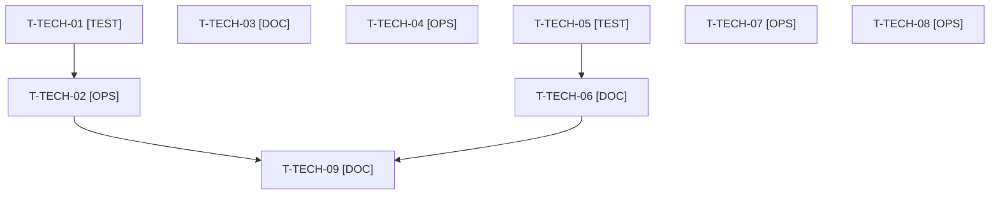

# Tâches transverses : actions de la rétrospective du sprint 18 et clôture de l'orchestrateur

Tâches **sans points** : elles comptent dans les heures, pas dans les 33 points. Elles portent les cinq actions de la rétrospective du sprint 18 (voir [../sprint-goal.md](../sprint-goal.md)) : disque de la VM Docker (1), lecture de la matrice CI et du `composer.json` de chaque plugin touché au cadrage (2), ECS et PHPStan avant chaque push (3), pas de faux jetons au format réel dans les tests (4), scripts pour les commandes longues de Thibaut (5).

## Vue d'ensemble des tâches

| ID | Type | Tâche | Estimation | Dépend de | Réalisé par | Statut |
|----|------|-------|------------|-----------|-------------|--------|
| T-TECH-01 | [TEST] | Tests rouges de `bin/check-disk` pour la VM Docker : espace libre de la VM mesuré, alerte, refus de `bin/run-tests` sous 3 Go dans la VM (action 1 de la rétro S18) | 0,75 h | - | Claude | 🔲 |
| T-TECH-02 | [OPS] | `bin/check-disk` mesure aussi le disque de la VM Docker ; `bin/run-tests` refuse de démarrer sous 3 Go dans la VM, le gel à 5 Go de la machine restant inchangé (worker devops) | 1,25 h | T-TECH-01 | Claude | 🔲 |
| T-TECH-03 | [DOC] | Rubrique « versions supportées (PHP, Symfony, Sylius) et impact de version » et « lire la matrice CI et le `composer.json` de chaque plugin touché au cadrage » dans `project-management/templates/user-story.md` et dans le gabarit de consigne de worker (action 2) | 0,75 h | - | Claude | 🔲 |
| T-TECH-04 | [OPS] | ECS et PHPStan rejoués sur l'arbre exact avant chaque push (démo et dépôts de plugins, dans Docker) ; la dernière ligne de sortie citée dans le rapport (action 3) | 0,5 h | - | Orchestrateur | ✅ |
| T-TECH-05 | [TEST] | Test garde rouge : aucun faux jeton au format réel (préfixes connus de clés d'API et de jetons) dans les `tests/` de la démo ; l'échec nomme le fichier (action 4) | 0,75 h | - | Claude | 🔲 |
| T-TECH-06 | [DOC] | Règle « secrets fictifs recomposés à l'exécution, jamais au format réel écrit en clair » dans `docs/tests-locaux.md` et dans le gabarit de consigne de worker | 0,5 h | T-TECH-05 | Claude | 🔲 |
| T-TECH-07 | [OPS] | Scripts du scratchpad pour les commandes longues de Thibaut, à OK ou FAIL par élément : tag et soumission du plugin company-insights, tags des deux releases d'US-146, `composer` avec `php -d memory_limit=1G` (action 5) | 0,75 h | - | Orchestrateur | ✅ |
| T-TECH-08 | [OPS] | Reconstruction de l'image et démarrage du conteneur (`/healthz`) par l'orchestrateur avant la revue, puis après tout correctif touchant l'image | 0,75 h | T-155-11, T-099-05, T-146-12 | Orchestrateur | 🔲 |
| T-TECH-09 | [DOC] | Bilan des indicateurs de la rétro S18 (disque, matrices CI, ECS et PHPStan avant push, alertes de secrets, scripts de Thibaut) préparé pour la rétro du 2027-03-19 | 0,5 h | T-TECH-02, T-TECH-06 | Orchestrateur | ✅ |

**Total estimé : 6,5 h** (9 tâches, aucune de Thibaut).

**Définition de fini des actions** : 0 run invalidé par le disque (1), 0 cellule de matrice CI en échec découverte par la PR (2), 0 CI rouge sur ECS ou PHPStan (3), 0 alerte GitGuardian sur des données de test (4), chaque commande de Thibaut exécutable en une ligne (5).

## Dépendances

Dépendances hors fichier : T-099-05, T-146-12, T-155-11.
