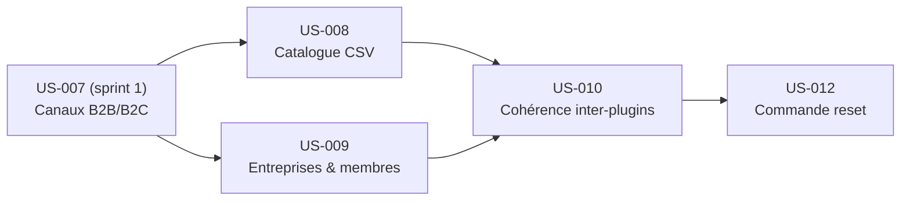

# Sprint 2 — Données B2B

## Informations

| Attribut | Valeur |
|----------|--------|
| Numéro | 2 |
| Nom | donnees-b2b |
| Début | 2026-10-15 |
| Fin | 2026-10-29 |
| Durée | 10 jours ouvrés |
| Points engagés | 26 |

## Sprint Goal

> Données B2B cohérentes : catalogue industriel importé de CSV, entreprises/membres/comptes de démo, données inter-plugins cohérentes, commande de remise à zéro.

À la fin du sprint, un `bin/console app:fixtures:load` charge 150 à 250 produits industriels sans lorem ipsum (depuis des CSV versionnés), crée au moins 5 entreprises avec membres et comptes de démo correctement rattachés aux 21 plugins, garantit la cohérence inter-plugins (prix par canal, stock, expédition, devis, flux, documents…), et une commande `app:demo:reset` remet l'environnement à l'état initial en moins de 10 minutes (cible alignée sur le critère d'acceptation testable de US-012).

## Lien avec le Sprint 1

Le sprint 1 a livré le walking skeleton : Sylius 2.3 + 21 plugins dans l'image FrankenPHP, canaux B2B/B2C configurés (US-007), environnement local opérationnel, CI verte. Le sprint 2 s'appuie sur ce socle pour y injecter des données de démo crédibles. **Prérequis strict : le sprint 1 est mergé sur `main` et l'application démarre correctement.**

## Sprint Backlog

| ID | Titre | Points | Statut |
|----|-------|--------|--------|
| US-008 | Catalogue industriel depuis des CSV | 8 | 🔵 To Do |
| US-009 | Entreprises, membres et comptes de démo | 5 | 🔵 To Do |
| US-010 | Données des plugins cohérentes | 8 | 🔵 To Do |
| US-012 | Commande de remise à zéro | 5 | 🔵 To Do |

**Total engagé : 26 points**

## Ordre de réalisation recommandé

1. US-008 (catalogue — bloque US-010 pour les prix, le stock, les flux)
2. US-009 (entreprises — bloque US-010 pour les comptes, devis, PunchOut)
3. US-010 (cohérence inter-plugins — dépend de US-008 et US-009)
4. US-012 (reset — dépend de toutes les données étant stables)

## Dépendances inter-stories

| Story | Dépend de |
|-------|-----------|
| US-008 | US-007 (canaux B2B/B2C, sprint 1) |
| US-009 | US-007 (canaux B2B/B2C, sprint 1) |
| US-010 | US-008, US-009 |
| US-012 | US-008, US-009, US-010 |



## Definition of Done (rappel)

- [ ] Critères d'acceptation automatisés et verts
- [ ] ECS et PHPStan passent sur le code de la démo
- [ ] Libellés en français et en anglais si interface
- [ ] Aucun secret ni identifiant réel dans le dépôt
- [ ] Documentation mise à jour si comportement visible
- [ ] CI verte

## Risques identifiés

| Risque | Probabilité | Impact | Mitigation |
|--------|-------------|--------|------------|
| Format CSV mal défini → import fragile | Élevée | Élevé | Définir le schéma CSV en début de sprint (pré-checklist) |
| Données inter-plugins incohérentes (prix/stock par canal) | Moyenne | Élevé | US-010 dédiée avec critères d'acceptation précis |
| Commande reset trop lente (> 2 min) | Faible | Moyen | Utiliser truncate + re-fixtures, pas de migration |
| Sprint 1 non mergé → blocage total | Moyenne | Critique | Vérifier la pré-checklist avant tout développement |
| Fixtures volumineuses → CI lente | Faible | Faible | Limiter à 150-250 produits, optimiser les insert batch |

## Burndown (prévisionnel)

```
Points |
  26   | ●
  23   |   ●
  20   |     ●
  17   |       ●
  14   |         ●
  11   |           ●
   8   |             ●
   5   |               ●
   2   |                 ●
   0   |                   ●
       D1 D2 D3 D4 D5 D6 D7 D8 D9 D10
```

## Cérémonies

| Cérémonie | Date indicative | Durée |
|-----------|----------------|-------|
| Sprint Planning Part 1 (Quoi) | 2026-10-15 | 2 h |
| Sprint Planning Part 2 (Comment) | 2026-10-15 | 2 h |
| Daily Scrum | Chaque jour | 15 min |
| Sprint Review | 2026-10-29 (matin) | 1 h |
| Rétrospective | 2026-10-29 (après-midi) | 1 h 30 |
| Affinage Backlog | 2026-10-22 (mid-sprint) | 1 h |

## Notes de planning

- US-008 et US-009 peuvent être développées en parallèle : elles sont indépendantes l'une de l'autre.
- US-010 ne peut démarrer qu'une fois les fixtures de base (US-008 + US-009) opérationnelles.
- US-012 est la story d'intégration finale : elle suppose que toutes les données sont stables.
- Les fichiers CSV source doivent être versionnés dans `fixtures/csv/` dès le premier jour du sprint.
