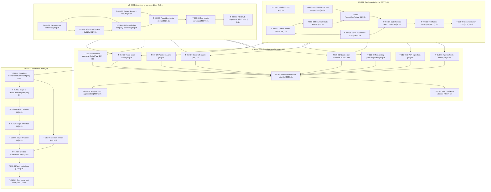

# Task Board — Sprint 2 (Données B2B)

## Légende

- 🔲 À faire
- 🔄 En cours
- 👀 En review
- ✅ Terminé
- 🚫 Bloqué

---

## Graphe de dépendances global

---

## 🔲 À faire

### US-008 — Catalogue industriel CSV (parallèle dès J1)

| ID | Tâche | Type | Estimation |
|----|-------|------|------------|
| T-008-01 | Schéma CSV des produits | [BE] | 1h |
| T-008-03 | Fixture taxons FR/EN | [BE] | 1h |
| T-008-02 | Fichiers CSV 150–250 produits | [BE] | 2h |
| T-008-04 | Fixture attributs FR/EN | [BE] | 1h |
| T-008-06 | Script illustrations SVG | [OPS] | 1h |
| T-008-05 | ProductCsvFixture | [BE] | 2h |
| T-008-07 | Suite fixtures demo YAML | [BE] | 0.5h |
| T-008-08 | Test de fumée catalogue | [TEST] | 1h |
| T-008-09 | Documentation CSV | [DOC] | 0.5h |

### US-009 — Entreprises et comptes de démo (parallèle à US-008)

| ID | Tâche | Type | Estimation |
|----|-------|------|------------|
| T-009-01 | Fixture Acme Industries | [BE] | 1h |
| T-009-03 | Fixture Sophie + Léa | [BE] | 0.5h |
| T-009-02 | Fixture TechParts + BuildCo | [BE] | 1h |
| T-009-04 | Rôles et limites company-accounts | [BE] | 1h |
| T-009-05 | Page identifiants démo | [BE] | 0.5h |
| T-009-06 | Test de fumée comptes | [TEST] | 1h |
| T-009-07 | README comptes de démo | [DOC] | 0.5h |

### US-010 — Données plugins cohérentes (après US-008 + US-009)

| ID | Tâche | Type | Estimation |
|----|-------|------|------------|
| T-010-01 | Trade-credit Acme | [BE] | 1h |
| T-010-02 | Tier-pricing produits phares | [BE] | 1h |
| T-010-03 | Purchase-approval Claire/Paul | [BE] | 0.5h |
| T-010-04 | Devis b2b-quote | [BE] | 1h |
| T-010-05 | Quick-order container-fill | [BE] | 0.5h |
| T-010-06 | GPSR 5 produits | [BE] | 1h |
| T-010-07 | Punchout Acme | [BE] | 1h |
| T-010-08 | Agentic feeds seeds | [BE] | 0.5h |
| T-010-09 | Ordonnancement priorités fixtures | [BE] | 0.5h |
| T-010-10 | Test parcours approbation | [TEST] | 1h |
| T-010-11 | Test cohérence globale | [TEST] | 1h |

### US-012 — Commande reset (après US-010)

| ID | Tâche | Type | Estimation |
|----|-------|------|------------|
| T-012-01 | Squelette DemoResetCommand | [BE] | 0.5h |
| T-012-06 | Gestion erreurs | [BE] | 0.5h |
| T-012-02 | Étape 1 Drop/Create/Migrate | [BE] | 1h |
| T-012-03 | Étape 2 Fixtures | [BE] | 0.5h |
| T-012-04 | Étape 3 Médias | [BE] | 0.5h |
| T-012-05 | Étape 4 Cache | [BE] | 0.5h |
| T-012-07 | Crontab supercronic | [OPS] | 0.5h |
| T-012-08 | Test reset réussi | [TEST] | 1h |
| T-012-09 | Test erreur exit code | [TEST] | 0.5h |

---

## 🔄 En cours

| ID | US | Tâche | Démarré | Assigné |
|----|-----|-------|---------|---------|
| — | — | — | — | — |

---

## 👀 En review

| ID | US | Tâche | Reviewer |
|----|-----|-------|----------|
| — | — | — | — |

---

## ✅ Terminé

| ID | US | Tâche | Réel | Terminé |
|----|-----|-------|------|---------|
| — | — | — | — | — |

---

## 🚫 Bloqué

| ID | US | Raison | Action |
|----|-----|--------|--------|
| — | — | — | — |

---

## Métriques

- **Tâches** : 36 total | 0 terminées (0%)
- **Heures** : 30.5h estimées | 0h consommées | 30.5h restantes
- **Points** : 26 engagés (US-008: 8 + US-009: 5 + US-010: 8 + US-012: 5) | 0 livrés

### Répartition par type

| Type | Nb tâches | Heures |
|------|-----------|--------|
| [BE] | 26 | 23.5h |
| [TEST] | 6 | 5.5h |
| [OPS] | 2 | 1.5h |
| [DOC] | 2 | 1h |
| **TOTAL** | **36** | **30.5h** |
