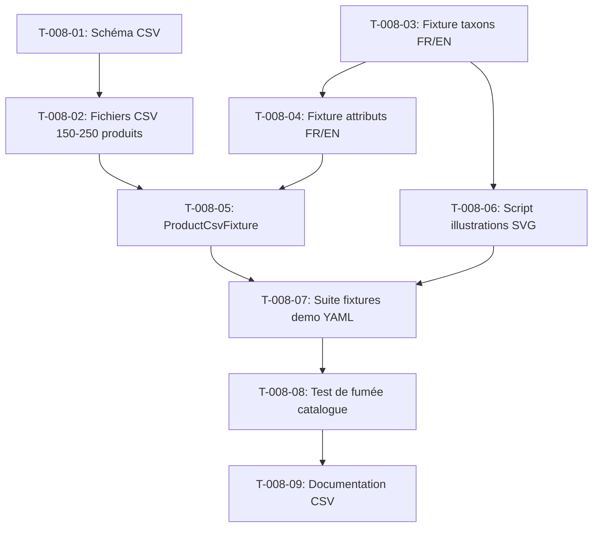

# Tâches — US-008 : Catalogue industriel depuis des CSV

## Informations US

- **Epic** : EPIC-02 — Données et scénarios B2B
- **Persona** : Nadia (commerciale terrain)
- **Story Points** : 8
- **Sprint** : sprint-2-donnees-b2b
- **Dépendances** : US-007

## Résumé

En tant que Nadia, je veux un catalogue B2B crédible (EPI, quincaillerie, fournitures), afin que la démo ressemble à un vrai distributeur.

## Vue d'ensemble des tâches

| ID | Type | Tâche | Estimation | Dépend de | Statut |
|----|------|-------|------------|-----------|--------|
| T-008-01 | [BE] | Définir le schéma CSV des produits | 1h | — | 🔲 |
| T-008-02 | [BE] | Créer les fichiers CSV (150–250 produits EPI, quincaillerie, fournitures) | 2h | T-008-01 | 🔲 |
| T-008-03 | [BE] | Fixture taxons : arborescence FR/EN (EPI, quincaillerie, fournitures) | 1h | — | 🔲 |
| T-008-04 | [BE] | Fixture attributs produit : types + traductions FR/EN (normes, conditionnement) | 1h | T-008-03 | 🔲 |
| T-008-05 | [BE] | Classe ProductCsvFixture : lecture CSV → ProductVariant + attributs + i18n | 2h | T-008-02, T-008-04 | 🔲 |
| T-008-06 | [OPS] | Script de génération d'illustrations SVG par taxon (sans licence incertaine) | 1h | T-008-03 | 🔲 |
| T-008-07 | [BE] | Déclarer la suite de fixtures « demo » dans sylius_fixtures.yaml avec priorités | 0.5h | T-008-05, T-008-06 | 🔲 |
| T-008-08 | [TEST] | Test de fumée : 150 ≤ produits ≤ 250, libellés FR/EN, aucun lorem ipsum | 1h | T-008-07 | 🔲 |
| T-008-09 | [DOC] | Documenter la structure CSV et la procédure d'ajout de produits | 0.5h | T-008-08 | 🔲 |

**Total estimé : 10h**

---

## Détail des tâches

### T-008-01 — Définir le schéma CSV des produits

- **Type** : [BE]
- **Estimation** : 1h
- **Dépend de** : —

**Description** :
Concevoir et documenter les colonnes des fichiers CSV : `sku`, `mpn`, `ean`, `name_fr`, `name_en`, `description_fr`, `description_en`, `taxon`, `attributes_json`, `weight_kg`, `width_cm`, `height_cm`, `depth_cm`, `price_eur_ht`, `illustration`. Le schéma doit être stable avant toute génération de données.

**Fichiers à créer** :
- `fixtures/csv/SCHEMA.md` — documentation du schéma

**Critères de validation** :
- [ ] Toutes les colonnes requises listées avec type et exemple
- [ ] Colonnes optionnelles clairement identifiées

---

### T-008-02 — Créer les fichiers CSV (150–250 produits)

- **Type** : [BE]
- **Estimation** : 2h
- **Dépend de** : T-008-01

**Description** :
Générer manuellement ou via un script les fichiers CSV réalistes, répartis en trois familles :
- `fixtures/csv/epi.csv` — ~80 produits EPI (casques, gants, chaussures de sécurité, harnais)
- `fixtures/csv/quincaillerie.csv` — ~80 produits (vis, boulons, outils, fixations)
- `fixtures/csv/fournitures.csv` — ~50 produits (papeterie, emballage, signalétique)

Chaque ligne comporte SKU, MPN, EAN13, libellés FR/EN sans lorem ipsum, attributs (normes EN/ISO, conditionnement), prix HT, poids et dimensions.

**Fichiers à créer** :
- `fixtures/csv/epi.csv`
- `fixtures/csv/quincaillerie.csv`
- `fixtures/csv/fournitures.csv`

**Critères de validation** :
- [ ] 150 ≤ total lignes ≤ 250
- [ ] Aucune cellule vide pour les colonnes obligatoires
- [ ] EAN13 uniques et valides (checksum)
- [ ] Aucun texte lorem ipsum

---

### T-008-03 — Fixture taxons : arborescence FR/EN

- **Type** : [BE]
- **Estimation** : 1h
- **Dépend de** : —

**Description** :
Créer la classe `TaxonDemoFixture` (ou fichier YAML) déclarant l'arborescence :
```
Catalogue
├── EPI (Équipements de Protection Individuelle)
│   ├── Protection tête
│   ├── Protection mains
│   ├── Chaussures de sécurité
│   └── Protection corps
├── Quincaillerie
│   ├── Visserie
│   ├── Outillage
│   └── Fixations
└── Fournitures industrielles
    ├── Emballage
    ├── Signalétique
    └── Papeterie
```
Libellés en français et en anglais. Slugs en anglais (convention Sylius).

**Fichiers à créer** :
- `src/Demo/DataFixtures/TaxonDemoFixture.php`

**Critères de validation** :
- [ ] Arborescence 3 niveaux chargée sans erreur
- [ ] `sylius:fixtures:load` exécuté sans exception
- [ ] Libellés FR/EN présents pour chaque taxon

---

### T-008-04 — Fixture attributs produit : types + traductions FR/EN

- **Type** : [BE]
- **Estimation** : 1h
- **Dépend de** : T-008-03

**Description** :
Créer la classe `ProductAttributeDemoFixture` qui définit :
- `epi_norm` (text) — norme de protection (EN 388, EN ISO 20345…)
- `packaging_unit` (select) — conditionnement (paire, carton de 12, sachet de 100…)
- `material` (text) — matière principale
- `certifications` (text) — certifications (CE, ATEX…)

Traductions FR/EN pour chaque attribut et valeur de liste.

**Fichiers à créer** :
- `src/Demo/DataFixtures/ProductAttributeDemoFixture.php`

**Critères de validation** :
- [ ] Attributs créés et accessibles dans l'admin Sylius
- [ ] Libellés FR/EN présents

---

### T-008-05 — Classe ProductCsvFixture : lecture CSV → produits Sylius

- **Type** : [BE]
- **Estimation** : 2h
- **Dépend de** : T-008-02, T-008-04

**Description** :
Implémenter `ProductCsvFixture` (implémente `FixtureInterface`) qui :
1. Parcourt les trois CSV via un service `CsvProductReader`
2. Crée `Product` + `ProductVariant` (SKU, MPN, EAN, prix, poids, dimensions)
3. Affecte les traductions FR/EN (`ProductTranslation`)
4. Lie au taxon via le slug
5. Assigne les attributs de la colonne `attributes_json`
6. Lie l'illustration générée depuis `public/media/fixtures/`

Respecter l'architecture hexagonale : lecture CSV dans `Infrastructure/`, mapping dans `Application/`.

**Fichiers à créer** :
- `src/Demo/DataFixtures/ProductCsvFixture.php`
- `src/Demo/Infrastructure/Csv/CsvProductReader.php`

**Critères de validation** :
- [ ] `sylius:fixtures:load --suite=demo` charge les produits sans erreur
- [ ] Chaque produit possède variant, traductions FR/EN et attributs
- [ ] PHPStan niveau max sans erreur sur ces fichiers

---

### T-008-06 — Script de génération d'illustrations SVG par taxon

- **Type** : [OPS]
- **Estimation** : 1h
- **Dépend de** : T-008-03

**Description** :
Créer un script PHP/Bash `bin/generate-fixtures-images.php` qui génère une illustration SVG simple par taxon (couleur + icône + libellé) pour chaque produit, en nommant les fichiers par SKU. Les images sont stockées dans `public/media/fixtures/` (gitignorées sauf les sources SVG modèles). Le script est idempotent.

**Fichiers à créer** :
- `bin/generate-fixtures-images.php`
- `public/media/fixtures/.gitkeep`
- Modèles SVG dans `assets/fixtures/icons/` (EPI, quincaillerie, fournitures)

**Critères de validation** :
- [ ] Script génère une image par SKU sans erreur
- [ ] Images référençables dans les fixtures CSV
- [ ] Aucune image sous licence incertaine

---

### T-008-07 — Suite de fixtures « demo » dans sylius_fixtures.yaml

- **Type** : [BE]
- **Estimation** : 0.5h
- **Dépend de** : T-008-05, T-008-06

**Description** :
Déclarer ou compléter la suite `demo` dans `config/packages/sylius_fixtures.yaml` en ajoutant les fixtures produits avec des priorités explicites et distinctes :
- `10` : taxons
- `20` : attributs produits
- `30` : produits CSV (EPI, quincaillerie, fournitures)

**Fichiers modifiés** :
- `config/packages/sylius_fixtures.yaml`

**Critères de validation** :
- [ ] `bin/console sylius:fixtures:load --suite=demo --no-interaction` se termine sans erreur
- [ ] Priorités explicites et distinctes dans le YAML

---

### T-008-08 — Test de fumée catalogue

- **Type** : [TEST]
- **Estimation** : 1h
- **Dépend de** : T-008-07

**Description** :
Écrire un test PHPUnit `CatalogSmokeTest` (TDD) qui vérifie :
- 150 ≤ nombre de produits ≤ 250
- Chaque produit a au moins une traduction FR et une traduction EN
- Aucun libellé ne contient « lorem », « ipsum », « placeholder » ou « test »
- Les taxons racines existent (EPI, Quincaillerie, Fournitures)

**Fichiers à créer** :
- `tests/Smoke/CatalogSmokeTest.php`

**Critères de validation** :
- [ ] Test rouge avant chargement fixtures
- [ ] Test vert après `sylius:fixtures:load --suite=demo`
- [ ] Ne casse pas les 19 smoke tests existants (`tests/Smoke/PagesTest.php`)

---

### T-008-09 — Documentation CSV et procédure d'ajout

- **Type** : [DOC]
- **Estimation** : 0.5h
- **Dépend de** : T-008-08

**Description** :
Compléter `fixtures/csv/SCHEMA.md` avec :
- Description de chaque colonne CSV
- Procédure pour ajouter un nouveau produit
- Commande pour régénérer les illustrations

**Critères de validation** :
- [ ] Documentation lisible sans contexte supplémentaire
- [ ] Procédure d'ajout testée manuellement

---

## Graphe de dépendances



## Résumé

| Type | Nb tâches | Heures |
|------|-----------|--------|
| [BE] | 6 | 7.5h |
| [OPS] | 1 | 1h |
| [TEST] | 1 | 1h |
| [DOC] | 1 | 0.5h |
| **TOTAL** | **9** | **10h** |
