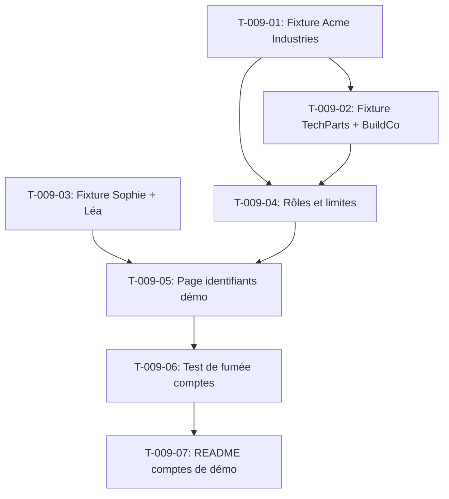

# Tâches — US-009 : Entreprises, membres et comptes de démo

## Informations US

- **Epic** : EPIC-02 — Données et scénarios B2B
- **Persona** : Hugo (responsable achats)
- **Story Points** : 5
- **Sprint** : sprint-2-donnees-b2b
- **Dépendances** : US-008

## Résumé

En tant que Hugo, je veux des entreprises fictives avec des membres et des rôles, et des comptes de démo documentés, afin de jouer chaque rôle B2B.

## Vue d'ensemble des tâches

| ID | Type | Tâche | Estimation | Dépend de | Statut |
|----|------|-------|------------|-----------|--------|
| T-009-01 | [BE] | Fixture entreprise Acme Industries (Claire, Paul, Isabelle) | 1h | — | 🔲 |
| T-009-02 | [BE] | Fixture entreprises TechParts SAS et BuildCo SA avec membres | 1h | T-009-01 | 🔲 |
| T-009-03 | [BE] | Fixture comptes clients B2C : Sophie (back-office) et Léa (B2C) | 0.5h | — | 🔲 |
| T-009-04 | [BE] | Configuration rôles et limites par entreprise (plugin company-accounts) | 1h | T-009-01, T-009-02 | 🔲 |
| T-009-05 | [BE] | Page ou template : affichage des identifiants de démo (emails, mots de passe) | 0.5h | T-009-03, T-009-04 | 🔲 |
| T-009-06 | [TEST] | Test de fumée : connexion des 5 comptes, présence des 3 entreprises | 1h | T-009-05 | 🔲 |
| T-009-07 | [DOC] | Mettre à jour README avec les comptes de démo | 0.5h | T-009-06 | 🔲 |

**Total estimé : 5.5h**

---

## Détail des tâches

### T-009-01 — Fixture entreprise Acme Industries

- **Type** : [BE]
- **Estimation** : 1h
- **Dépend de** : —

**Description** :
Créer `CompanyDemoFixture` pour la société principale Acme Industries avec ses trois membres :
- **Claire Dupont** `claire@acme.example` — rôle Acheteuse (buyer)
- **Paul Martin** `paul@acme.example` — rôle Approbateur (approver)
- **Isabelle Renard** `isabelle@acme.example` — rôle Administratrice (admin)

Domaine `.example` uniquement, aucune donnée réelle. Mots de passe : `Demo1234!` (affiché sur la page démo).

**Fichiers à créer** :
- `src/Demo/DataFixtures/CompanyDemoFixture.php` (classe principale)

**Critères de validation** :
- [ ] Entreprise Acme Industries créée dans la base
- [ ] 3 membres avec les bons rôles créés et liés
- [ ] Connexion fonctionnelle avec les identifiants

---

### T-009-02 — Fixture entreprises TechParts SAS et BuildCo SA

- **Type** : [BE]
- **Estimation** : 1h
- **Dépend de** : T-009-01

**Description** :
Étendre `CompanyDemoFixture` pour créer deux entreprises supplémentaires :
- **TechParts SAS** : 2 membres (1 acheteur, 1 admin) — `*@techparts.example`
- **BuildCo SA** : 2 membres (1 acheteur, 1 approbateur) — `*@buildco.example`

Ces entreprises servent à démontrer la gestion multi-comptes.

**Fichiers modifiés** :
- `src/Demo/DataFixtures/CompanyDemoFixture.php`

**Critères de validation** :
- [ ] 3 entreprises au total dans la base
- [ ] 7 membres B2B au total
- [ ] Chaque membre peut se connecter

---

### T-009-03 — Fixture comptes clients Sophie et Léa

- **Type** : [BE]
- **Estimation** : 0.5h
- **Dépend de** : —

**Description** :
Créer `CustomerDemoFixture` pour les comptes non-B2B :
- **Sophie Blanc** `sophie@demo.example` — groupe back-office restreint (accès admin limité, canal B2B)
- **Léa Petit** `lea@demo.example` — cliente B2C ordinaire (canal B2C)

Mots de passe : `Demo1234!`.

**Fichiers à créer** :
- `src/Demo/DataFixtures/CustomerDemoFixture.php`

**Critères de validation** :
- [ ] 2 comptes créés avec groupes corrects
- [ ] Sophie accessible dans le canal B2B admin, Léa dans le canal B2C

---

### T-009-04 — Configuration rôles et limites (plugin company-accounts)

- **Type** : [BE]
- **Estimation** : 1h
- **Dépend de** : T-009-01, T-009-02

**Description** :
Via le service `CompanyAccountsManager` du plugin `sylius-company-accounts-plugin`, configurer dans les fixtures :
- Rôle `buyer` : peut passer commande, soumis à la limite d'approbation
- Rôle `approver` : peut valider les commandes en attente
- Rôle `company_admin` : gestion des membres de l'entreprise

Vérifier la compatibilité avec le plugin (lire son `FixtureInterface` si disponible, sinon utiliser l'ORM directement). Les rôles doivent être cohérents avec US-010 (purchase-approval).

**Fichiers modifiés** :
- `src/Demo/DataFixtures/CompanyDemoFixture.php`

**Critères de validation** :
- [ ] Rôles assignés correctement dans la base
- [ ] Aucune erreur PHPStan sur les appels au plugin

---

### T-009-05 — Page d'affichage des identifiants de démo

- **Type** : [BE]
- **Estimation** : 0.5h
- **Dépend de** : T-009-03, T-009-04

**Description** :
Créer ou compléter le contrôleur de démo (existant dans `src/Demo/`) pour exposer `/demo/accounts` : page HTML (Twig) listant les comptes avec email, mot de passe et rôle. Cette page est accessible sans authentification (usage lors de démos). Ne jamais afficher de vraies données.

**Fichiers créés/modifiés** :
- `src/Demo/Controller/DemoAccountsController.php`
- `templates/demo/accounts.html.twig`
- `config/routes/demo.yaml` (route `/demo/accounts`)

**Critères de validation** :
- [ ] Page accessible à `/demo/accounts` sans authentification
- [ ] Tous les comptes de démo listés avec email et mot de passe
- [ ] Page traduite FR/EN

---

### T-009-06 — Test de fumée comptes et entreprises

- **Type** : [TEST]
- **Estimation** : 1h
- **Dépend de** : T-009-05

**Description** :
Écrire `AccountsSmokeTest` (TDD) qui vérifie :
- 3 entreprises présentes en base
- 5 comptes principaux existent (claire, paul, isabelle, sophie, lea)
- Chaque compte se connecte via le formulaire Sylius (HTTP 302 vers tableau de bord)
- La page `/demo/accounts` répond HTTP 200

**Fichiers à créer** :
- `tests/Smoke/AccountsSmokeTest.php`

**Critères de validation** :
- [ ] Test rouge avant fixtures
- [ ] Test vert après `sylius:fixtures:load --suite=demo`
- [ ] Ne casse pas les smoke tests existants

---

### T-009-07 — Mise à jour README avec les comptes de démo

- **Type** : [DOC]
- **Estimation** : 0.5h
- **Dépend de** : T-009-06

**Description** :
Ajouter une section « Comptes de démo » dans `README.md` avec un tableau des emails, mots de passe, rôles et entreprises. Mentionner la page `/demo/accounts` pour un accès rapide en démo live.

**Fichiers modifiés** :
- `README.md`

**Critères de validation** :
- [ ] Section présente et à jour
- [ ] Tableau lisible en markdown brut et rendu GitHub

---

## Graphe de dépendances

## Résumé

| Type | Nb tâches | Heures |
|------|-----------|--------|
| [BE] | 5 | 4h |
| [TEST] | 1 | 1h |
| [DOC] | 1 | 0.5h |
| **TOTAL** | **7** | **5.5h** |
