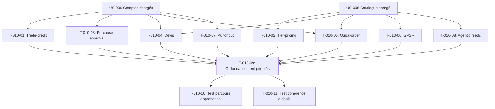

# Tâches — US-010 : Données des plugins cohérentes

## Informations US

- **Epic** : EPIC-02 — Données et scénarios B2B
- **Persona** : Nadia (commerciale terrain)
- **Story Points** : 8
- **Sprint** : sprint-2-donnees-b2b
- **Dépendances** : US-008, US-009

## Résumé

En tant que Nadia, je veux que les données de chaque plugin forment des parcours cohérents, afin que les scénarios fonctionnent bout à bout.

## Vue d'ensemble des tâches

| ID | Type | Tâche | Estimation | Dépend de | Statut |
|----|------|-------|------------|-----------|--------|
| T-010-01 | [BE] | Fixture trade-credit : crédit commercial pour Acme Industries | 1h | — | 🔲 |
| T-010-02 | [BE] | Fixture tier-pricing : grilles de prix par quantité (10-15 produits phares) | 1h | — | 🔲 |
| T-010-03 | [BE] | Fixture purchase-approval : limites Claire → Paul (seuil 500 €) | 0.5h | — | 🔲 |
| T-010-04 | [BE] | Fixture b2b-quote : 2 devis de démonstration pour Acme | 1h | — | 🔲 |
| T-010-05 | [BE] | Fixture container-fill / quick-order : listes préremplies pour Acme | 0.5h | — | 🔲 |
| T-010-06 | [BE] | Fixture GPSR : données de conformité sur 5 produits types | 1h | — | 🔲 |
| T-010-07 | [BE] | Fixture punchout : configuration acheteur PunchOut pour Acme | 1h | — | 🔲 |
| T-010-08 | [BE] | Fixture agentic-feeds : seeds produits pour suggestions IA | 0.5h | — | 🔲 |
| T-010-09 | [BE] | Ordonnancement des priorités de fixtures (explicites, distinctes, README) | 0.5h | T-010-01 à T-010-08 | 🔲 |
| T-010-10 | [TEST] | Test de fumée parcours approbation : Claire commande > 500 € → en attente Paul | 1h | T-010-09 | 🔲 |
| T-010-11 | [TEST] | Test de fumée cohérence globale : crédit, tier-pricing, devis, GPSR présents | 1h | T-010-09 | 🔲 |

**Total estimé : 9h**

---

## Détail des tâches

### T-010-01 — Fixture trade-credit pour Acme Industries

- **Type** : [BE]
- **Estimation** : 1h
- **Dépend de** : US-008 (produits), US-009 (Acme Industries)

**Description** :
Via le plugin `sylius-trade-credit-plugin`, créer `TradeCreditDemoFixture` qui affecte à Acme Industries :
- Limite de crédit : 10 000 € HT
- Solde disponible initial : 10 000 € HT
- Conditions : paiement à 30 jours

TechParts SAS : 5 000 € — BuildCo SA : 3 000 €.

**Fichiers à créer** :
- `src/Demo/DataFixtures/TradeCreditDemoFixture.php`

**Critères de validation** :
- [ ] Crédit visible dans l'admin pour chaque entreprise
- [ ] PHPStan max sans erreur

---

### T-010-02 — Fixture tier-pricing pour les produits phares

- **Type** : [BE]
- **Estimation** : 1h
- **Dépend de** : US-008 (produits chargés)

**Description** :
Via le plugin `sylius-tier-pricing-plugin`, créer `TierPricingDemoFixture` qui applique des grilles de prix dégressifs sur 10 à 15 produits représentatifs (EPI, visserie courante) :
- 1–9 unités : prix catalogue
- 10–49 unités : −5 %
- 50+ unités : −10 %

Les limites d'approbation de Claire (T-010-03) sont calibrées pour franchir ce seuil lors du scénario approbation.

**Fichiers à créer** :
- `src/Demo/DataFixtures/TierPricingDemoFixture.php`

**Critères de validation** :
- [ ] Prix par paliers visibles sur les fiches produits concernés
- [ ] Cohérence avec les seuils d'approbation (US-010-03)

---

### T-010-03 — Fixture purchase-approval pour Claire et Paul

- **Type** : [BE]
- **Estimation** : 0.5h
- **Dépend de** : US-009 (Claire et Paul créés)

**Description** :
Via le plugin `sylius-purchase-approval-plugin`, créer `PurchaseApprovalDemoFixture` :
- Claire (acheteuse Acme) : commandes ≤ 500 € HT → validées automatiquement
- Claire : commandes > 500 € HT → soumises à Paul (approbateur)
- Paul peut approuver ou rejeter depuis son tableau de bord

Calibrer le seuil pour être atteignable facilement avec les prix par paliers.

**Fichiers à créer** :
- `src/Demo/DataFixtures/PurchaseApprovalDemoFixture.php`

**Critères de validation** :
- [ ] Limite 500 € configurée pour Claire dans la base
- [ ] Paul désigné comme approbateur pour Acme

---

### T-010-04 — Fixture b2b-quote : 2 devis de démonstration

- **Type** : [BE]
- **Estimation** : 1h
- **Dépend de** : US-008 (produits), US-009 (Acme Industries)

**Description** :
Via le plugin `sylius-b2b-quote-plugin`, créer `QuoteDemoFixture` avec :
- **Devis Q-2024-001** : Acme Industries, 3 références EPI, statut « envoyé »
- **Devis Q-2024-002** : TechParts SAS, 5 références quincaillerie, statut « brouillon »

Chaque devis contient les lignes produits avec quantité et prix négocié.

**Fichiers à créer** :
- `src/Demo/DataFixtures/QuoteDemoFixture.php`

**Critères de validation** :
- [ ] 2 devis visibles dans l'admin
- [ ] Statuts corrects (envoyé / brouillon)

---

### T-010-05 — Fixture container-fill / quick-order pour Acme

- **Type** : [BE]
- **Estimation** : 0.5h
- **Dépend de** : US-008 (produits), US-009 (Claire)

**Description** :
- **Container-fill** : créer une palette type pour Acme (produits EPI récurrents, qté cible)
- **Quick-order** : créer une liste de commande rapide pré-remplie pour Claire (5 SKU fréquents)

**Fichiers à créer** :
- `src/Demo/DataFixtures/QuickOrderDemoFixture.php`

**Critères de validation** :
- [ ] Liste rapide visible dans le compte Claire
- [ ] Palette container-fill chargée sans erreur

---

### T-010-06 — Fixture GPSR sur 5 produits types

- **Type** : [BE]
- **Estimation** : 1h
- **Dépend de** : US-008 (produits chargés)

**Description** :
Via le plugin `sylius-gpsr-plugin`, créer `GpsrDemoFixture` qui enrichit 5 produits EPI avec :
- Nom et adresse du fournisseur UE responsable (fictif, domaine `.example`)
- Numéro de déclaration de conformité CE
- Lien vers notice de sécurité (PDF fictif ou URL interne)
- Avertissements de sécurité pertinents

**Fichiers à créer** :
- `src/Demo/DataFixtures/GpsrDemoFixture.php`

**Critères de validation** :
- [ ] 5 produits avec données GPSR complètes
- [ ] Données visibles sur la fiche produit front

---

### T-010-07 — Fixture punchout : acheteur PunchOut pour Acme

- **Type** : [BE]
- **Estimation** : 1h
- **Dépend de** : US-009 (Acme Industries)

**Description** :
Via le plugin `sylius-punchout-plugin`, créer `PunchoutDemoFixture` :
- Configurer Acme Industries comme acheteur PunchOut (cXML)
- DUNS fictif : `123456789`
- Shared secret : `demo-secret-acme` (non sensible, affiché dans la doc démo)
- URL de retour configurée vers `https://erp.acme.example/punchout/return`

**Fichiers à créer** :
- `src/Demo/DataFixtures/PunchoutDemoFixture.php`

**Critères de validation** :
- [ ] Configuration PunchOut chargée en base
- [ ] Identifiants affichés dans la page `/demo/accounts`

---

### T-010-08 — Fixture agentic-feeds : seeds pour suggestions IA

- **Type** : [BE]
- **Estimation** : 0.5h
- **Dépend de** : US-008 (produits chargés)

**Description** :
Via le plugin `sylius-agentic-feeds-plugin`, créer `AgenticFeedsDemoFixture` qui déclenche ou simule la génération des embeddings produits pour activer les suggestions IA sur la démo. Si le plugin requiert une clé API, utiliser la variable d'environnement `OPENAI_API_KEY` (optionnelle, fixtures dégradées si absente).

**Fichiers à créer** :
- `src/Demo/DataFixtures/AgenticFeedsDemoFixture.php`

**Critères de validation** :
- [ ] Fixtures chargées sans erreur même sans clé API
- [ ] Seeds créés si clé API disponible

---

### T-010-09 — Ordonnancement des priorités de fixtures

- **Type** : [BE]
- **Estimation** : 0.5h
- **Dépend de** : T-010-01 à T-010-08

**Description** :
Compléter `config/packages/sylius_fixtures.yaml` avec les priorités explicites pour les nouvelles fixtures :
- `10` : taxons (US-008)
- `20` : attributs produits (US-008)
- `30` : produits CSV (US-008)
- `40` : entreprises et membres (US-009)
- `50` : clients B2C (US-009)
- `60` : trade-credit, tier-pricing, purchase-approval (US-010)
- `70` : devis, quick-order, GPSR, punchout, agentic-feeds (US-010)

Documenter les priorités dans `fixtures/README.md`.

**Fichiers modifiés** :
- `config/packages/sylius_fixtures.yaml`

**Fichiers à créer** :
- `fixtures/README.md`

**Critères de validation** :
- [ ] `sylius:fixtures:load --suite=demo --no-interaction` passe sans erreur
- [ ] Priorités toutes distinctes

---

### T-010-10 — Test de fumée parcours approbation

- **Type** : [TEST]
- **Estimation** : 1h
- **Dépend de** : T-010-09

**Description** :
Écrire `ApprovalWorkflowSmokeTest` (TDD) qui simule le scénario :
1. Claire se connecte
2. Elle ajoute au panier des produits pour un total > 500 € HT
3. Elle passe commande
4. La commande passe dans l'état « en attente d'approbation »

Test via WebTestCase (sans UI) en appelant les services Sylius directement.

**Fichiers à créer** :
- `tests/Smoke/ApprovalWorkflowSmokeTest.php`

**Critères de validation** :
- [ ] Test rouge avant fixtures
- [ ] Test vert après `sylius:fixtures:load --suite=demo`
- [ ] Ne casse pas les smoke tests existants

---

### T-010-11 — Test de fumée cohérence globale

- **Type** : [TEST]
- **Estimation** : 1h
- **Dépend de** : T-010-09

**Description** :
Écrire `PluginDataCoherenceSmokeTest` qui vérifie :
- Acme Industries a un crédit commercial ≥ 1 €
- Au moins 10 produits ont des prix par paliers
- Au moins 1 devis existe en base
- Au moins 5 produits ont des données GPSR
- La configuration PunchOut pour Acme existe

**Fichiers à créer** :
- `tests/Smoke/PluginDataCoherenceSmokeTest.php`

**Critères de validation** :
- [ ] Test rouge avant fixtures
- [ ] Test vert après chargement complet
- [ ] Ne casse pas les smoke tests existants

---

## Graphe de dépendances

## Résumé

| Type | Nb tâches | Heures |
|------|-----------|--------|
| [BE] | 9 | 7h |
| [TEST] | 2 | 2h |
| **TOTAL** | **11** | **9h** |
