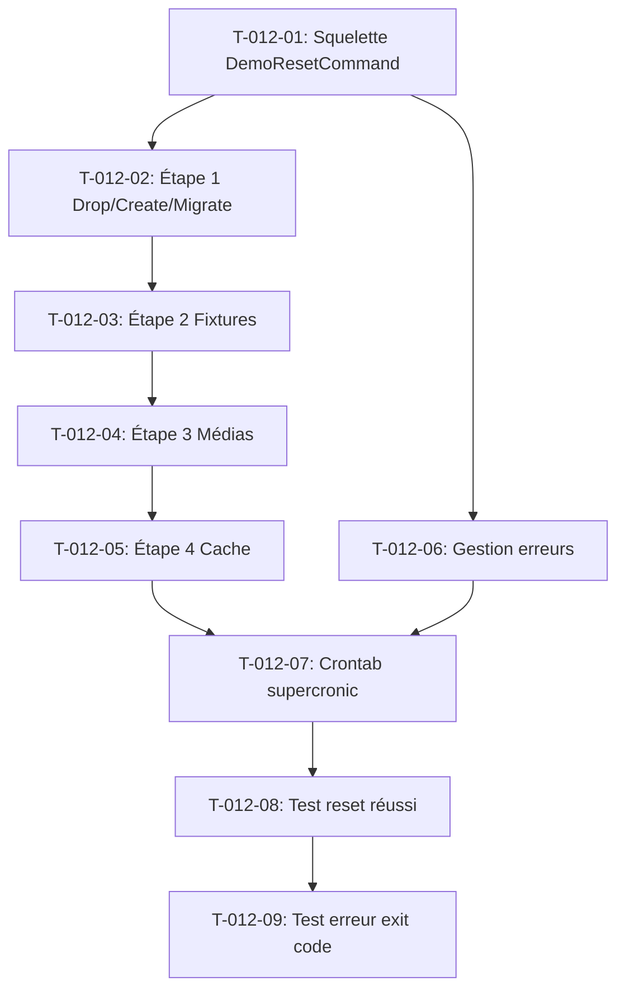

# Tâches — US-012 : Commande de remise à zéro

## Informations US

- **Epic** : EPIC-02 — Données et scénarios B2B
- **Persona** : Thibaut (mainteneur)
- **Story Points** : 5
- **Sprint** : sprint-2-donnees-b2b
- **Dépendances** : US-010 (toutes les fixtures chargées)

## Résumé

En tant que Thibaut, je veux une commande qui remet la démo à l'état initial, afin de la relancer chaque nuit.

## Vue d'ensemble des tâches

| ID | Type | Tâche | Estimation | Dépend de | Statut |
|----|------|-------|------------|-----------|--------|
| T-012-01 | [BE] | Squelette DemoResetCommand (Symfony Console, logging, exit code) | 0.5h | — | 🔲 |
| T-012-02 | [BE] | Étape 1 : drop/create base + migrations Doctrine | 1h | T-012-01 | 🔲 |
| T-012-03 | [BE] | Étape 2 : chargement fixtures suite demo | 0.5h | T-012-02 | 🔲 |
| T-012-04 | [BE] | Étape 3 : régénération médias (images produits) | 0.5h | T-012-03 | 🔲 |
| T-012-05 | [BE] | Étape 4 : clear + warmup cache prod | 0.5h | T-012-04 | 🔲 |
| T-012-06 | [BE] | Gestion des erreurs : catch + log + exit code non nul | 0.5h | T-012-01 | 🔲 |
| T-012-07 | [OPS] | Intégration dans le crontab supercronic (reset nightly) | 0.5h | T-012-05, T-012-06 | 🔲 |
| T-012-08 | [TEST] | Test d'intégration : commande → code 0 et base peuplée | 1h | T-012-07 | 🔲 |
| T-012-09 | [TEST] | Test d'intégration : simulation d'erreur → code retour non nul | 0.5h | T-012-08 | 🔲 |

**Total estimé : 5.5h**

---

## Détail des tâches

### T-012-01 — Squelette DemoResetCommand

- **Type** : [BE]
- **Estimation** : 0.5h
- **Dépend de** : —

**Description** :
Créer la classe `DemoResetCommand` dans `src/Demo/Command/` :
- Nom de commande : `app:demo:reset`
- Options : `--dry-run` (log sans exécuter), `--no-media` (sauter la régénération médias)
- Injection d'un `LoggerInterface` et du `Application` Symfony Console
- Structure try/catch globale avec journalisation de chaque étape

**Fichiers à créer** :
- `src/Demo/Command/DemoResetCommand.php`

**Critères de validation** :
- [ ] Commande enregistrée : `bin/console list app:demo` la liste
- [ ] `--help` affiche les options et leur description

---

### T-012-02 — Étape 1 : drop/create base + migrations

- **Type** : [BE]
- **Estimation** : 1h
- **Dépend de** : T-012-01

**Description** :
Implémenter dans `DemoResetCommand` l'étape 1 qui exécute dans l'ordre :
```bash
php bin/console doctrine:database:drop --force --if-exists
php bin/console doctrine:database:create
php bin/console doctrine:migrations:migrate --no-interaction
```

Utiliser `$this->runCommand()` (sous-commandes Symfony) ou `Process` pour rester testable. Logger chaque sous-commande avec durée. Timeout par étape : 3 min.

**Fichiers modifiés** :
- `src/Demo/Command/DemoResetCommand.php`

**Critères de validation** :
- [ ] Base recrée et migrée sans erreur manuelle
- [ ] `doctrine:migrations:status` : 0 migration en attente après exécution

---

### T-012-03 — Étape 2 : chargement des fixtures

- **Type** : [BE]
- **Estimation** : 0.5h
- **Dépend de** : T-012-02

**Description** :
Ajouter l'étape 2 dans `DemoResetCommand` :
```bash
php bin/console sylius:fixtures:load --suite=demo --no-interaction
```

Logger le nombre de fixtures chargées. Timeout : 5 min.

**Fichiers modifiés** :
- `src/Demo/Command/DemoResetCommand.php`

**Critères de validation** :
- [ ] Fixtures chargées après exécution de la commande
- [ ] Durée de cette étape loguée

---

### T-012-04 — Étape 3 : régénération des médias

- **Type** : [BE]
- **Estimation** : 0.5h
- **Dépend de** : T-012-03

**Description** :
Ajouter l'étape 3 : régénérer les thumbnails et caches d'images Sylius :
```bash
php bin/console liip:imagine:cache:remove   # si LiipImagineBundle présent
php bin/console sylius:install:assets        # ou équivalent Sylius 2.3
```

Si aucun bundle d'images n'est disponible, recopier les illustrations depuis `public/media/fixtures/` vers les chemins Sylius. Logger le résultat.

**Fichiers modifiés** :
- `src/Demo/Command/DemoResetCommand.php`

**Critères de validation** :
- [ ] Les images produits sont accessibles après reset
- [ ] Pas d'erreur 404 sur les illustrations en front

---

### T-012-05 — Étape 4 : clear + warmup cache prod

- **Type** : [BE]
- **Estimation** : 0.5h
- **Dépend de** : T-012-04

**Description** :
Ajouter l'étape 4 dans `DemoResetCommand` :
```bash
php bin/console cache:clear --env=prod --no-debug
php bin/console cache:warmup --env=prod --no-debug
```

Timeout : 2 min. Logger la durée totale de la commande complète (toutes étapes).

**Fichiers modifiés** :
- `src/Demo/Command/DemoResetCommand.php`

**Critères de validation** :
- [ ] Cache prod régénéré
- [ ] Durée totale loguée (doit être < 10 min)

---

### T-012-06 — Gestion des erreurs

- **Type** : [BE]
- **Estimation** : 0.5h
- **Dépend de** : T-012-01

**Description** :
Finaliser la gestion des erreurs dans `DemoResetCommand` :
- Chaque sous-commande est wrappée dans un try/catch
- En cas d'exception : logger `error` (message + trace), retourner `Command::FAILURE` (code 1)
- Afficher un message d'erreur lisible en sortie stderr
- En cas de succès complet : retourner `Command::SUCCESS` (code 0)

**Fichiers modifiés** :
- `src/Demo/Command/DemoResetCommand.php`

**Critères de validation** :
- [ ] `$? == 0` après succès
- [ ] `$? != 0` après erreur simulée
- [ ] Erreur journalisée dans les logs Symfony

---

### T-012-07 — Intégration crontab supercronic

- **Type** : [OPS]
- **Estimation** : 0.5h
- **Dépend de** : T-012-05, T-012-06

**Description** :
Ajouter la tâche nightly dans le fichier `docker/crontab` (supercronic) :
```cron
0 3 * * * php /var/www/html/bin/console app:demo:reset >> /var/log/demo-reset.log 2>&1
```

Reset à 3h du matin UTC. Vérifier que le log est accessible depuis le conteneur.

**Fichiers modifiés** :
- `docker/crontab`

**Critères de validation** :
- [ ] Entrée cron présente dans le fichier
- [ ] Syntaxe valide (`supercronic --test docker/crontab` passe)

---

### T-012-08 — Test d'intégration : reset réussi

- **Type** : [TEST]
- **Estimation** : 1h
- **Dépend de** : T-012-07

**Description** :
Écrire `DemoResetCommandTest` (TDD) via `KernelTestCase` + `CommandTester` :
1. Exécuter `app:demo:reset` en environnement de test
2. Vérifier exit code = 0
3. Vérifier que des produits existent en base après le reset
4. Vérifier que la durée ne dépasse pas 10 min (timeout de test)

> Note : en CI, utiliser une base de test dédiée (variable `DATABASE_URL_TEST`).

**Fichiers à créer** :
- `tests/Integration/Command/DemoResetCommandTest.php`

**Critères de validation** :
- [ ] Test rouge avant implémentation complète
- [ ] Test vert avec toutes les étapes fonctionnelles
- [ ] Exécutable via `php bin/phpunit tests/Integration/`

---

### T-012-09 — Test d'intégration : erreur → exit code non nul

- **Type** : [TEST]
- **Estimation** : 0.5h
- **Dépend de** : T-012-08

**Description** :
Étendre `DemoResetCommandTest` avec un scénario d'erreur :
- Simuler une URL de base de données invalide (override `DATABASE_URL`)
- Exécuter `app:demo:reset`
- Vérifier exit code ≠ 0
- Vérifier qu'un message d'erreur est émis en sortie

**Fichiers modifiés** :
- `tests/Integration/Command/DemoResetCommandTest.php`

**Critères de validation** :
- [ ] Test vert : exit code non nul sur erreur
- [ ] Pas de régression sur les autres tests

---

## Graphe de dépendances



## Résumé

| Type | Nb tâches | Heures |
|------|-----------|--------|
| [BE] | 6 | 4h |
| [OPS] | 1 | 0.5h |
| [TEST] | 2 | 1.5h |
| **TOTAL** | **9** | **6h** |
