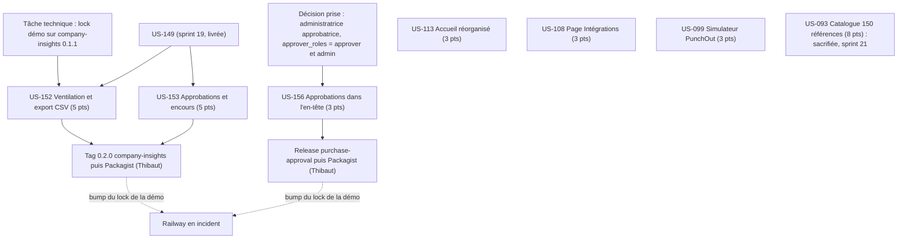

# Dépendances : Sprint 020 (démo enrichie)

> Périmètre validé par Thibaut le 2026-10-22 (30 points) ; US-094, US-100 et US-121 sont hors périmètre.

## Ressources partagées

- Un seul worker à la fois ; disque d'environ 5,4 Go libres (`bin/run-tests` refuse sous 5 Go).
- US-152 et US-153 touchent le même dépôt (`sylius-company-insights-plugin`, 0.2.0) : les mener l'une après l'autre ; US-153 lit les plugins optionnels purchase-approval et trade-credit.
- US-156 dans le dépôt `sylius-purchase-approval-plugin`, indépendante des stories de company-insights.
- US-113 et US-108 touchent les fichiers de la démo (accueil, pages) : pas en parallèle (US-093, catalogue, sacrifiée et reportée au sprint 21).
- US-099 touche le simulateur de `punchout-cxml` et la démo : pas en même temps qu'US-113.

## Ordre de publication (action 2 de la rétro S19)

Pour US-152, US-153 et US-156 : tag du plugin, puis Packagist (Thibaut), puis vérification de la version publiée, puis bump du `composer.lock` de la démo ; la PR de la démo s'ouvre après cette vérification.

## Chemin critique

Lock company-insights 0.1.1 puis US-152 puis US-153 (10 points, même dépôt) puis tag 0.2.0 et bump de la démo. US-156 : décision prise le 2026-10-22 ; US-093 (8 points, ≈ 16,5 h) a été sacrifiée le 2026-10-22 et reportée au sprint 21.
