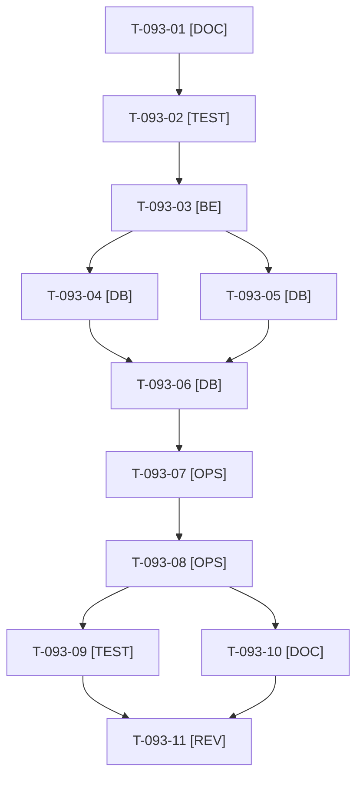

# Tâches : US-093 : Catalogue crédible, tranche 2 : environ 150 références réalistes

> **⚠️ SACRIFIÉE le 2026-10-22 (capacité) : reportée au sprint 21.** Statut backlog ; ces tâches sont conservées pour mémoire, hors périmètre et hors total du sprint 20 (22 points engagés, ~69,5 h).

## Informations US

- **Epic** : EPIC-11
- **Persona** : Nadia
- **Story Points** : 8 (Should)
- **Sprint** : sprint-21 (sacrifiée du sprint-20-demo-enrichie le 2026-10-22)
- **Story** : [US-093](../../../backlog/user-stories/US-093.md)

## Résumé de la US

**En tant que** Nadia
**Je veux** un catalogue d'environ 150 références (visserie, EPI, outillage) avec familles et attributs
**Afin de** évaluer la recherche et le filtrage sur un volume proche du réel

## Règles et fichiers visés

- Fichiers de la démo : `fixtures/csv/` (`quincaillerie.csv`, `epi.csv`, `fournitures.csv`), `fixtures/images/` et `fixtures/README.md`, `bin/fetch-product-images`, `docs/images-produits.md`, `docs/remise-a-zero-demo.md`, `bin/profile-reset`.
- Au moins 150 références, chacune avec famille, conditionnement, prix, image et palier cohérent ; doublon de code et palier supérieur au prix de base font échouer le chargement ou le contrôle de données, en nommant la cause.
- Cibles : pages filtrées sous 800 ms au p95 ; remise à zéro nocturne sous 10 minutes avec le nouveau volume (mesure avant et après).
- **Disque (≈ 5,4 Go libres)** : budget d'images estimé au cadrage (T-093-01), `bin/check-disk` avant et après le téléchargement, `bin/clean-test-caches` ciblé ; un seul build d'image à la fois ; si le budget dépasse ce qui reste, la story est sacrifiée ou limitée à une tranche (sacrifice n°1).
- Licences d'images et crédits dans `ImageCreditsController` ; aucune marque réelle comme logo ; ne pas mener en même temps qu'US-113, US-108 ou US-099.
- Ordre de sacrifice du sprint : n°1 (premier sacrifice). Règles du sprint : voir [README.md](./README.md).

## Vue d'ensemble des tâches

La colonne « Réalisé par » dit qui fait la tâche : **Claude** seul, **Orchestrateur** (Claude en rôle d'orchestrateur) ou **Thibaut** (action de sa part). 🚫 = bloquée (voir [README.md](./README.md)). Ordre TDD : les tâches [TEST] « rouges » précèdent le code qu'elles décrivent.

| ID | Type | Tâche | Estimation | Dépend de | Réalisé par | Statut |
|----|------|-------|------------|-----------|-------------|--------|
| T-093-01 | [DOC] | Cadrage : inventaire du catalogue actuel (≈ 80 références), répartition cible par famille (visserie, EPI, outillage, fournitures), attributs, conditionnements et paliers ; budget disque des images estimé en Mo et comparé à l'espace libre ; `fixtures/README.md` et `docs/images-produits.md` relus | 1 h | T-TECH-02 | Claude | 🔲 |
| T-093-02 | [TEST] | Tests rouges de données : au moins 150 références avec famille, conditionnement, prix et image ; doublon de code refusé en nommant le code ; palier supérieur au prix de base refusé ; familles non vides | 1,75 h | T-093-01 | Claude | 🔲 |
| T-093-03 | [BE] | Contrôle de données du chargement des fixtures (doublon, palier, champs obligatoires) avec message nommant la cause | 1,5 h | T-093-02 | Claude | 🔲 |
| T-093-04 | [DB] | Fixtures : tranche visserie et quincaillerie (environ 35 références nouvelles, libellés FR et EN, attributs, conditionnements, paliers) | 2,25 h | T-093-03 | Claude | 🔲 |
| T-093-05 | [DB] | Fixtures : tranche EPI et outillage (environ 35 références nouvelles, mêmes règles) | 2,25 h | T-093-03 | Claude | 🔲 |
| T-093-06 | [DB] | Fixtures : fournitures, familles et attributs de filtrage, cohérence des prix entre tranches | 1,5 h | T-093-04, T-093-05 | Claude | 🔲 |
| T-093-07 | [OPS] | Images : manifeste et téléchargement (`bin/fetch-product-images`), compression, crédits ; `bin/check-disk` avant et après, `bin/clean-test-caches` ciblé | 1,75 h | T-093-06 | Claude | 🔲 |
| T-093-08 | [OPS] | Mesures : durée de `app:demo:reset` avant et après (`bin/profile-reset`, objectif sous 10 minutes), pages filtrées par famille sous 800 ms au p95 | 1,5 h | T-093-07 | Claude | 🔲 |
| T-093-09 | [TEST] | Rendu réel FR et EN du catalogue et des filtres par famille, pa11y WCAG2AAA, `bin/measure-mobile`, suite via `bin/run-tests`, ECS (`src tests`), PHPStan | 1,5 h | T-093-08 | Claude | 🔲 |
| T-093-10 | [DOC] | `fixtures/README.md`, `docs/images-produits.md`, `docs/remise-a-zero-demo.md` (volume et durée), crédits d'images | 0,75 h | T-093-08 | Claude | 🔲 |
| T-093-11 | [REV] | Revue (cohérence des données, aucune marque réelle, licences et crédits d'images, espace disque restant) | 0,75 h | T-093-09, T-093-10 | Claude | 🔲 |

**Total estimé : 16,5 h** (11 tâches, aucune de Thibaut).

## Dépendances

Dépendances hors fichier : T-TECH-02.
