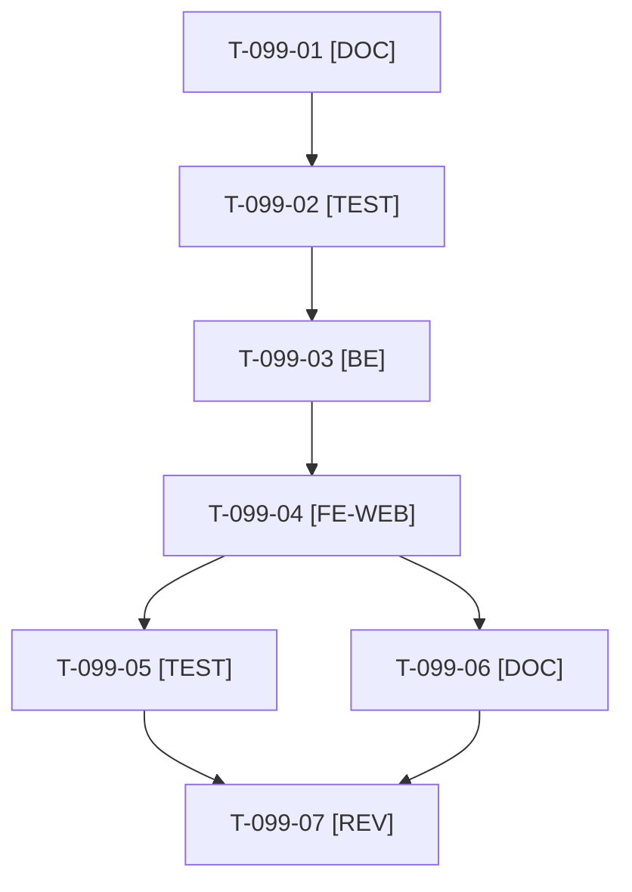

# Tâches : US-099 : Simulateur PunchOut habillé et expliqué

## Informations US

- **Epic** : EPIC-11
- **Persona** : Nadia (acheteuse d'un grand compte)
- **Story Points** : 3 (Should)
- **Sprint** : sprint-20-demo-enrichie
- **Story** : [US-099](../../../backlog/user-stories/US-099.md)

## Résumé de la US

**En tant que** Nadia, acheteuse d'un grand compte
**Je veux** un simulateur présenté comme un portail d'achat fictif, avec des étapes numérotées et un schéma du flux
**Afin de** comprendre PunchOut sans jargon

## Règles et fichiers visés

- Reprise de la décomposition du sprint 19 (reportée par sacrifice de capacité, sans retard). Le simulateur est dans la démo : `src/Demo/Controller/PunchOutSimulatorController.php` (cXML) et `PunchOutOciSimulatorController.php` (OCI), `templates/demo/punchout_simulator/simulator.html.twig`, `translations/simulator.{fr,en}.yaml`, tests dans `tests/Unit/Demo/PunchOutSimulator/` et `tests/Smoke/PunchOutSimulatorSmokeTest.php`.
- **Gherkin : 5 scénarios (1 nominal, 2 alternatifs, 2 erreurs).** Le 5e (URL de retour hors des domaines autorisés) est une proposition du cadrage du sprint 19, **à confirmer par Thibaut** (non tranché au planning du 2026-10-22) ; l'aide du jargon doit aussi être accessible au clavier. La story est engagée telle quelle.
- Ton de la charte d'US-063 ; aucune marque réelle (Ariba, Coupa, SAP) comme logo ; schéma du flux en SVG en ligne avec alternative textuelle ; libellés FR et EN ; WCAG2AAA ; `bin/measure-mobile`.
- Fichiers de la démo : pas en même temps qu'US-113, US-108 ni US-093.
- Ordre de sacrifice du sprint : n°2. Règles du sprint : voir [README.md](./README.md).

## Vue d'ensemble des tâches

La colonne « Réalisé par » dit qui fait la tâche : **Claude** seul, **Orchestrateur** (Claude en rôle d'orchestrateur) ou **Thibaut** (action de sa part). 🚫 = bloquée (voir [README.md](./README.md)). Ordre TDD : les tâches [TEST] « rouges » précèdent le code qu'elles décrivent.

| ID | Type | Tâche | Estimation | Dépend de | Réalisé par | Statut |
|----|------|-------|------------|-----------|-------------|--------|
| T-099-01 | [DOC] | Fiche : 5e scénario (URL de retour hors domaines autorisés) et aide au clavier confirmés ou retirés avec Thibaut ; plan des quatre étapes numérotées, glossaire (cXML, OCI, OrderRequest, HOOK_URL) en une phrase chacun, schéma du flux | 0,75 h | T-108-07 | Claude | ✅ |
| T-099-02 | [TEST] | Tests rouges : quatre étapes numérotées (liste ordonnée) et retour de panier lisible, aide lisible au survol et au focus clavier, parité des clés FR et EN, session expirée avec lien pour relancer, URL de retour refusée avec explication | 1 h | T-099-01 | Claude | ✅ |
| T-099-03 | [BE] | Étape courante calculée par le contrôleur (lancement, boutique, panier reçu, commande), message de session expirée avec action « relancer », explication du refus de domaine avec les domaines autorisés | 0,75 h | T-099-02 | Claude | ✅ |
| T-099-04 | [FE-WEB] | Habillage du portail fictif (sans marque réelle), étapes numérotées, aides du jargon, schéma du flux en SVG avec alternative textuelle, retour de panier lisible, protocoles cXML et OCI ; libellés FR et EN (`simulator.*.yaml`) ; contrastes AAA | 2 h | T-099-03 | Claude | ✅ |
| T-099-05 | [TEST] | Rendu réel FR et EN (cXML et OCI), pa11y WCAG2AAA, `bin/measure-mobile`, suite via `bin/run-tests`, ECS (`src tests`) et PHPStan | 1 h | T-099-04 | Claude | ✅ |
| T-099-06 | [DOC] | Documentation à jour (guide des parcours `docs/parcours-guides.md`, page du simulateur) et mention du simulateur habillé dans le kit média | 0,5 h | T-099-04 | Claude | ✅ |
| T-099-07 | [REV] | Revue (aucune marque réelle comme logo, ton de la charte, parité FR et EN) | 0,5 h | T-099-05, T-099-06 | Claude | ✅ |

**Total estimé : 6,5 h** (7 tâches, aucune de Thibaut).

## Dépendances

Dépendances hors fichier : T-108-07.
