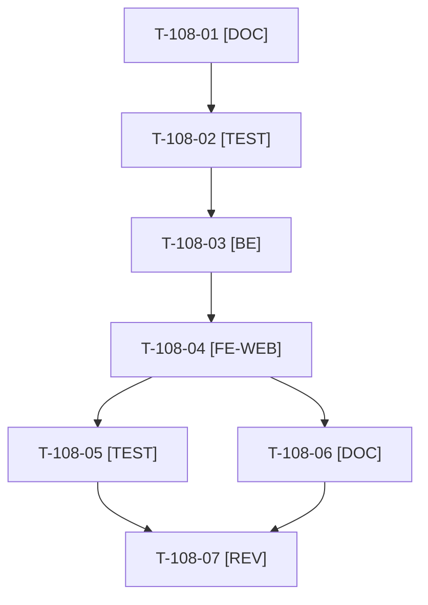

# Tâches : US-108 : Page « Intégrations » : ERP, PIM, transporteurs, e-facture, grands comptes, assistants

## Informations US

- **Epic** : EPIC-12
- **Persona** : Hugo (intégrateur)
- **Story Points** : 3 (Should)
- **Sprint** : sprint-20-demo-enrichie
- **Story** : [US-108](../../../backlog/user-stories/US-108.md)

## Résumé de la US

**En tant que** Hugo, intégrateur
**Je veux** un schéma des intégrations avec leur état (disponible, en cours, non fourni)
**Afin de** savoir ce qui existe déjà et ce qui reste à développer

## Règles et fichiers visés

- Fichiers de la démo : page existante `IntegrateController` et `templates/demo/integrate.html.twig` (à relire pour ne pas créer de doublon), `config/demo/plugins.yaml` (source des états, comme le statut des plugins d'US-087), traductions FR et EN.
- États : disponible, en cours ou à venir, **non fourni** (jamais « sur mesure ») ; une intégration non fournie renvoie vers le contrat d'événements du plugin webhook-outbox. Aucun bouton de contact ; le pied de page porte le CTA neutre d'US-158.
- Contrôles automatisés : un plugin publié ne peut pas être marqué à venir ; les formulations commerciales (« sur mesure », « devis », « nous développons pour vous ») font échouer le contrôle de charte (réutilise celui d'US-113).
- Dépendance nominale d'US-130 (spike P5, sprint 21) **non bloquante** : la page n'a pas besoin du spike (confirmé au cadrage, T-108-01).
- Touche les fichiers de pages de la démo : après US-113, **pas en même temps qu'US-099 ni US-093**.
- Ordre de sacrifice du sprint : n°3. Règles du sprint : voir [README.md](./README.md).

## Vue d'ensemble des tâches

La colonne « Réalisé par » dit qui fait la tâche : **Claude** seul, **Orchestrateur** (Claude en rôle d'orchestrateur) ou **Thibaut** (action de sa part). 🚫 = bloquée (voir [README.md](./README.md)). Ordre TDD : les tâches [TEST] « rouges » précèdent le code qu'elles décrivent.

| ID | Type | Tâche | Estimation | Dépend de | Réalisé par | Statut |
|----|------|-------|------------|-----------|-------------|--------|
| T-108-01 | [DOC] | Cadrage : page `integrate` et `plugins.yaml` relus, matrice intégration, plugin, état (ERP, PIM, transporteurs, PA/PDP, portails d'achat, assistants), confirmation que la page ne dépend pas d'US-130, textes FR et EN rédigés | 0,5 h | T-113-07 | Claude | 🔲 |
| T-108-02 | [TEST] | Tests rouges : chaque intégration a un état et un lien vers son plugin, « à venir » ou « en cours » pour un plugin non publié, « non fourni » avec renvoi vers le contrat d'événements de webhook-outbox, cohérence d'état (plugin publié marqué à venir échoue), charte (formulations commerciales refusées) | 1,25 h | T-108-01 | Claude | 🔲 |
| T-108-03 | [BE] | Source des états dérivée de `config/demo/plugins.yaml`, contrôle de cohérence, extension du contrôle de charte, route et contrôleur de la page | 1 h | T-108-02 | Claude | 🔲 |
| T-108-04 | [FE-WEB] | Page « Intégrations » : schéma en SVG avec alternative textuelle, badges d'état, liens vers les plugins, entrée de menu ou de pied de page, aucun bouton de contact ; libellés FR et EN ; contrastes AAA, mobile | 1,75 h | T-108-03 | Claude | 🔲 |
| T-108-05 | [TEST] | Rendu réel FR et EN, pa11y WCAG2AAA, `bin/measure-mobile`, suite via `bin/run-tests`, ECS (`src tests`), PHPStan | 1 h | T-108-04 | Claude | 🔲 |
| T-108-06 | [DOC] | Documentation à jour (`docs/vitrine-plugins.md`, README de la démo) | 0,5 h | T-108-04 | Claude | 🔲 |
| T-108-07 | [REV] | Revue (aucune formulation commerciale, états cohérents avec la vitrine, parité FR et EN) | 0,5 h | T-108-05, T-108-06 | Claude | 🔲 |

**Total estimé : 6,5 h** (7 tâches, aucune de Thibaut).

## Dépendances

Dépendances hors fichier : T-113-07.
