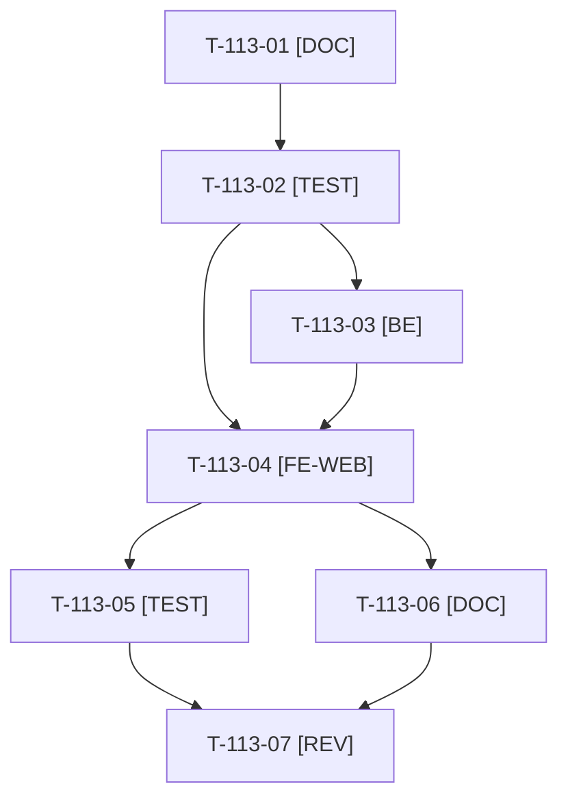

# Tâches : US-113 : Accueil réorganisé : trois colonnes, pourquoi cette démo, qui l'a conçue

## Informations US

- **Epic** : EPIC-12
- **Persona** : Camille (recruteuse IT) ; Nadia
- **Story Points** : 3 (Should)
- **Sprint** : sprint-20-demo-enrichie
- **Story** : [US-113](../../../backlog/user-stories/US-113.md)

## Résumé de la US

**En tant que** Camille, recruteuse IT
**Je veux** un bandeau « Ce que vous allez voir en 5 minutes » et une explication de qui a conçu cette démo et pourquoi
**Afin de** comprendre en 30 secondes que c'est une réalisation d'un Delivery Manager / CTO et non une démo d'éditeur

## Règles et fichiers visés

- Fichiers de la démo : `templates/shop/theme_b2b/home_*.html.twig` (hero, rôles, acheteur, parcours, accès rapide), traductions FR et EN, variable `DEMO_PROFILE_URL` (profil LinkedIn de Thibaut), page À propos.
- Texte : « démo B2B réalisée par Thibaut Monier, 25 ans de delivery, avec 24 plugins open source » ; section « Comment elle a été faite » (IA générative, tests, analyse statique, scan de sécurité) avec lien vers le dépôt ; **chiffres publics et vérifiables seulement** ; aucune mention de prestation ni d'appel commercial ; CTA neutre d'US-158.
- Contrôle de charte automatisé : titre évoquant une démo d'éditeur signalé, chiffre absent des dépôts ou de la CI publics refusé.
- Sans `DEMO_PROFILE_URL` : auteur en texte non cliquable, aucune erreur.
- Touche les fichiers d'accueil de la démo : **pas en même temps qu'US-108, US-099 ni US-093** (un seul worker).
- Ordre de sacrifice du sprint : n°7 (dernier recours). Règles du sprint : voir [README.md](./README.md).

## Vue d'ensemble des tâches

La colonne « Réalisé par » dit qui fait la tâche : **Claude** seul, **Orchestrateur** (Claude en rôle d'orchestrateur) ou **Thibaut** (action de sa part). 🚫 = bloquée (voir [README.md](./README.md)). Ordre TDD : les tâches [TEST] « rouges » précèdent le code qu'elles décrivent.

| ID | Type | Tâche | Estimation | Dépend de | Réalisé par | Statut |
|----|------|-------|------------|-----------|-------------|--------|
| T-113-01 | [DOC] | Cadrage : accueil actuel relu (`home_*.html.twig`), liste des chiffres vérifiables (source publique de chacun), wireframe des trois colonnes Acheter, Valider, S'intégrer et du choix de rôle, textes FR et EN rédigés | 0,75 h | T-TECH-03 | Claude | ✅ |
| T-113-02 | [TEST] | Tests rouges : trois colonnes, choix de rôle et auteur visibles à 1440 px, section auteur et méthode avec liens profil et dépôt, auteur non cliquable sans URL de profil, contrôle de charte (titre d'éditeur signalé, chiffre invérifiable refusé) | 1,25 h | T-113-01 | Claude | ✅ |
| T-113-03 | [BE] | Contrôle de charte des textes publics (formulations ambiguës, chiffres non sourcés par liste blanche) et lecture tolérante de `DEMO_PROFILE_URL` | 0,75 h | T-113-02 | Claude | ✅ |
| T-113-04 | [FE-WEB] | Bandeau en trois colonnes, section « Qui a conçu cette démo » et « Comment elle a été faite », mention dans À propos ; libellés FR et EN ; contrastes AAA, mobile | 1,75 h | T-113-02, T-113-03 | Claude | ✅ |
| T-113-05 | [TEST] | Rendu réel FR et EN à 1440 px et sur mobile, pa11y WCAG2AAA, `bin/measure-mobile`, suite via `bin/run-tests`, ECS (`src tests`), PHPStan | 1 h | T-113-04 | Claude | ✅ |
| T-113-06 | [DOC] | Documentation à jour (`docs/theme-b2b.md`, README de la démo) et captures d'accueil pour le README | 0,5 h | T-113-04 | Claude | 🔲 |
| T-113-07 | [REV] | Revue (ton neutre, aucune prestation ni Sylius Plus, chiffres vérifiables, parité FR et EN) | 0,5 h | T-113-05, T-113-06 | Claude | ✅ |

**Total estimé : 6,5 h** (7 tâches, aucune de Thibaut).

## Dépendances

Dépendances hors fichier : T-TECH-03.
