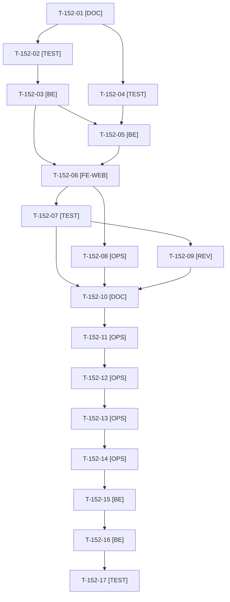

# Tâches : US-152 : Company-insights : ventilation par site et centre de coût, export CSV

## Informations US

- **Epic** : EPIC-15
- **Persona** : Isabelle (administratrice d'Acme Industries) ; son service comptable
- **Story Points** : 5 (Should)
- **Sprint** : sprint-20-demo-enrichie
- **Story** : [US-152](../../../backlog/user-stories/US-152.md)

## Résumé de la US

**En tant que** Isabelle, administratrice d'Acme Industries
**Je veux** répartir les achats par site de livraison et par centre de coût, puis exporter le détail en CSV
**Afin de** refacturer chaque service et alimenter la comptabilité sans ressaisie

## Règles et fichiers visés

- Deux dépôts : `sylius-company-insights-plugin` (prochaine version **0.2.0**, partagée avec US-153 ; dernier tag v0.1.1) et la démo `sylius-b2b-demo`. Les tâches de release de la 0.2.0 (T-152-10 à T-152-14) sont portées par cette fiche, la dernière à être sacrifiée ; elles attendent US-153 si elle est maintenue.
- **Matrice CI et `composer.json` lus au cadrage (2026-10-22)** : `php ^8.2`, `sylius/sylius ^2.2.9 || ^2.3`, Symfony `^6.4 || ^7.4 || ^8.0` ; CI : PHP 8.2 (Sylius 2.2, Symfony 6.4), 8.3 et 8.4 (Symfony 7.4, Sylius 2.2 et 2.3), 8.3 (Sylius 2.3, Symfony 6.4), 8.4 et 8.5 (Symfony 8, Sylius 2.3), MySQL 8.4, MariaDB 11.4 et PostgreSQL 17 ; actions épinglées par SHA et `permissions: contents: read` déjà en place. Impact : les requêtes d'agrégation et l'export doivent être portables sur les trois moteurs (pas de fonction de date propre à MySQL), et le code compatible PHP 8.2 / Symfony 6.4.
- Point d'extension `OrderDimensionProviderInterface` (libellé de la dimension, valeur pour une commande) ; **aucune implémentation dans le plugin** ; la démo fournit « Centre de coût » (`ATELIER-01`, `MAINT-02`, via `OrderPoReferenceAwareTrait`). Sans fournisseur, le bloc n'est pas affiché.
- Export CSV : UTF-8 avec BOM, séparateur « ; », une ligne par ligne de commande, filtres et cloisonnement respectés, limite de 24 mois et de 50 000 lignes, préfixe des cellules commençant par `=`, `+`, `-` ou `@`, journal des exports (qui, quand, période) sans contenu. **Les tests construisent leurs valeurs piégées à l'exécution** (aucun jeton ni secret au format réel écrit en clair).
- Cloisonnement par entreprise testé sur chaque requête (scénarios « autre entreprise ») ; revue de sécurité de l'export avant le merge, **rapportée hors dépôt public**, aucun détail exploitable dans les messages, README ou CHANGELOG.
- Même fichier que US-153 (gabarit du tableau de bord, traductions) : US-152 avant US-153, un seul worker à la fois.
- Aucune mention ni comparaison à Sylius Plus dans les textes publiés (README, CHANGELOG, captures).
- Ordre de sacrifice du sprint : n°6 (dernier recours). Règles du sprint : voir [README.md](./README.md).

## Ordre de publication (action 2 de la rétro S19)

1. Plugin : PR sur `main`, matrice CI complète verte (run terminé), merge, tag `v0.2.0`, release GitHub (après GO de Thibaut, T-152-11 et T-152-12). 2. Packagist : indexation de la 0.2.0 confirmée par Thibaut (T-152-13). 3. Vérification de la version publiée par script OK ou FAIL (T-152-14). 4. **Alors seulement** : `composer.lock` de la démo (T-152-15) et PR de la démo.

## Vue d'ensemble des tâches

La colonne « Réalisé par » dit qui fait la tâche : **Claude** seul, **Orchestrateur** (Claude en rôle d'orchestrateur) ou **Thibaut** (action de sa part). 🚫 = bloquée (voir [README.md](./README.md)). Ordre TDD : les tâches [TEST] « rouges » précèdent le code qu'elles décrivent.

| ID | Type | Tâche | Estimation | Dépend de | Réalisé par | Statut |
|----|------|-------|------------|-----------|-------------|--------|
| T-152-01 | [DOC] | Cadrage : `git fetch`, partir de `main` (v0.1.1), branche vérifiée ; matrice CI et `composer.json` relus, rubriques « versions supportées et impact de version » et « ordre de publication » rédigées ; contrat de `OrderDimensionProviderInterface` et du format d'export figés | 1 h | T-TECH-01 | Claude | 🔲 |
| T-152-02 | [TEST] | Tests d'intégration rouges de la ventilation : par site (adresse d'entreprise reconnue, sinon « Autres adresses »), par dimension (fournisseur de test, bloc absent sans fournisseur), filtres membre, site et période, cloisonnement « autre entreprise » | 1,5 h | T-152-01 | Claude | 🔲 |
| T-152-03 | [BE] | Point d'extension `OrderDimensionProviderInterface` (étiquette de service), requêtes de ventilation portables MySQL, MariaDB et PostgreSQL, filtres en liste blanche appliqués au tableau de bord, objets de lecture | 2 h | T-152-02 | Claude | 🔲 |
| T-152-04 | [TEST] | Tests rouges de l'export CSV : encodage et BOM, séparateur, colonnes, une ligne par ligne de commande, filtres et cloisonnement, neutralisation des formules (valeurs piégées recomposées à l'exécution), refus au-delà de 24 mois ou 50 000 lignes sans fichier, journal sans contenu | 1,5 h | T-152-01 | Claude | 🔲 |
| T-152-05 | [BE] | Exporteur CSV en flux, neutralisation des cellules commençant par `=`, `+`, `-` ou `@`, limites et message, journalisation (qui, quand, période), permission de l'export | 1,75 h | T-152-03, T-152-04 | Claude | 🔲 |
| T-152-06 | [FE-WEB] | Filtres (membre, site, période), bloc de ventilation avec tableau équivalent, bouton d'export, message de période trop longue ; libellés FR et EN ; contrastes AAA, mobile | 2 h | T-152-03, T-152-05 | Claude | 🔲 |
| T-152-07 | [TEST] | Dans Docker (PHP 8.4, Sylius 2.3) : ECS, PHPStan max, Rector, couverture ; rendu réel FR et EN et pa11y WCAG2AAA dans l'application de test ; lecture du code pour les cellules PHP 8.2, Symfony 6.4 et PostgreSQL | 1 h | T-152-06 | Claude | 🔲 |
| T-152-08 | [OPS] | Captures de la ventilation et de l'export pour le README (application de test du plugin, données fictives, sans marque tierce) ; relevé du disque avant (`bin/check-disk`) ; **à faire avant le jour 5** | 0,5 h | T-152-06, T-TECH-02 | Claude | 🔲 |
| T-152-09 | [REV] | Revue de sécurité (cloisonnement, injection de formule, limites, journal, permission), rapportée hors dépôt public, et revue de code | 0,75 h | T-152-07 | Claude | 🔲 |
| T-152-10 | [DOC] | Préparation de la 0.2.0 : README EN et FR (point d'extension, export, limites, versions supportées), `CHANGELOG.md`, captures, matrice CI de `main` verte (run terminé) ; attend US-153 (T-153-09, T-153-12) si elle est maintenue | 0,75 h | T-152-07, T-152-08, T-152-09, T-TECH-08 | Claude | 🔲 |
| T-152-11 | [OPS] | Thibaut donne le GO du tag et de la release `v0.2.0` de company-insights | 0,25 h | T-152-10 | Thibaut | 🔲 |
| T-152-12 | [OPS] | Push de la branche, PR, matrice CI complète verte (run terminé), merge, tag `v0.2.0` et release GitHub ; script de vérification Packagist remis à Thibaut | 0,75 h | T-152-11, T-TECH-10 | Claude | 🔲 |
| T-152-13 | [OPS] | Thibaut confirme que Packagist indexe la 0.2.0 (mise à jour du paquet déjà soumis) | 0,25 h | T-152-12 | Thibaut | 🔲 |
| T-152-14 | [OPS] | Vérification de la version publiée (script du scratchpad à OK ou FAIL) avant toute PR de la démo | 0,25 h | T-152-13 | Claude | 🔲 |
| T-152-15 | [BE] | Démo : `php -d memory_limit=1G composer require tmonier/sylius-company-insights-plugin:^0.2`, migration éventuelle ; `composer.lock` écrit seul (jamais en parallèle d'une autre montée de version) | 0,5 h | T-152-14 | Claude | 🔲 |
| T-152-16 | [BE] | Démo : implémentation « Centre de coût » du fournisseur de dimension (`ATELIER-01`, `MAINT-02`) et enregistrement du service | 0,75 h | T-152-15 | Claude | 🔲 |
| T-152-17 | [TEST] | Tests de la démo : ventilation d'Acme (Atelier de Lyon, Dépôt de Grenoble), centres de coût, export CSV, TechParts absent des chiffres d'Acme ; scénario d'Isabelle dans `config/demo/plugins.yaml` et `docs/vitrine-plugins.md` ; suite via `bin/run-tests`, ECS (`src tests`), PHPStan | 1 h | T-152-16 | Claude | 🔲 |

**Total estimé : 16,5 h** (17 tâches, dont 2 de Thibaut, soit 0,5 h).

## Dépendances

Dépendances hors fichier : T-TECH-01, T-TECH-02, T-TECH-08, T-TECH-10.
