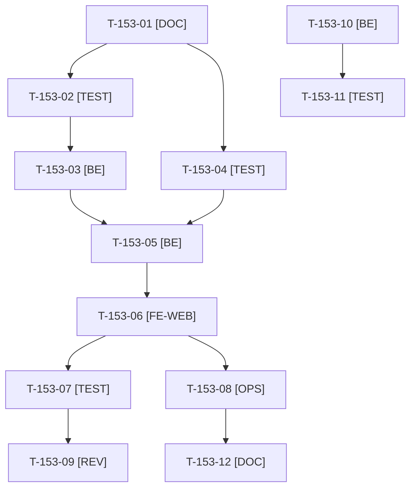

# Tâches : US-153 : Company-insights : indicateurs des approbations et de l'encours

## Informations US

- **Epic** : EPIC-15
- **Persona** : Isabelle (administratrice d'Acme Industries)
- **Story Points** : 5 (Should)
- **Sprint** : sprint-20-demo-enrichie
- **Story** : [US-153](../../../backlog/user-stories/US-153.md)

## Résumé de la US

**En tant que** Isabelle, administratrice d'Acme Industries
**Je veux** voir comment se passent les approbations et où en est l'encours de l'entreprise
**Afin de** ajuster les plafonds de mes acheteurs et éviter un blocage de commande par dépassement de crédit

## Règles et fichiers visés

- Même dépôt et même version que US-152 : `sylius-company-insights-plugin` 0.2.0 ; les tâches de release sont dans [US-152-tasks.md](./US-152-tasks.md) (T-152-10 à T-152-14). Matrice CI et `composer.json` : voir la rubrique de cadrage d'US-152 (PHP 8.2 à 8.5, Sylius 2.2 et 2.3, Symfony 6.4, 7.4 et 8, MySQL, MariaDB, PostgreSQL).
- **Gherkin complété au planning du 2026-10-22** : 6 scénarios (2 nominaux, 2 alternatifs, 2 erreurs), dont « service du plugin compagnon en erreur » (page 200, widget « Données momentanément indisponibles », erreur journalisée sans donnée personnelle).
- Interface `InsightsWidgetProviderInterface` ; intégrations dans `src/Bridge/` (sur le modèle du `Bridge` de company-accounts), **détectées à l'exécution** : plugin compagnon absent = widget absent, sans erreur ; **aucune dépendance obligatoire** (`suggest` seulement dans `composer.json`).
- Les chiffres viennent des **services publics** de `sylius-purchase-approval-plugin` (v1.1.0) et `sylius-trade-credit-plugin`, sans requête sur leurs tables ; matrice de tests avec et sans chaque compagnon.
- **Risque à lever au cadrage (T-153-01)** : si un service public ne fournit pas le délai médian, le taux de refus ou les acheteurs les plus souvent soumis, le widget est réduit aux données disponibles et l'écart est consigné ; aucune modification de purchase-approval n'est prévue dans ce sprint en dehors d'US-156.
- Cloisonnement par entreprise, aucune donnée personnelle au-delà du nom ; revue rapportée hors dépôt public.
- Aucune mention ni comparaison à Sylius Plus dans les textes publiés.
- Ordre de sacrifice du sprint : n°5. Règles du sprint : voir [README.md](./README.md).

## Ordre de publication (action 2 de la rétro S19)

Publié avec US-152 : une seule version 0.2.0 du plugin (voir [US-152-tasks.md](./US-152-tasks.md)). Les widgets de la démo (T-153-10, T-153-11) ne démarrent qu'après la vérification de la version publiée (T-152-14) et le bump du `composer.lock` (T-152-15). Les plugins compagnons restent aux versions déjà verrouillées de la démo (`^1.1`).

## Vue d'ensemble des tâches

La colonne « Réalisé par » dit qui fait la tâche : **Claude** seul, **Orchestrateur** (Claude en rôle d'orchestrateur) ou **Thibaut** (action de sa part). 🚫 = bloquée (voir [README.md](./README.md)). Ordre TDD : les tâches [TEST] « rouges » précèdent le code qu'elles décrivent.

| ID | Type | Tâche | Estimation | Dépend de | Réalisé par | Statut |
|----|------|-------|------------|-----------|-------------|--------|
| T-153-01 | [DOC] | Cadrage : services publics de purchase-approval (compteur d'attente, `ApprovalPolicy`, historique) et de trade-credit (limite, encours, échu, prochaine échéance) lus ; écarts avec les indicateurs demandés consignés ; matrice des compagnons absents ou présents | 1,25 h | T-152-01 | Claude | 🔲 |
| T-153-02 | [TEST] | Tests rouges du registre de widgets : fournisseurs détectés à l'exécution, plugin compagnon absent donc widget absent sans erreur, permission requise par widget | 1 h | T-153-01 | Claude | 🔲 |
| T-153-03 | [BE] | Interface `InsightsWidgetProviderInterface`, registre par étiquette de service, rendu générique des widgets sur le tableau de bord | 1,5 h | T-153-02 | Claude | 🔲 |
| T-153-04 | [TEST] | Tests rouges des deux Bridges : approbations (attente de 4 jours, montant, plus ancienne en tête, délai médian, taux de refus, acheteurs souvent soumis : 4 commandes sur 5), encours (échu depuis 18 jours, utilisation du crédit, prochaine échéance, entreprise sans compte), cloisonnement, avec et sans compagnon, service en erreur (page 200, message, journal) | 2 h | T-153-01 | Claude | 🔲 |
| T-153-05 | [BE] | `Bridge/PurchaseApproval` et `Bridge/TradeCredit` : garde de présence à l'exécution, appels aux services publics, gestion d'erreur journalisée, `suggest` dans `composer.json` sans `require` | 2,25 h | T-153-03, T-153-04 | Claude | 🔲 |
| T-153-06 | [FE-WEB] | Widgets « Approbations » et « Encours » : jauge d'utilisation avec équivalent textuel, liens vers les pages des plugins compagnons, états vide (« Pas de compte de paiement à terme ») et d'erreur ; libellés FR et EN ; contrastes AAA, mobile | 1,75 h | T-153-05, T-152-06 | Claude | 🔲 |
| T-153-07 | [TEST] | Dans Docker : ECS, PHPStan max, Rector, couverture ; matrice locale avec et sans chaque compagnon ; rendu réel FR et EN et pa11y WCAG2AAA dans l'application de test | 1 h | T-153-06 | Claude | 🔲 |
| T-153-08 | [OPS] | Captures des deux widgets pour le README (application de test, données fictives, sans marque tierce) ; relevé du disque avant ; **à faire avant le jour 5** | 0,5 h | T-153-06, T-TECH-02 | Claude | 🔲 |
| T-153-09 | [REV] | Revue de sécurité (cloisonnement, aucune donnée personnelle au-delà du nom, aucune dépendance obligatoire) rapportée hors dépôt public, et revue de code | 0,75 h | T-153-07 | Claude | 🔲 |
| T-153-10 | [BE] | Démo : widgets pour Isabelle ; ajustement minimal du plan de commandes si une donnée manque (commande de Claire en attente depuis 4 jours, facture échue depuis 18 jours), parcours existants inchangés | 0,75 h | T-152-15 | Claude | ✅ |
| T-153-11 | [TEST] | Tests de la démo : widgets d'Isabelle (approbations, encours), autre entreprise exclue, durée de remise à zéro ≤ +20 % ; suite via `bin/run-tests`, ECS (`src tests`), PHPStan | 1 h | T-153-10 | Claude | ✅ |
| T-153-12 | [DOC] | README EN et FR (interface de widget, intégrations optionnelles), entrée du `CHANGELOG.md` de la 0.2.0, captures | 0,5 h | T-153-08 | Claude | 🔲 |

**Total estimé : 14,25 h** (12 tâches, aucune de Thibaut).

## Dépendances

Dépendances hors fichier : T-152-01, T-152-06, T-TECH-02, T-152-15.

## Écarts consignés au cadrage (T-153-01, worker plugin, 2026-10-22)

- **purchase-approval 1.1.0** : seul le compteur d'attente (`countPendingByCompany`) et les listes du dépôt public (`createListQueryBuilderByCompany`) sont fournis. **Aucun service ne fournit** le délai médian, le taux de refus ni les acheteurs les plus souvent soumis : le pont les calcule à partir des approbations de la période lues par ce dépôt (2 000 au plus, entités `OrderApprovalInterface`), sans toucher aux tables. Taux de refus = refusées / (approuvées + refusées), les demandes expirées ou annulées n'étant pas des décisions ; part d'un acheteur = approbations / commandes validées par lui dans la période (requête sur les tables du plugin company-insights uniquement). Montants des demandes TTC (total de l'approbation). Aucune modification de purchase-approval.
- **Visibilité** : `ApprovalPermissions::APPROVAL_LIST` n'est accordée qu'aux rôles de `approver_roles` (par défaut `approver` seul, pas `admin`). Le widget reste visible de tout administrateur du tableau de bord ; **son lien vers les approbations n'apparaît que si le membre a APPROVAL_LIST**. Pour que le lien s'affiche pour Isabelle dans la démo, il faut `approver_roles: [approver, admin]` côté démo (à vérifier par l'orchestrateur).
- **trade-credit 1.1.0** : tout vient de `StatementBuilder::forCustomer()` (limite, encours, disponible, échu, factures échues, prochaine échéance) ; aucun écart. Le relevé est celui du compte de l'entreprise résolu depuis le client du membre connecté.
- **Port `OrderReferenceProviderInterface`** (non prévu à la fiche US-152) : la colonne « Référence PO » de l'export a besoin d'une source ; le plugin n'a pas de notion de PO. La démo doit implémenter ce port (colonne `sylius_order.po_reference`) en plus de `OrderDimensionProviderInterface` (centre de coût).
- Contrat `OrderDimensionProviderInterface` : `code()`, `label()`, `values(list<int> $orderIds): array<int, ?string>` (appel groupé, 1 000 identifiants au plus à la fois).
