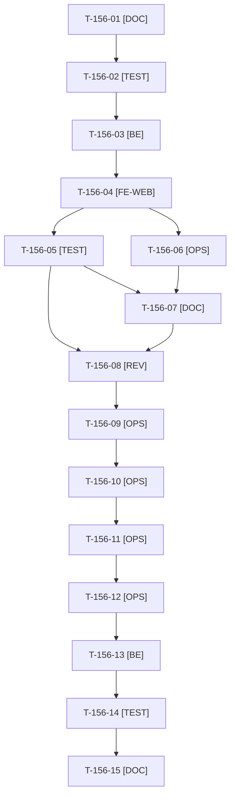

# Tâches : US-156 : Purchase-approval : approbations en attente signalées dans l'en-tête

## Informations US

- **Epic** : EPIC-07
- **Persona** : Paul (approbateur d'Acme Industries) ; Isabelle (administratrice)
- **Story Points** : 3 (Should)
- **Sprint** : sprint-20-demo-enrichie
- **Story** : [US-156](../../../backlog/user-stories/US-156.md)

## Résumé de la US

**En tant que** Paul, approbateur d'Acme Industries
**Je veux** voir dans l'en-tête de chaque page combien de commandes attendent ma décision
**Afin de** ne pas bloquer mes collègues sans ouvrir mon compte pour le savoir

## Règles et fichiers visés

- Deux dépôts : `sylius-purchase-approval-plugin` (release mineure **v1.2.0**, dernier tag v1.1.0) et la démo. **La branche locale du plugin est `fix/company-tabs-test` (ancienne) : ne pas s'en servir** ; `git fetch`, puis branche depuis `main`.
- **Matrice CI et `composer.json` lus au cadrage (2026-10-22)** : `php ^8.2`, `sylius/sylius ^2.2.9 || ^2.3`, Symfony `^6.4 || ^7.4 || ^8.0` ; CI : PHP 8.2 (Sylius 2.2, Symfony 6.4), 8.3 et 8.4 (Symfony 7.4), 8.3 (Sylius 2.3, Symfony 6.4), 8.4 (Symfony 8, Sylius 2.3), MySQL 8.4, MariaDB 11.4, PostgreSQL 17. **Écarts au gabarit d'un nouveau plugin** : pas de ligne PHP 8.5 ni de bloc `permissions` ; à traiter dans la PR de la release seulement si le gabarit (T-TECH-08) le permet sans élargir le périmètre, sinon au sprint 21.
- **Décision de Thibaut du 2026-10-22** : l'administratrice est approbatrice dans la démo, `approver_roles` = `[approver, admin]`, sans dépasser la limite d'approbation d'Isabelle ; aucun changement de règle dans le plugin (« qui peut décider voit le compteur »).
- Entrée d'en-tête via les hooks Twig `sylius_shop.base.header.content.security.logged_in_user.desktop` et `.mobile` ; visible pour la permission `APPROVAL_LIST` ; compte uniquement ce que **ce membre peut décider** (ni ses commandes ni celles au-delà de sa limite), égal à la liste filtrée « à décider » ; « 99+ » au-delà ; une requête `COUNT` par page, mémoïsée, jamais pour un visiteur ou un acheteur ; option `header_badge` (true par défaut).
- Accessibilité : nombre annoncé en texte, contraste AAA, cible tactile de 44 px ; compatibilité avec le thème `theme_b2b` (en-tête, barre de démo) vérifiée dans la démo.
- Parcours de la démo à revérifier après le passage d'`admin` dans `approver_roles` : commandes d'Isabelle payées sur compte, e-mails « approbation demandée », tests de démo.
- Ordre de sacrifice du sprint : n°4. Règles du sprint : voir [README.md](./README.md).

## Ordre de publication (action 2 de la rétro S19)

1. Plugin : PR sur `main`, matrice CI complète verte (run terminé), merge, tag `v1.2.0`, release GitHub (après GO de Thibaut, T-156-09 et T-156-10). 2. Packagist : Thibaut confirme l'indexation (T-156-11). 3. Vérification de la version publiée par script OK ou FAIL (T-156-12). 4. **Alors seulement** : `composer.lock` de la démo (T-156-13) et PR de la démo. Le `composer.lock` a un seul écrivain : T-156-13 après T-152-17 (ou sans attente si US-152 et US-153 sont sacrifiées).

## Vue d'ensemble des tâches

La colonne « Réalisé par » dit qui fait la tâche : **Claude** seul, **Orchestrateur** (Claude en rôle d'orchestrateur) ou **Thibaut** (action de sa part). 🚫 = bloquée (voir [README.md](./README.md)). Ordre TDD : les tâches [TEST] « rouges » précèdent le code qu'elles décrivent.

| ID | Type | Tâche | Estimation | Dépend de | Réalisé par | Statut |
|----|------|-------|------------|-----------|-------------|--------|
| T-156-01 | [DOC] | Cadrage : `git fetch`, partir de `main` (v1.1.0), branche vérifiée ; matrice CI et `composer.json` relus, rubriques « versions supportées et impact de version » et « ordre de publication » ; hooks Twig de l'en-tête et thème `theme_b2b` lus ; contrat du compteur « à décider par ce membre » | 1 h | T-TECH-03 | Claude | 🔲 |
| T-156-02 | [TEST] | Tests rouges : compteur par membre (propre commande et dépassement de limite exclus, autre entreprise exclue, égal à la liste filtrée), « 99+ », visibilité par `APPROVAL_LIST`, aucune requête de comptage pour un visiteur ou un acheteur (comptage des requêtes), option `header_badge` | 1,75 h | T-156-01 | Claude | 🔲 |
| T-156-03 | [BE] | Service de comptage par membre, mémoïsé pour la requête, fonction Twig, option de configuration `header_badge` (true par défaut) | 1,5 h | T-156-02 | Claude | 🔲 |
| T-156-04 | [FE-WEB] | Composant d'en-tête sur les hooks Twig ordinateur et mobile : icône, libellé, pastille, libellé accessible « Aucune approbation en attente », lien vers la liste à décider ; libellés FR et EN ; contraste AAA, cible de 44 px | 1,5 h | T-156-03 | Claude | 🔲 |
| T-156-05 | [TEST] | Dans Docker : ECS, PHPStan max, Rector, tests ; rendu réel FR et EN, ordinateur et mobile, pa11y WCAG2AAA dans l'application de test ; lecture du code pour les cellules PHP 8.2 et Symfony 6.4 | 1 h | T-156-04 | Claude | 🔲 |
| T-156-06 | [OPS] | Captures de l'en-tête (ordinateur et mobile) pour le README (application de test, données fictives) ; relevé du disque avant ; à faire au plus tard le jour 5 | 0,5 h | T-156-04, T-TECH-02 | Claude | 🔲 |
| T-156-07 | [DOC] | README EN et FR (en-tête, option `header_badge`, versions supportées), `CHANGELOG.md` de la v1.2.0, captures | 0,5 h | T-156-05, T-156-06 | Claude | 🔲 |
| T-156-08 | [REV] | Revue (permission, aucune requête pour un visiteur, cloisonnement, absence de donnée personnelle) rapportée hors dépôt public, et revue de code | 0,5 h | T-156-05, T-156-07 | Claude | 🔲 |
| T-156-09 | [OPS] | Thibaut donne le GO du tag et de la release `v1.2.0` de purchase-approval | 0,25 h | T-156-08 | Thibaut | 🔲 |
| T-156-10 | [OPS] | Push de la branche, PR, matrice CI complète verte (run terminé), merge, tag `v1.2.0` et release GitHub ; script de vérification Packagist remis à Thibaut | 0,75 h | T-156-09, T-TECH-10 | Claude | 🔲 |
| T-156-11 | [OPS] | Thibaut confirme que Packagist indexe la v1.2.0 | 0,25 h | T-156-10 | Thibaut | 🔲 |
| T-156-12 | [OPS] | Vérification de la version publiée (script du scratchpad à OK ou FAIL) avant toute PR de la démo | 0,25 h | T-156-11 | Claude | 🔲 |
| T-156-13 | [BE] | Démo : `php -d memory_limit=1G composer require tmonier/sylius-purchase-approval-plugin:^1.2`, `approver_roles` = `[approver, admin]` (limite d'approbation d'Isabelle inchangée) ; `composer.lock` écrit seul | 0,75 h | T-156-12 | Claude | 🔲 |
| T-156-14 | [TEST] | Tests de la démo : pastille de Paul, entrée d'Isabelle selon la décision, aucune entrée pour Claire ni pour un visiteur, parcours d'Isabelle inchangés (commandes sur compte, e-mails « approbation demandée »), en-tête et barre de démo du thème ; rendu réel ordinateur et mobile, pa11y ; suite via `bin/run-tests`, ECS (`src tests`), PHPStan | 1,5 h | T-156-13 | Claude | 🔲 |
| T-156-15 | [DOC] | Parcours guidé de Paul et d'Isabelle (`config/demo/plugins.yaml`) et `docs/vitrine-plugins.md` mis à jour | 0,25 h | T-156-14 | Claude | 🔲 |

**Total estimé : 12,25 h** (15 tâches, dont 2 de Thibaut, soit 0,5 h).

## Dépendances

Dépendances hors fichier : T-TECH-03, T-TECH-02, T-TECH-10.
