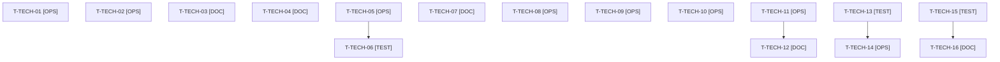

# Tâches transverses : actions de la rétrospective du sprint 19, reprises et clôture de l'orchestrateur

Tâches **sans points** : elles comptent dans les heures, pas dans les 30 points. Elles portent le lock de company-insights, les cinq actions de la rétrospective du sprint 19 (voir [../sprint-goal.md](../sprint-goal.md)) : budget disque et captures tôt (1), ordre de publication et versions supportées dans les fiches (2), gate recoupé et refus d'outil (3), gabarit de CI d'un nouveau plugin (4), plan de déploiement de repli (5), ainsi que la vérification en production des sprints 18 et 19 dès la reprise de Railway.

## Vue d'ensemble des tâches

| ID | Type | Tâche | Estimation | Dépend de | Réalisé par | Statut |
|----|------|-------|------------|-----------|-------------|--------|
| T-TECH-01 | [OPS] | Démo : monter le lock sur company-insights 0.1.1 (`php -d memory_limit=1G composer update tmonier/sylius-company-insights-plugin`, lock actuellement sur v0.1.0, contrainte `^0.1` inchangée) ; seul ce paquet change dans `composer.lock` ; ECS, PHPStan et tests de fumée via `bin/run-tests` | 0,75 h | - | Claude | ✅ |
| T-TECH-02 | [OPS] | Budget d'espace disque (action 1 de la rétro S19) : relevé `df -h .` et `bin/check-disk` au planning, `bin/clean-test-caches`, captures des plugins planifiées avant le jour 5, relevé noté dans le sprint-goal | 0,5 h | - | Orchestrateur | 🔲 |
| T-TECH-03 | [DOC] | Rubriques « ordre de publication » et « versions supportées (PHP, Symfony, Sylius) et impact de version, matrice CI lue au cadrage » dans `project-management/templates/user-story.md` et le gabarit de consigne de worker (action 2 de la rétro S19 ; absorbe T-TECH-03 du sprint 19) | 0,5 h | - | Claude | ✅ |
| T-TECH-04 | [DOC] | Gabarit de l'orchestrateur : gate recoupé avec la somme des points du fichier de statut (écart affiché), et « un refus d'outil n'arrête jamais le sprint » (action 3 de la rétro S19) | 0,5 h | - | Orchestrateur | 🔲 |
| T-TECH-05 | [OPS] | Thibaut déploie d'un coup les PR #43 à #48 sur Railway à la reprise (échéance 2027-03-26, action 5 de la rétro S19) ; aucune commande Railway par Claude | 0,5 h | - | Thibaut | 🔲 |
| T-TECH-06 | [TEST] | Vérification en production des sprints 18 et 19 dès la reprise de Railway : checks du runbook (`docs/ouverture-publique.md`, `docs/deploiement-railway.md`) et un contrôle par story livrée (US-149, US-150, US-151, US-155, US-146, stories du sprint 18) ; anomalies ouvertes en backlog, rien de sensible dans le dépôt public | 1,5 h | T-TECH-05 | Claude | 🔲 |
| T-TECH-07 | [DOC] | Note au runbook : plan de déploiement de repli quand les builds Railway sont suspendus (état de la plateforme, ordre de déploiement des PR en attente) — action 5 de la rétro S19 | 0,75 h | - | Claude | ✅ |
| T-TECH-08 | [OPS] | Gabarit de CI d'un nouveau plugin (action 4 de la rétro S19) : PHP 8.4 et 8.5, actions épinglées par SHA, `permissions` minimal ; documenté et vérifié sur company-insights avant la 0.2.0 (CI verte sur PHP 8.5 ; déjà présents au cadrage) ; écarts de purchase-approval consignés | 1 h | - | Claude | 🔲 |
| T-TECH-09 | [OPS] | ECS et PHPStan rejoués sur l'arbre exact avant chaque push (démo et dépôts de plugins, dans Docker) ; dernière ligne de sortie citée dans le rapport | 0,5 h | - | Orchestrateur | 🔲 |
| T-TECH-10 | [OPS] | Scripts du scratchpad pour les commandes de Thibaut, à OK ou FAIL par élément : tag v0.2.0 de company-insights, tag v1.2.0 de purchase-approval, vérification Packagist, `composer` avec `php -d memory_limit=1G` | 0,75 h | - | Orchestrateur | 🔲 |
| T-TECH-11 | [OPS] | Reconstruction de l'image et démarrage du conteneur (`/healthz`) par l'orchestrateur avant la revue, puis après tout correctif touchant l'image (un seul build à la fois) | 0,75 h | T-093-09, T-099-05, T-153-11, T-156-14 | Orchestrateur | 🔲 |
| T-TECH-12 | [DOC] | Bilan des indicateurs de la rétro S19 (captures reportées pour le disque, CI rouge d'ordre de publication, écart de gate, arrêts non demandés, workers morts) préparé pour la rétro du 2027-04-02 | 0,5 h | T-TECH-11 | Orchestrateur | 🔲 |

**Total estimé : 8,5 h** (12 tâches, dont 1 de Thibaut, soit 0,5 h ; 8 h pour Claude et l'orchestrateur).

**Définition de fini des actions** : 0 tâche de captures reportée pour manque d'espace (1), 0 CI rouge due à un ordre de publication (2), 0 écart de calcul du gate et 0 arrêt non demandé (3), CI de company-insights verte sur PHP 8.5 et gabarit documenté (4), production à jour avec les PR #43 à #48 et checks du runbook rejoués (5).

## Reprises conditionnelles du sprint 19 (hors total)

Le sprint 19 a laissé T-TECH-01, 02, 03, 05, 06 et 08 non livrées. **T-TECH-03 (gabarit de fiche) et T-TECH-08 (image) sont déjà reprises ci-dessus** (T-TECH-03 et T-TECH-11 du sprint 20). Les quatre autres ne sont engagées que si la rétrospective du sprint 19 (2027-03-19) les reporte ; elles ne sont **pas comptées** dans le total ni dans la capacité (voir [README.md](./README.md), section Capacité).

| ID | Type | Tâche | Estimation | Dépend de | Réalisé par | Statut |
|----|------|-------|------------|-----------|-------------|--------|
| T-TECH-13 | [TEST] | Reprise de T-TECH-01 du sprint 19 : tests rouges de `bin/check-disk` pour la VM Docker (espace libre mesuré, alerte, refus de `bin/run-tests` sous 3 Go dans la VM) | 0,75 h | - | Claude | 🔲 |
| T-TECH-14 | [OPS] | Reprise de T-TECH-02 du sprint 19 : `bin/check-disk` mesure le disque de la VM Docker ; `bin/run-tests` refuse de démarrer sous 3 Go dans la VM, le gel à 5 Go de la machine restant inchangé | 1,25 h | T-TECH-13 | Claude | 🔲 |
| T-TECH-15 | [TEST] | Reprise de T-TECH-05 du sprint 19 : test garde rouge, aucun faux jeton au format réel dans les `tests/` de la démo ; l'échec nomme le fichier | 0,75 h | - | Claude | 🔲 |
| T-TECH-16 | [DOC] | Reprise de T-TECH-06 du sprint 19 : règle « secrets fictifs recomposés à l'exécution » dans `docs/tests-locaux.md` et le gabarit de consigne de worker | 0,5 h | T-TECH-15 | Claude | 🔲 |

**Total conditionnel : 3,25 h** (4 tâches).

## Dépendances

Dépendances hors fichier : T-099-05, T-153-11, T-156-14.
