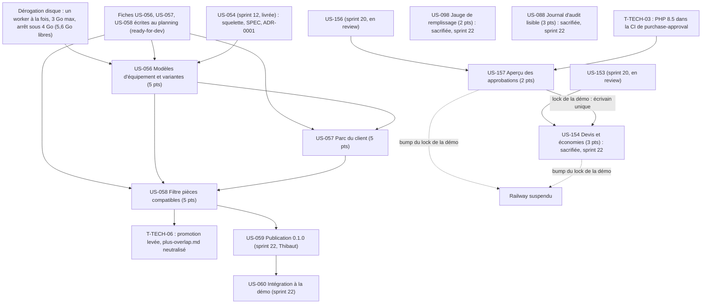

# Dépendances : Sprint 021 (parc d'équipements)

> Périmètre **validé par Thibaut le 2026-10-22** (variante B, 25 points, ramenés à 17 par les sacrifices). US-093, US-101 et US-130 sont retournées au backlog (« reportée, sprint 22+ »). **Sacrifices appliqués le 2026-10-22** : US-154, US-088 et US-098 (reportées au sprint 22) ; réserve : US-157 ; plancher = le MMF (US-056, US-057, US-058).

## Ressources partagées

- **Un seul worker à la fois** sur tout le sprint, budget ≤ 3 Go par worker, arrêt sous 4 Go libres (dérogation encadrée du 2026-10-22 à l'action 1 de la rétro S20) ; nettoyage de ses propres caches, `vendor` et image en fin de tâche.
- US-056, US-057 et US-058 touchent le même dépôt (`sylius-customer-asset-management-plugin`) : les mener l'une après l'autre, dans cet ordre, chacune sur sa branche créée depuis `origin/main` après la fusion de la précédente. Le dépôt est sur une branche fusionnée (`docs/readme-demo-profile`) : ne jamais y committer.
- US-157 et T-TECH-03 (PHP 8.5) et T-TECH-04 (captures) touchent le même dépôt (`sylius-purchase-approval-plugin`) : un seul worker, un seul vendor.
- US-154 (`sylius-company-insights-plugin`) sacrifiée le 2026-10-22, reportée au sprint 22.
- `composer.lock` de la démo à **écrivain unique** : T-157-12 ; jamais en parallèle d'une autre montée de version.
- US-098 et US-088 (démo) sacrifiées le 2026-10-22, reportées au sprint 22 ; `bin/run-tests` exige 5 Go libres.
- T-TECH-06 modifie le dépôt du plugin parc d'équipements (README, `docs/plus-overlap.md`) : dans le worker d'US-058, même PR.

## Ordre de publication

- **Purchase-approval (US-157, v1.3.0)** (company-insights 0.3.0 : US-154 sacrifiée, sprint 22) : tag du plugin après GO de Thibaut, puis Packagist (Thibaut confirme l'indexation), puis vérification de la version publiée, puis bump du `composer.lock` de la démo ; la PR de la démo s'ouvre après cette vérification.
- **Plugin parc d'équipements (nouveau paquet, 0.1.0)** : la préparation de la release est dans le sprint (README, captures, CHANGELOG, CI verte sur PHP 8.2 à 8.5). Le tag, la **soumission du nouveau paquet à Packagist par Thibaut seul**, la vérification et la montée de la démo sont les tâches conditionnelles T-058-12 à T-058-16 (US-059 et US-060, sprint 22 par défaut), après son GO.

## Chemin critique

Dérogation disque (T-TECH-01), puis US-056, US-057, US-058 (15 points, même dépôt, séquentiels, trois PR fusionnées l'une après l'autre ; **T-056-10, GO de push, PR et merge**). US-157 (avec la CI PHP 8.5) est indépendante du MMF et peut passer avant ou après, mais un seul worker à la fois. US-098, US-088 et US-154 sont sacrifiées (sprint 22). Le plugin n'apparaît dans la démo qu'au sprint 22 (US-060), après publication (US-059).
