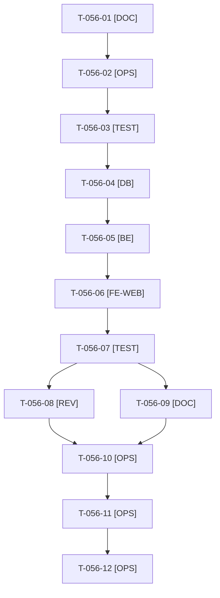

# Tâches : US-056 : Plugin équipements : modèles d'équipement liés aux variantes compatibles (admin)

## Informations US

- **Epic** : EPIC-14
- **Persona** : Sophie (back-office du marchand)
- **Story Points** : 5
- **Sprint** : sprint-21-parc-equipements (MMF (15 points, plancher))
- **Story** : [US-056](../../../backlog/user-stories/US-056.md)

## Résumé de la US

**En tant que** Sophie, gestionnaire du catalogue
**Je veux** créer des modèles d'équipement et indiquer, depuis une variante, les modèles compatibles
**Afin de** que les clients retrouvent ensuite les pièces de leurs machines

## Règles et fichiers visés

- Un seul dépôt : `sylius-customer-asset-management-plugin`, **sur la branche fusionnée `docs/readme-demo-profile`** : `git fetch`, puis branche `feature/us-056-modeles-equipement` créée depuis `origin/main` (d475cdf au cadrage du 2026-10-22). Ne jamais committer sur la branche fusionnée.
- **Matrice CI et `composer.json` lus au cadrage (2026-10-22)** : `php ^8.3`, `sylius/sylius ^2.3` ; CI : PHP 8.3 et 8.4 (Symfony 7.4, Sylius 2.3, MySQL 8.4), PHP 8.3 (Symfony 6.4), PHP 8.4 (Symfony 8.0, MariaDB 11.4, PostgreSQL 17) ; actions non épinglées par SHA (`actions/checkout@v4`, `SyliusLabs/BuildTestAppAction@v4`), aucun bloc `permissions`. **Cible** : PHP 8.2, 8.3, 8.4 et 8.5, actions épinglées par SHA, `permissions: contents: read` (T-056-02).
- Spécification : `SPEC.md` §2 et §3 ; ADR-0001 (tables `equipment_model`, `equipment_model_variant`, compatibilité par variante, index `(equipment_model_id, variant_id)`, migrations préfixées).
- Impact de version : **0.1.0** (nouveau paquet) ; aucun tag dans ce sprint sans le GO de Thibaut. Les fiches sont dans [US-056](../../../backlog/user-stories/US-056.md).
- Règles du sprint, consigne de worker et budget disque : voir [README.md](./README.md).

## Vue d'ensemble des tâches

La colonne « Réalisé par » dit qui fait la tâche : **Claude** seul, **Orchestrateur** (Claude en rôle d'orchestrateur) ou **Thibaut** (action de sa part). Ordre TDD : les tâches [TEST] « rouges » précèdent le code qu'elles décrivent. Un seul worker à la fois sur le sprint.

| ID | Type | Tâche | Estimation | Dépend de | Réalisé par | Statut |
|----|------|-------|------------|-----------|-------------|--------|
| T-056-01 | [DOC] | Cadrage : `git fetch`, branche vérifiée puis `feature/us-056-modeles-equipement` depuis `origin/main` ; relevé `df -h .` et `bin/check-disk` ; matrice CI et `composer.json` relus ; rubriques « versions supportées » et « ordre de publication » ; contrat des entités figé d'après l'ADR-0001 | 1 h | T-TECH-01 | Claude | ✅ |
| T-056-02 | [OPS] | Matrice CI : PHP 8.2 à 8.5 (Symfony `^6.4`, `^7.4`, `^8.0`, Sylius `~2.3.0`, MySQL 8.4, MariaDB 11.4, PostgreSQL 17), actions épinglées par SHA, `permissions: contents: read` ; `composer.json` en `php ^8.2` si Sylius 2.3 le permet (à vérifier) ; PHPStan toujours sauté sur Symfony 6.4 | 1,5 h | T-056-01 | Claude | ✅ |
| T-056-03 | [TEST] | Tests rouges : unitaires (modèle : code, traductions, ajout et retrait de variantes), intégration (schéma et index de la migration, suppression d'un modèle retire ses liens), fonctionnels d'administration (création, code en double, données invalides, 403 sans permission, fiche de variante) | 2 h | T-056-02 | Claude | ✅ |
| T-056-04 | [DB] | Entités `EquipmentModel` et traductions, relation many-to-many avec `ProductVariant` (côté propriétaire sur le modèle), dépôt, migration avec index `(equipment_model_id, variant_id)`, préfixe de la configuration des migrations | 2,5 h | T-056-03 | Claude | ✅ |
| T-056-05 | [BE] | Ressource Sylius des modèles : routes d'administration, grille, formulaire et validation (code unique ≤ 64, nom ≤ 255), permission dédiée, entrée de menu ; libellés FR et EN | 2,5 h | T-056-04 | Claude | ✅ |
| T-056-06 | [FE-WEB] | Extension du formulaire de variante (hook Twig) : champ « Modèles compatibles », gabarit ; nombre de variantes compatibles dans la liste des modèles | 2 h | T-056-05 | Claude | ✅ |
| T-056-07 | [TEST] | Dans Docker : ECS, PHPStan max, Rector, suite complète ; rendu réel FR et EN des écrans, pa11y WCAG2AAA ; migration montée et descendue sur MySQL, MariaDB et PostgreSQL ; lecture du code pour les cellules PHP 8.2 et 8.5 et Symfony 6.4 | 1,25 h | T-056-06 | Claude | ✅ |
| T-056-08 | [REV] | Revue de sécurité (permission, CSRF, validation) rapportée hors dépôt public, et revue de code | 0,5 h | T-056-07 | Claude | ✅ |
| T-056-09 | [DOC] | README EN et FR (installation, administration des modèles), `CHANGELOG.md` [Unreleased], sans comparaison avec Sylius Plus | 0,5 h | T-056-07 | Claude | ✅ |
| T-056-10 | [OPS] | Thibaut donne le GO de push, PR et merge des PR du plugin (US-056 à US-058) ; aucun tag | 0,25 h | T-056-08, T-056-09 | Thibaut | 🔲 |
| T-056-11 | [OPS] | Push, PR vers `main`, matrice complète verte (run terminé), merge | 0,5 h | T-056-10 | Claude | 👀 |
| T-056-12 | [OPS] | Fin de worker : suppression de `vendor`, des caches et de l'image Docker du plugin ; `df -h .` avant et après dans le rapport | 0,25 h | T-056-11 | Claude | ✅ |

**Total estimé : 14,75 h** (12 tâches, dont 1 de Thibaut, soit 0,25 h ; 14,5 h pour Claude).

## Dépendances

Dépendances hors fichier : T-TECH-01.
