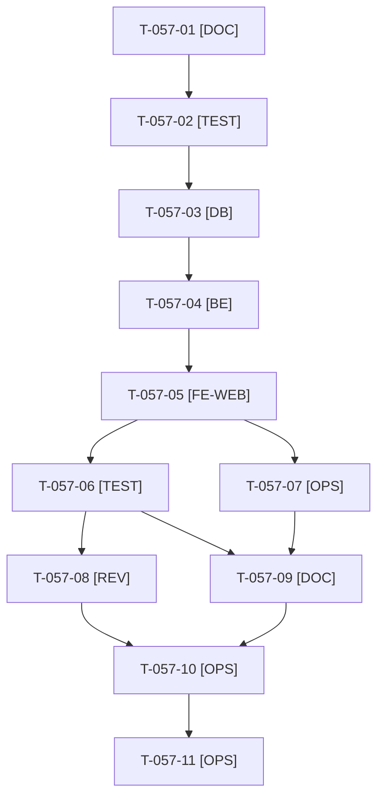

# Tâches : US-057 : Plugin équipements : parc du client dans l'espace client (CRUD)

## Informations US

- **Epic** : EPIC-14
- **Persona** : Claire (acheteuse d'Acme Industries)
- **Story Points** : 5
- **Sprint** : sprint-21-parc-equipements (MMF (15 points, plancher))
- **Story** : [US-057](../../../backlog/user-stories/US-057.md)

## Résumé de la US

**En tant que** Claire, acheteuse
**Je veux** déclarer, modifier et supprimer les machines de mon parc dans mon espace client
**Afin de** que le catalogue sache de quels équipements je m'occupe

## Règles et fichiers visés

- Même dépôt qu'US-056 : branche `feature/us-057-parc-client` depuis `origin/main` **après la fusion d'US-056** (jamais en parallèle).
- Cloisonnement : identifiant étranger ou inconnu = **404**, jamais 403 ; voter sur chaque route ; UUID ; entrées validées côté serveur (`SPEC.md` §4, ADR-0001 décision 3).
- Données personnelles (`SPEC.md` §7) : plaque ou numéro de série jamais journalisés ni dans une URL, supprimés avec le client (`ON DELETE CASCADE` et cascade Doctrine, ADR-0001 décision 5).
- company-accounts est une dépendance optionnelle (`require-dev` et `suggest`) : le voter la détecte à l'exécution ; scénario « avec » et « sans » testés.
- Garde ajoutée ici : un modèle utilisé par un parc ne peut plus être supprimé en administration (scénario de la fiche). Captures au plus tard le jour 5. Fiche : [US-057](../../../backlog/user-stories/US-057.md).
- Règles du sprint, consigne de worker et budget disque : voir [README.md](./README.md).

## Vue d'ensemble des tâches

La colonne « Réalisé par » dit qui fait la tâche : **Claude** seul, **Orchestrateur** (Claude en rôle d'orchestrateur) ou **Thibaut** (action de sa part). Ordre TDD : les tâches [TEST] « rouges » précèdent le code qu'elles décrivent. Un seul worker à la fois sur le sprint.

| ID | Type | Tâche | Estimation | Dépend de | Réalisé par | Statut |
|----|------|-------|------------|-----------|-------------|--------|
| T-057-01 | [DOC] | Cadrage : `git fetch`, `feature/us-057-parc-client` depuis `origin/main` (US-056 fusionnée), branche vérifiée ; relevé du disque ; contrat du voter, détection de company-accounts, règles RGPD relus | 0,75 h | T-056-12 | Claude | 🔲 |
| T-057-02 | [TEST] | Tests rouges : unitaires (entité, validation), voter (propriétaire, membre de l'entreprise avec et sans company-accounts, autre client, visiteur), fonctionnels (CRUD, 404 pour un UUID étranger en lecture, modification et suppression, saisie invalide, redirection d'un visiteur, garde de suppression d'un modèle utilisé, aucune plaque dans les journaux ni les URLs, suppression en cascade) | 2 h | T-057-01 | Claude | 🔲 |
| T-057-03 | [DB] | Entité `CustomerAsset` (UUID, client, modèle, libellé, identifiant), migration (clé étrangère client `ON DELETE CASCADE`, clé étrangère modèle, index), cascade Doctrine | 2 h | T-057-02 | Claude | 🔲 |
| T-057-04 | [BE] | Voter, dépôt par propriétaire ou entreprise (détection de company-accounts), validation serveur (identifiant ≤ 40, sans caractère de contrôle, modèle existant), réponse 404 uniforme, aucun journal de l'identifiant, garde de suppression d'un modèle utilisé | 2,5 h | T-057-03 | Claude | 🔲 |
| T-057-05 | [FE-WEB] | Contrôleurs et routes `/account/equipment`, formulaires, gabarits liste, ajout, modification et suppression avec confirmation, entrée dans le menu du compte ; libellés FR et EN ; mobile ; contraste AAA | 3 h | T-057-04 | Claude | 🔲 |
| T-057-06 | [TEST] | Dans Docker : ECS, PHPStan max, Rector, suite ; rendu réel FR et EN, ordinateur et mobile, pa11y WCAG2AAA ; cascade vérifiée sur MySQL, MariaDB et PostgreSQL | 1,5 h | T-057-05 | Claude | 🔲 |
| T-057-07 | [OPS] | Captures de « Mon matériel » pour le README (application de test, données fictives, sans plaque réelle) ; relevé du disque avant ; **au plus tard le jour 5** | 0,5 h | T-057-05 | Claude | 🔲 |
| T-057-08 | [REV] | Revue de sécurité (voter, cloisonnement, 404, UUID, RGPD) rapportée hors dépôt public, et revue de code | 0,75 h | T-057-06 | Claude | 🔲 |
| T-057-09 | [DOC] | README EN et FR (cloisonnement, données personnelles, limitation du débit laissée à l'application, captures), `CHANGELOG.md` | 0,5 h | T-057-06, T-057-07 | Claude | 🔲 |
| T-057-10 | [OPS] | Push, PR vers `main`, matrice complète verte (run terminé), merge (GO de T-056-10) | 0,5 h | T-057-08, T-057-09 | Claude | 🔲 |
| T-057-11 | [OPS] | Fin de worker : suppression de `vendor`, des caches et de l'image Docker du plugin ; `df -h .` avant et après | 0,25 h | T-057-10 | Claude | 🔲 |

**Total estimé : 14,25 h** (11 tâches, dont 0 de Thibaut, soit 0 h ; 14,25 h pour Claude).

## Dépendances

Dépendances hors fichier : T-056-12.
