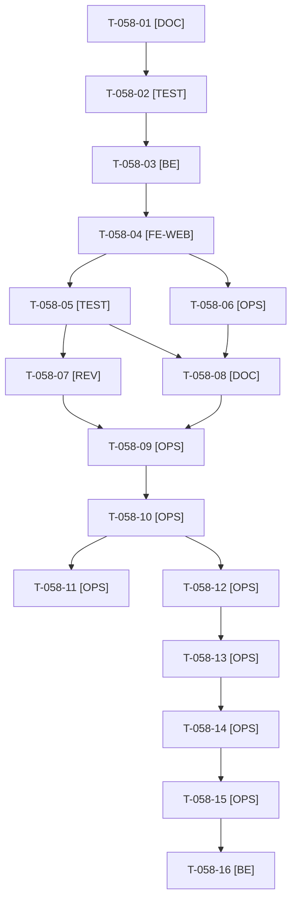

# Tâches : US-058 : Plugin équipements : filtre « pièces compatibles » au catalogue

## Informations US

- **Epic** : EPIC-14
- **Persona** : Claire (acheteuse d'Acme Industries)
- **Story Points** : 5
- **Sprint** : sprint-21-parc-equipements (MMF (15 points, plancher))
- **Story** : [US-058](../../../backlog/user-stories/US-058.md)

## Résumé de la US

**En tant que** Claire, qui gère un parc déclaré
**Je veux** filtrer le catalogue sur les pièces compatibles avec mon matériel
**Afin de** trouver la bonne pièce sans appeler le vendeur

## Règles et fichiers visés

- Même dépôt : branche `feature/us-058-filtre-compatibilite` depuis `origin/main` après la fusion d'US-057.
- Filtre par **extension de la requête de listing** de Sylius 2.3 (sous-requête `EXISTS`, ADR-0001 décision 4), activé par un paramètre de requête, état en session et dans l'URL ; contrôle proposé seulement à un client connecté dont le parc n'est pas vide ; repli sans filtre sinon.
- Aucune requête de compatibilité tant que le filtre n'est pas activé (test du nombre de requêtes).
- Préparation de la release **0.1.0** dans le sprint (README complet, captures, `CHANGELOG.md`, CI verte) : le tag, la soumission Packagist et la montée de la démo sont les tâches **conditionnelles** T-058-12 à T-058-16 (US-059 et US-060, sprint 22 par défaut), hors total.
- Décision de Thibaut du 2026-10-22 : promotion levée, **sans comparaison avec Sylius Plus** dans les textes publics ; `docs/plus-overlap.md` et la mention de suspension du README du plugin sont neutralisés par T-TECH-06 (même worker). Fiche : [US-058](../../../backlog/user-stories/US-058.md).
- Règles du sprint, consigne de worker et budget disque : voir [README.md](./README.md).

## Vue d'ensemble des tâches

La colonne « Réalisé par » dit qui fait la tâche : **Claude** seul, **Orchestrateur** (Claude en rôle d'orchestrateur) ou **Thibaut** (action de sa part). Ordre TDD : les tâches [TEST] « rouges » précèdent le code qu'elles décrivent. Un seul worker à la fois sur le sprint.

| ID | Type | Tâche | Estimation | Dépend de | Réalisé par | Statut |
|----|------|-------|------------|-----------|-------------|--------|
| T-058-01 | [DOC] | Cadrage : `git fetch`, `feature/us-058-filtre-compatibilite` depuis `origin/main` (US-057 fusionnée) ; relevé du disque ; méthode de listing du dépôt de produits de Sylius 2.3 (taxons et recherche), hooks Twig des listes, état en session | 0,75 h | T-057-11 | Claude | 🔲 |
| T-058-02 | [TEST] | Tests rouges : extension de requête (`EXISTS`, tout le parc ou une machine, parc vide, visiteur, machine d'un autre client ignorée), état en session et dans l'URL, message « aucune pièce compatible », nombre de requêtes sans filtre actif ; fixtures d'un catalogue de 40 produits dont 12 compatibles | 2 h | T-058-01 | Claude | 🔲 |
| T-058-03 | [BE] | Extension de la requête de listing, état du filtre (session et requête, identifiant de machine validé et rattaché au client), décision « contrôle proposé » | 3 h | T-058-02 | Claude | 🔲 |
| T-058-04 | [FE-WEB] | Contrôle « Compatible avec mon matériel » sur les listes de catégories et la recherche (hooks Twig), message vide et lien « Retirer le filtre » ; libellés FR et EN ; clavier ; contraste AAA ; mobile | 2 h | T-058-03 | Claude | 🔲 |
| T-058-05 | [TEST] | Dans Docker : ECS, PHPStan max, Rector, suite ; rendu réel FR et EN, pa11y WCAG2AAA ; `EXPLAIN` de la requête sur MySQL, MariaDB et PostgreSQL (index utilisé) ; lecture du code pour PHP 8.2 et 8.5 | 1,5 h | T-058-04 | Claude | 🔲 |
| T-058-06 | [OPS] | Captures du filtre (avec et sans filtre, ordinateur et mobile) pour le README ; relevé du disque avant ; **au plus tard le jour 5** | 0,5 h | T-058-04 | Claude | 🔲 |
| T-058-07 | [REV] | Revue de sécurité (identifiant de machine dans l'URL, cloisonnement, absence de fuite) rapportée hors dépôt public, et revue de code | 0,5 h | T-058-05 | Claude | 🔲 |
| T-058-08 | [DOC] | README EN et FR complet (installation, configuration, usage, limites du listing, versions supportées, captures), `CHANGELOG.md` prêt pour la 0.1.0, statut des tranches dans `SPEC.md` | 1 h | T-058-05, T-058-06 | Claude | 🔲 |
| T-058-09 | [OPS] | Push, PR vers `main`, matrice complète verte (run terminé), merge (GO de T-056-10) | 0,5 h | T-058-07, T-058-08 | Claude | 🔲 |
| T-058-10 | [OPS] | Préparation de la release 0.1.0 : CI de `main` verte sur PHP 8.2 à 8.5, `composer validate --strict`, `branch-alias`, script du scratchpad à OK ou FAIL (tag et vérification Packagist) remis à Thibaut ; aucun tag | 0,5 h | T-058-09, T-TECH-10 | Claude | 🔲 |
| T-058-11 | [OPS] | Fin de worker : suppression de `vendor`, des caches et de l'image Docker du plugin ; `df -h .` avant et après | 0,25 h | T-058-10 | Claude | 🔲 |

**Total estimé : 12,5 h** (11 tâches, dont 0 de Thibaut, soit 0 h ; 12,5 h pour Claude).

## Tâches conditionnelles (hors total) : publication de la 0.1.0

Elles relèvent d'US-059 et d'US-060 (sprint 22 par défaut). Elles ne sont engagées dans le sprint 21 que si Thibaut donne son GO avant la fin du sprint et que la capacité le permet ; elles ne sont **pas comptées** dans le total ni dans la capacité. Ordre de publication : tag après le GO, soumission du nouveau paquet à Packagist par Thibaut seul, vérification de la version publiée, puis seulement la montée de la démo.

| ID | Type | Tâche | Estimation | Dépend de | Réalisé par | Statut |
|----|------|-------|------------|-----------|-------------|--------|
| T-058-12 | [OPS] | Thibaut donne le GO du tag et de la release `v0.1.0` du plugin parc d'équipements | 0,25 h | T-058-10 | Thibaut | 📅 |
| T-058-13 | [OPS] | Tag `v0.1.0` et release GitHub (CI de `main` verte) | 0,5 h | T-058-12 | Claude | 📅 |
| T-058-14 | [OPS] | Thibaut soumet le **nouveau paquet** à Packagist (URL du dépôt) et confirme l'indexation de la 0.1.0 | 0,5 h | T-058-13 | Thibaut | 📅 |
| T-058-15 | [OPS] | Vérification de la version publiée (script du scratchpad à OK ou FAIL) avant toute PR de la démo | 0,25 h | T-058-14 | Claude | 📅 |
| T-058-16 | [BE] | Démo : `php -d memory_limit=1G composer require tmonier/sylius-customer-asset-management-plugin:^0.1`, `composer.lock` écrit seul (le reste de l'intégration est US-060, sprint 22) | 1 h | T-058-15 | Claude | 📅 |

**Total conditionnel : 2,5 h** (5 tâches, dont 2 de Thibaut, soit 0,75 h).

## Dépendances

Dépendances hors fichier : T-057-11, T-TECH-10.
