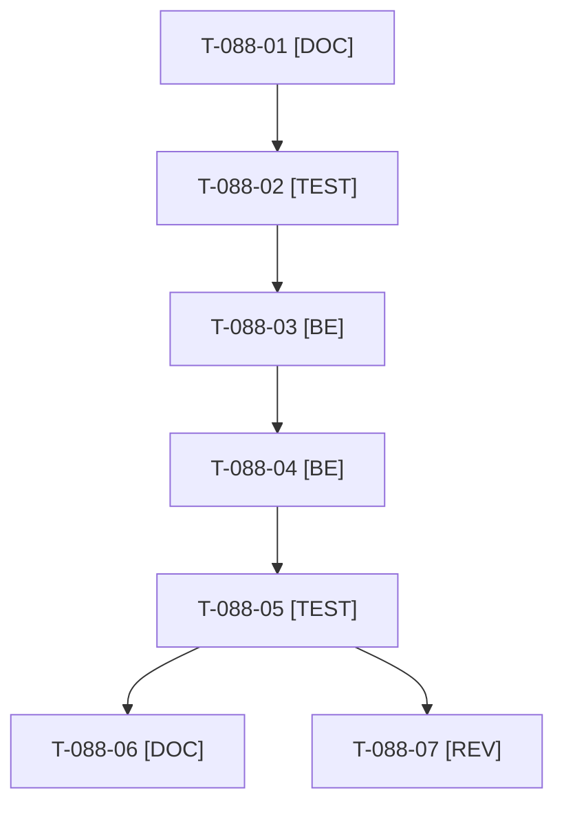

# Tâches : US-088 : Journal d'audit lisible : reset masqué et événements métier

> **⚠️ SACRIFIÉE le 2026-10-22 (capacité) : reportée au sprint 22.** Statut backlog ; ces tâches (7,25 h) sont conservées pour mémoire, hors périmètre et hors total du sprint 21 (17 points engagés, ~61 h).

## Informations US

- **Epic** : EPIC-11
- **Persona** : Sophie (back-office du marchand)
- **Story Points** : 3
- **Sprint** : sprint-21-parc-equipements (sacrifiée le 2026-10-22, reportée au sprint 22)
- **Story** : [US-088](../../../backlog/user-stories/US-088.md)

## Résumé de la US

**En tant que** Sophie (back-office)
**Je veux** un journal d'audit sans les créations de la remise à zéro, mais avec quelques événements métier
**Afin de** démontrer l'audit sans bruit

## Règles et fichiers visés

- Dépôt de la démo seul : `src/Demo/DataFixtures/AuditLogDemoFixture.php`, commande `app:demo:reset`, plugin `sylius-audit-log-plugin` (`^1.0`, lecture seule).
- Les écritures du reset sont exclues (ou purgées en fin de reset) ; 5 à 6 événements métier rejoués (prix, validation d'inscription, plafond, approbation) ; une modification réelle d'un visiteur reste journalisée ; test d'intégration qui échoue si le filtre est désactivé. Fiche : [US-088](../../../backlog/user-stories/US-088.md).
- Règles du sprint, consigne de worker et budget disque : voir [README.md](./README.md).

## Vue d'ensemble des tâches

La colonne « Réalisé par » dit qui fait la tâche : **Claude** seul, **Orchestrateur** (Claude en rôle d'orchestrateur) ou **Thibaut** (action de sa part). Ordre TDD : les tâches [TEST] « rouges » précèdent le code qu'elles décrivent. Un seul worker à la fois sur le sprint.

| ID | Type | Tâche | Estimation | Dépend de | Réalisé par | Statut |
|----|------|-------|------------|-----------|-------------|--------|
| T-088-01 | [DOC] | Cadrage : `AuditLogDemoFixture`, `app:demo:reset`, écouteur du plugin d'audit et ses points d'extension lus ; choix « exclure » ou « purger » consigné | 0,75 h | T-TECH-01 | Claude | 🔲 |
| T-088-02 | [TEST] | Tests rouges : journal sans ligne de reset, 5 à 6 événements métier datés et attribués, deux resets de suite sans doublon, modification réelle journalisée, échec explicite si le filtre est désactivé | 1,5 h | T-088-01 | Claude | 🔲 |
| T-088-03 | [BE] | Exclusion des écritures de la remise à zéro du journal (ou purge en fin de reset), sans toucher aux écritures des visiteurs | 2 h | T-088-02 | Claude | 🔲 |
| T-088-04 | [BE] | Rejeu de 5 à 6 événements métier (prix, validation d'inscription, plafond, approbation) attribués à des comptes de démo, dates cohérentes | 1,5 h | T-088-03 | Claude | 🔲 |
| T-088-05 | [TEST] | Reset réel exécuté deux fois ; rendu réel du journal FR et EN, pa11y WCAG2AAA ; suite via `bin/run-tests`, ECS (`src tests`), PHPStan | 1 h | T-088-04 | Claude | 🔲 |
| T-088-06 | [DOC] | `docs/remise-a-zero-demo.md` mis à jour (journal propre, événements rejoués) | 0,25 h | T-088-05 | Claude | 🔲 |
| T-088-07 | [REV] | Revue (aucun secret, chiffres vérifiables, parité FR et EN) | 0,25 h | T-088-05 | Claude | 🔲 |

**Total estimé : 7,25 h** (7 tâches, dont 0 de Thibaut, soit 0 h ; 7,25 h pour Claude).

## Dépendances

Dépendances hors fichier : T-TECH-01.
