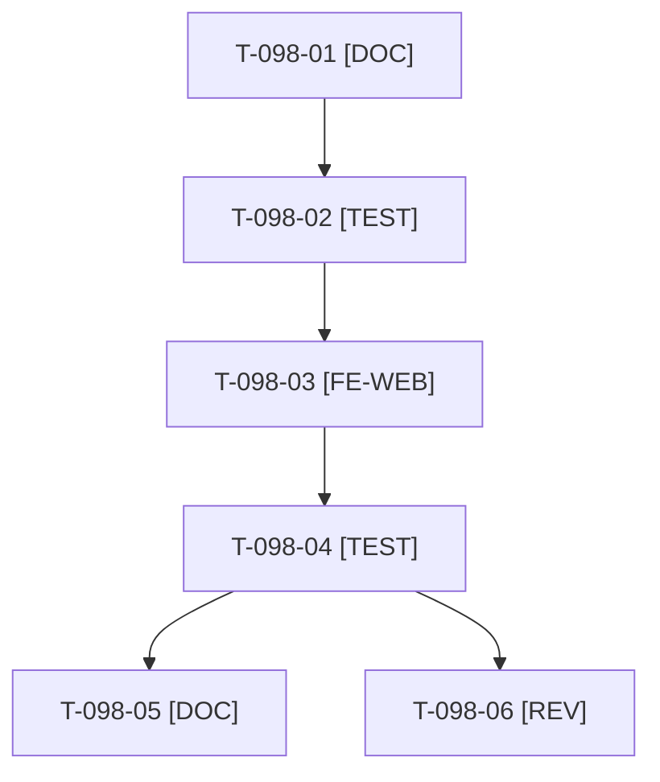

# Tâches : US-098 : Jauge de remplissage condensée sur la fiche produit

> **⚠️ SACRIFIÉE le 2026-10-22 (capacité) : reportée au sprint 22.** Statut backlog ; ces tâches (4 h) sont conservées pour mémoire, hors périmètre et hors total du sprint 21 (17 points engagés, ~61 h).

## Informations US

- **Epic** : EPIC-11
- **Persona** : Nadia (responsable e-commerce B2B)
- **Story Points** : 2
- **Sprint** : sprint-21-parc-equipements (sacrifiée le 2026-10-22, reportée au sprint 22)
- **Story** : [US-098](../../../backlog/user-stories/US-098.md)

## Résumé de la US

**En tant que** Nadia
**Je veux** une jauge de remplissage qui n'affiche que les contenants pertinents
**Afin de** la lire sans effort

## Règles et fichiers visés

- Dépôt de la démo seul (aucun tag de plugin) ; confirmer au cadrage si le gabarit vit dans la démo (`templates/shop/container_fill/`) ou dans le plugin container-fill (alors surcharge de gabarit dans la démo, pas de release).
- Contenant pertinent = taux strictement supérieur à 0 % ; les autres dans un `
` natif ; bloc masqué sans donnée. Fiche : [US-098](../../../backlog/user-stories/US-098.md).
- Tests via `bin/run-tests` seulement ; `bin/run-tests` refuse de démarrer sous 5 Go libres (voir le risque disque du README).
- Règles du sprint, consigne de worker et budget disque : voir [README.md](./README.md).

## Vue d'ensemble des tâches

La colonne « Réalisé par » dit qui fait la tâche : **Claude** seul, **Orchestrateur** (Claude en rôle d'orchestrateur) ou **Thibaut** (action de sa part). Ordre TDD : les tâches [TEST] « rouges » précèdent le code qu'elles décrivent. Un seul worker à la fois sur le sprint.

| ID | Type | Tâche | Estimation | Dépend de | Réalisé par | Statut |
|----|------|-------|------------|-----------|-------------|--------|
| T-098-01 | [DOC] | Cadrage : gabarit de la jauge et `docs/remplissage-contenants.md` lus, définition de « pertinent », emplacement du rendu (démo ou plugin) | 0,5 h | T-TECH-01 | Claude | 🔲 |
| T-098-02 | [TEST] | Tests rouges : 2 contenants pertinents sur 9, détails repliables au clavier, 9 sur 9 sans contrôle « détails », aucune donnée de contenant (bloc masqué), `
` sans JavaScript | 1 h | T-098-01 | Claude | 🔲 |
| T-098-03 | [FE-WEB] | Gabarit : filtre des contenants pertinents, `
` des autres, libellés FR et EN, contraste AAA | 1,25 h | T-098-02 | Claude | 🔲 |
| T-098-04 | [TEST] | Rendu réel FR et EN, pa11y WCAG2AAA, `bin/measure-mobile` ; suite ciblée via `bin/run-tests`, ECS (`src tests`), PHPStan | 0,75 h | T-098-03 | Claude | 🔲 |
| T-098-05 | [DOC] | `docs/remplissage-contenants.md` mis à jour | 0,25 h | T-098-04 | Claude | 🔲 |
| T-098-06 | [REV] | Revue (ton neutre, parité FR et EN, accessibilité) | 0,25 h | T-098-04 | Claude | 🔲 |

**Total estimé : 4 h** (6 tâches, dont 0 de Thibaut, soit 0 h ; 4 h pour Claude).

## Dépendances

Dépendances hors fichier : T-TECH-01.
