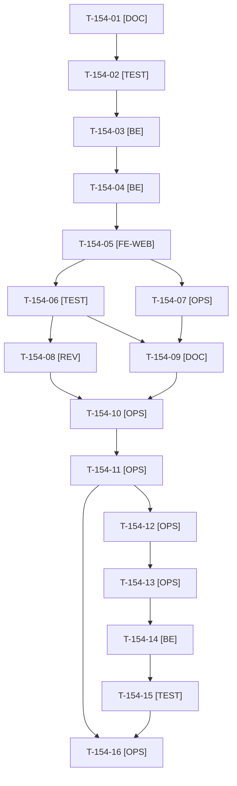

# Tâches : US-154 : Company-insights : conversion des devis et économies des prix dégressifs

> **⚠️ SACRIFIÉE le 2026-10-22 (capacité) : reportée au sprint 22.** Statut backlog ; ces tâches (13,25 h) sont conservées pour mémoire, hors périmètre et hors total du sprint 21 (17 points engagés, ~61 h).

## Informations US

- **Epic** : EPIC-15
- **Persona** : Isabelle (administratrice d'Acme Industries)
- **Story Points** : 3
- **Sprint** : sprint-21-parc-equipements (sacrifiée le 2026-10-22, reportée au sprint 22)
- **Story** : [US-154](../../../backlog/user-stories/US-154.md)

## Résumé de la US

**En tant que** Isabelle
**Je veux** savoir combien de nos demandes de devis aboutissent et ce que nous ont fait économiser les prix dégressifs
**Afin de** mesurer la valeur de nos conditions négociées

## Règles et fichiers visés

- Deux dépôts : `sylius-company-insights-plugin` (release mineure **0.3.0**, dernier tag v0.2.1) et la démo. `git fetch`, puis branche `feature/us-154-devis-et-economies` depuis `origin/main`.
- Widgets sur l'interface `InsightsWidgetProviderInterface` (US-153) ; plugins compagnons `quote-request` et `tier-pricing` **optionnels** (détection à l'exécution, widget absent sans erreur) ; chiffres issus des services publics, jamais des tables ; économie calculée sur le prix figé de la ligne de commande.
- Matrice CI et `composer.json` relus au cadrage (T-154-01). Lock de la démo : T-157-12 d'abord (écrivain unique). Fiche : [US-154](../../../backlog/user-stories/US-154.md).
- Règles du sprint, consigne de worker et budget disque : voir [README.md](./README.md).

## Vue d'ensemble des tâches

La colonne « Réalisé par » dit qui fait la tâche : **Claude** seul, **Orchestrateur** (Claude en rôle d'orchestrateur) ou **Thibaut** (action de sa part). Ordre TDD : les tâches [TEST] « rouges » précèdent le code qu'elles décrivent. Un seul worker à la fois sur le sprint.

| ID | Type | Tâche | Estimation | Dépend de | Réalisé par | Statut |
|----|------|-------|------------|-----------|-------------|--------|
| T-154-01 | [DOC] | Cadrage : `git fetch`, branche depuis `origin/main` (v0.2.1), branche vérifiée ; matrice CI et `composer.json` relus ; services publics de quote-request et tier-pricing, prix de base disponible dans la ligne de commande, `InsightsWidgetProviderInterface` lus ; rubriques « versions » et « ordre de publication » | 1 h | T-TECH-01, T-157-15 | Claude | 🔲 |
| T-154-02 | [TEST] | Tests rouges : indicateurs des devis (4 demandes, 3 devis, 2 commandes, 67 %, délai médian, expirés), économie (120 casques à 9 € au lieu de 11 € = 240 € HT), grille modifiée après l'achat, un seul compagnon, aucun compagnon, période sans demande, service en erreur | 1,5 h | T-154-01 | Claude | 🔲 |
| T-154-03 | [BE] | Widget « Devis » (fournisseur de widget, permission, taux « non applicable » sans demande, repli « Données indisponibles ») | 2 h | T-154-02 | Claude | 🔲 |
| T-154-04 | [BE] | Widget « Économies » (différence prix de base et prix figé, sommée sur la période, rapportée à la dépense HT) | 2 h | T-154-03 | Claude | 🔲 |
| T-154-05 | [FE-WEB] | Rendu des deux widgets avec tableau équivalent ; libellés FR et EN, libellé factuel « Économies sur prix dégressifs » ; contraste AAA ; mobile | 1 h | T-154-04 | Claude | 🔲 |
| T-154-06 | [TEST] | Dans Docker : ECS, PHPStan max, Rector, suite avec et sans compagnons ; rendu réel FR et EN, pa11y WCAG2AAA ; lecture du code pour les cellules PHP 8.2 et Symfony 6.4 | 1 h | T-154-05 | Claude | 🔲 |
| T-154-07 | [OPS] | Captures des deux widgets pour le README (application de test, données fictives) ; relevé du disque avant ; au plus tard le jour 5 si la story est maintenue | 0,5 h | T-154-05 | Claude | 🔲 |
| T-154-08 | [REV] | Revue (économie sur prix figé, cloisonnement entreprise, journal sans donnée de commande) rapportée hors dépôt public, et revue de code | 0,5 h | T-154-06 | Claude | 🔲 |
| T-154-09 | [DOC] | README EN et FR (deux widgets, plugins optionnels, versions supportées), `CHANGELOG.md` de la 0.3.0, captures | 0,5 h | T-154-06, T-154-07 | Claude | 🔲 |
| T-154-10 | [OPS] | Thibaut donne le GO du tag et de la release `v0.3.0` de company-insights | 0,25 h | T-154-08, T-154-09 | Thibaut | 🔲 |
| T-154-11 | [OPS] | Push, PR, matrice complète verte (run terminé), merge, tag `v0.3.0` et release GitHub ; script de vérification Packagist remis à Thibaut | 0,75 h | T-154-10, T-TECH-10 | Claude | 🔲 |
| T-154-12 | [OPS] | Thibaut confirme que Packagist indexe la 0.3.0 (paquet déjà soumis) | 0,25 h | T-154-11 | Thibaut | 🔲 |
| T-154-13 | [OPS] | Vérification de la version publiée (script du scratchpad à OK ou FAIL) avant toute PR de la démo | 0,25 h | T-154-12 | Claude | 🔲 |
| T-154-14 | [BE] | Démo : `php -d memory_limit=1G composer require tmonier/sylius-company-insights-plugin:^0.3` ; `composer.lock` écrit seul (après T-157-12) | 0,5 h | T-154-13, T-157-12 | Claude | 🔲 |
| T-154-15 | [TEST] | Tests de la démo : widgets d'Acme (devis, économies), TechParts absent des chiffres d'Acme ; scénario d'Isabelle dans `config/demo/plugins.yaml` et `docs/vitrine-plugins.md` ; rendu réel et pa11y ; suite via `bin/run-tests`, ECS (`src tests`), PHPStan | 1 h | T-154-14 | Claude | 🔲 |
| T-154-16 | [OPS] | Fin de worker : suppression de `vendor`, des caches et de l'image du plugin, puis des caches du worker de démo ; `df -h .` avant et après | 0,25 h | T-154-11, T-154-15 | Claude | 🔲 |

**Total estimé : 13,25 h** (16 tâches, dont 2 de Thibaut, soit 0,5 h ; 12,75 h pour Claude).

## Dépendances

Dépendances hors fichier : T-157-12, T-157-15, T-TECH-01, T-TECH-10.
