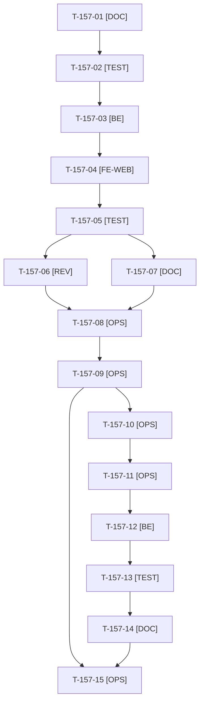

# Tâches : US-157 : Purchase-approval : aperçu des approbations en attente depuis l'en-tête

## Informations US

- **Epic** : EPIC-07
- **Persona** : Paul (approbateur d'Acme Industries)
- **Story Points** : 2
- **Sprint** : sprint-21-parc-equipements (sacrifice n°4)
- **Story** : [US-157](../../../backlog/user-stories/US-157.md)

## Résumé de la US

**En tant que** Paul, approbateur d'Acme Industries
**Je veux** qu'un clic sur « Approbations » dans l'en-tête m'affiche les dernières commandes à décider
**Afin de** ouvrir directement la plus urgente sans repasser par mon compte

## Règles et fichiers visés

- Deux dépôts : `sylius-purchase-approval-plugin` (release mineure **v1.3.0**, dernier tag v1.2.0, branche locale `main`) et la démo. `git fetch`, puis branche `feature/us-157-apercu-approbations` depuis `origin/main`.
- **Matrice CI et `composer.json` lus au cadrage** : `php ^8.2`, `sylius/sylius ^2.2.9 || ^2.3`, Symfony `^6.4 || ^7.4 || ^8.0` ; CI : PHP 8.2 (Sylius 2.2, Symfony 6.4), 8.3 et 8.4 (Symfony 7.4), 8.3 (Sylius 2.3, Symfony 6.4), 8.4 (Symfony 8) ; **PHP 8.5 et bloc `permissions` absents** : ajoutés par T-TECH-03 dans la même PR (écart T-TECH-08 du sprint 20).
- Prolonge US-156 (compteur d'en-tête) : panneau de 5 approbations les plus anciennes à décider, chargé au premier clic (Turbo Frame), aucune décision depuis le panneau, repli sans JavaScript vers la liste.
- Grouper T-TECH-03 et T-TECH-04 (même dépôt, même worker, un seul vendor). Fiche : [US-157](../../../backlog/user-stories/US-157.md).
- Règles du sprint, consigne de worker et budget disque : voir [README.md](./README.md).

## Vue d'ensemble des tâches

La colonne « Réalisé par » dit qui fait la tâche : **Claude** seul, **Orchestrateur** (Claude en rôle d'orchestrateur) ou **Thibaut** (action de sa part). Ordre TDD : les tâches [TEST] « rouges » précèdent le code qu'elles décrivent. Un seul worker à la fois sur le sprint.

| ID | Type | Tâche | Estimation | Dépend de | Réalisé par | Statut |
|----|------|-------|------------|-----------|-------------|--------|
| T-157-01 | [DOC] | Cadrage : `git fetch`, branche depuis `origin/main` (v1.2.0), branche vérifiée ; matrice CI et `composer.json` relus ; hooks de l'en-tête d'US-156, Turbo Frame ou composant Live ; contrat du panneau (5 plus anciennes décidables, échéance `expire_after_days`) | 0,75 h | T-TECH-01 | Claude | 🔲 |
| T-157-02 | [TEST] | Tests rouges : 5 plus anciennes dans l'ordre, lien « Tout voir (N) », mention « expire dans N jours », cloisonnement par entreprise et par limite d'approbation, aucune requête sans clic, 403 sans la permission `APPROVAL_LIST` | 1,25 h | T-157-01 | Claude | 🔲 |
| T-157-03 | [BE] | Contrôleur de fragment et requête (les 5 plus anciennes à décider par ce membre, total, échéance), permission, chargement différé | 1,5 h | T-157-02 | Claude | 🔲 |
| T-157-04 | [FE-WEB] | Panneau d'en-tête : bouton `aria-expanded`, Turbo Frame chargé au premier clic, fermeture par Échap, focus rendu au bouton, repli sans JavaScript ; libellés FR et EN ; contraste AAA ; cible de 44 px | 1,75 h | T-157-03 | Claude | 🔲 |
| T-157-05 | [TEST] | Dans Docker : ECS, PHPStan max, Rector, suite ; rendu réel FR et EN, ordinateur et mobile, pa11y WCAG2AAA ; lecture du code pour PHP 8.2 et Symfony 6.4 | 1 h | T-157-04 | Claude | 🔄 |
| T-157-06 | [REV] | Revue (permission, cloisonnement, aucune donnée personnelle superflue) rapportée hors dépôt public, et revue de code | 0,5 h | T-157-05 | Claude | 🔲 |
| T-157-07 | [DOC] | README EN et FR (panneau, versions supportées), `CHANGELOG.md` de la v1.3.0, captures de T-TECH-04 | 0,5 h | T-157-05, T-TECH-04 | Claude | 🔲 |
| T-157-08 | [OPS] | Thibaut donne le GO du tag et de la release `v1.3.0` de purchase-approval | 0,25 h | T-157-06, T-157-07 | Thibaut | 🔲 |
| T-157-09 | [OPS] | Push, PR, matrice complète verte dont PHP 8.5 (run terminé), merge, tag `v1.3.0` et release GitHub ; script de vérification Packagist remis à Thibaut | 0,75 h | T-157-08, T-TECH-03, T-TECH-10 | Claude | 🔲 |
| T-157-10 | [OPS] | Thibaut confirme que Packagist indexe la v1.3.0 | 0,25 h | T-157-09 | Thibaut | 🔲 |
| T-157-11 | [OPS] | Vérification de la version publiée (script du scratchpad à OK ou FAIL) avant toute PR de la démo | 0,25 h | T-157-10 | Claude | 🔲 |
| T-157-12 | [BE] | Démo : `php -d memory_limit=1G composer require tmonier/sylius-purchase-approval-plugin:^1.3` ; `composer.lock` écrit seul (avant T-154-14) | 0,5 h | T-157-11 | Claude | 🔲 |
| T-157-13 | [TEST] | Tests de la démo : panneau de Paul (5 plus anciennes, « Tout voir »), entrée d'Isabelle, aucune entrée pour Claire ni pour un visiteur, parcours d'US-156 inchangés ; rendu réel et pa11y ; suite via `bin/run-tests`, ECS (`src tests`), PHPStan | 1,25 h | T-157-12 | Claude | 🔲 |
| T-157-14 | [DOC] | Parcours guidé de Paul (`config/demo/plugins.yaml`) et `docs/vitrine-plugins.md` mis à jour | 0,25 h | T-157-13 | Claude | 🔲 |
| T-157-15 | [OPS] | Fin de worker : suppression de `vendor`, des caches et de l'image du plugin (après T-157-09), puis des caches du worker de démo ; `df -h .` avant et après | 0,25 h | T-157-09, T-157-14 | Claude | 🔲 |

**Total estimé : 11 h** (15 tâches, dont 2 de Thibaut, soit 0,5 h ; 10,5 h pour Claude).

## Dépendances

Dépendances hors fichier : T-TECH-01, T-TECH-03, T-TECH-04, T-TECH-10.
