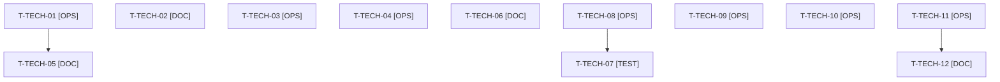

# Tâches transverses : actions de la rétrospective du sprint 20, reprises et clôture de l'orchestrateur

Tâches **sans points** : elles comptent dans les heures, pas dans les 25 points. Elles portent les cinq actions de la rétrospective du sprint 20 (voir [../sprint-goal.md](../sprint-goal.md)) : budget disque des workers de plugins (1, ici en dérogation encadrée), gabarit de l'orchestrateur et statuts à jour (2), gabarit de CI et PHP 8.5 pour purchase-approval (3), arbitrage du sprint 21 (4, fait au planning du 2026-10-22), déploiement et vérification en production (5, bloquée). Elles portent aussi la reprise de T-113-06 et la levée de la suspension de promotion du plugin parc d'équipements.

## Vue d'ensemble des tâches

| ID | Type | Tâche | Estimation | Dépend de | Réalisé par | Statut |
|----|------|-------|------------|-----------|-------------|--------|
| T-TECH-01 | [OPS] | Dérogation disque encadrée (décision de Thibaut du 2026-10-22, écart à l'action 1 de la rétro S20) : relevé `df -h .` et `bin/check-disk` au planning et avant chaque worker, `bin/clean-test-caches`, règles consignées dans les consignes de worker (un seul worker, ≤ 3 Go, nettoyage en fin de tâche, arrêt sous 4 Go libres) ; relevé noté dans le sprint-goal | 0,75 h | - | Orchestrateur | 🔲 |
| T-TECH-02 | [DOC] | Gabarit de l'orchestrateur (action 2 de la rétro S20, reprise de T-TECH-04 du S20) : gate recoupé avec la somme des points du fichier de statut (écart affiché), « un refus d'outil n'arrête jamais le sprint », et ligne de tâche mise à jour dans le fichier de tâches pour toute tâche faite dans un autre dépôt | 0,5 h | - | Orchestrateur | 🔲 |
| T-TECH-03 | [OPS] | PHP 8.5 dans la CI de purchase-approval (action 3 de la rétro S20, écart T-TECH-08 du S20) : gabarit de CI de plugin documenté dans `docs/` (PHP 8.2 à 8.5, actions épinglées par SHA, `permissions` minimal) à partir de company-insights, appliqué à purchase-approval dans la PR de la v1.3.0 ; CI verte sur PHP 8.5 | 1,5 h | T-157-01 | Claude | 🔲 |
| T-TECH-04 | [OPS] | Captures du README de purchase-approval (reprise de T-156-06 du S20 : en-tête ordinateur et mobile, puis panneau d'US-157) ; relevé du disque avant ; au plus tard le jour 5 | 0,5 h | T-157-04 | Claude | 🔲 |
| T-TECH-05 | [DOC] | Reprise de T-113-06 du S20 : documentation à jour (`docs/theme-b2b.md`, README de la démo) et captures d'accueil pour le README de la démo ; relevé du disque avant ; au plus tard le jour 5 | 0,5 h | T-TECH-01 | Claude | 🔲 |
| T-TECH-06 | [DOC] | Promotion levée (décision de Thibaut du 2026-10-22) dans le dépôt du plugin parc d'équipements : `docs/plus-overlap.md` et mention « Promotion suspended » du README neutralisés, sans comparaison avec Sylius Plus dans les textes publics ; fait dans le worker d'US-058 (même dépôt, même PR) | 0,5 h | T-058-08 | Claude | 🔲 |
| T-TECH-07 | [TEST] | Vérification en production des sprints 18 à 20 dès la reprise de Railway (action 5 de la rétro S20) : checks du runbook (`docs/ouverture-publique.md`, `docs/deploiement-railway.md`) et un contrôle par story livrée ; anomalies ouvertes en backlog, rien de sensible dans le dépôt public. **Bloquée** : Railway suspendu | 2 h | T-TECH-08 | Claude | 🚫 |
| T-TECH-08 | [OPS] | Thibaut déploie d'un coup les PR #43 à #49 (et suivantes) sur Railway à la reprise ; aucune commande Railway par Claude. **Bloquée** : plateforme suspendue | 0,5 h | - | Thibaut | 🚫 |
| T-TECH-09 | [OPS] | ECS et PHPStan rejoués sur l'arbre exact avant chaque push (démo et trois dépôts de plugins, dans Docker) ; dernière ligne de sortie citée dans le rapport | 1 h | - | Orchestrateur | 🔲 |
| T-TECH-10 | [OPS] | Scripts du scratchpad pour les commandes de Thibaut, à OK ou FAIL par élément : tags `v0.1.0` (conditionnel), `v1.3.0`, `v0.3.0`, vérification Packagist, `composer` avec `php -d memory_limit=1G` | 0,75 h | - | Orchestrateur | 🔲 |
| T-TECH-11 | [OPS] | Reconstruction de l'image et démarrage du conteneur (`/healthz`) par l'orchestrateur avant la revue, puis après tout correctif touchant l'image (un seul build à la fois, image supprimée ensuite) | 0,75 h | T-088-05, T-098-04, T-157-13, T-154-15 | Orchestrateur | 🔲 |
| T-TECH-12 | [DOC] | Bilan des indicateurs de la rétro S20 (arrêts dus au disque, captures reportées, écart de gate, tâches livrées restées 🔲, CI de purchase-approval sur PHP 8.5) préparé pour la rétro du 2027-04-16 | 0,5 h | T-TECH-11 | Orchestrateur | 🔲 |

**Total estimé : 9,75 h** (12 tâches, dont 1 de Thibaut, soit 0,5 h ; 9,25 h pour Claude et l'orchestrateur). T-TECH-07 (2 h) et T-TECH-08 sont 🚫 tant que Railway est suspendu : leurs heures ne sont dépensées qu'à la reprise.

**Définition de fini des actions** : 0 arrêt du sprint dû au disque et espace libre jamais sous 4 Go (1) ; 0 écart de gate, 0 arrêt non demandé, 0 tâche livrée restée 🔲 à la clôture (2) ; CI de purchase-approval verte sur PHP 8.5, gabarit dans `docs/`, captures dans le README (3) ; décisions du planning consignées dans `sprint-status.yaml` et le sprint-goal (4, fait) ; production à jour et checks du runbook rejoués dans les 7 jours ouvrés après la reprise (5).

## Reprises du sprint 20

| Origine (S20) | Reprise | Note |
|---------------|---------|------|
| T-113-06 | T-TECH-05 | Décision de Thibaut du 2026-10-22 : reprise en tâche technique |
| T-156-06 | T-TECH-04 | Captures du README de purchase-approval |
| T-TECH-08 | T-TECH-03 | Gabarit de CI de plugin et PHP 8.5 de purchase-approval |
| T-TECH-04 | T-TECH-02 | Gabarit de l'orchestrateur |
| T-TECH-02 | T-TECH-01 | Budget disque (dérogation) |
| T-TECH-05 et T-TECH-06 | T-TECH-08 et T-TECH-07 | Déploiement et vérification en production, bloquées |
| T-TECH-09, 10, 11 et 12 | T-TECH-09, 10, 11 et 12 | Mêmes tâches de l'orchestrateur, nouvelles références |

## Dépendances

Dépendances hors fichier : T-058-08, T-157-01, T-157-04, T-157-13 (US-088, US-098 et US-154 sacrifiées le 2026-10-22).
