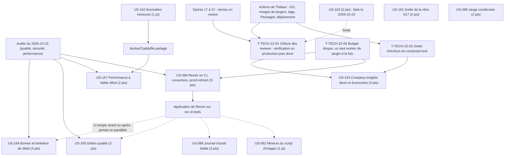

# Dépendances : Sprint 022 (finalisation)

> Périmètre du plan du 2026-10-23 (27 points). Les dépendances ci-dessous portent sur les stories ; le détail des tâches est dans chaque fichier `tasks/US-XXX-tasks.md`. Sources : [sprint-goal.md](./sprint-goal.md), [tasks/README.md](./tasks/README.md).

## Ordre recommandé

1. **Jour 1** : T-TECH-22-04 (disque), T-TECH-22-01a (liste des stories), T-161-06 (checklist d'intégration), cadrages (T-164-01, T-162-01, T-084-01) ; Thibaut est sollicité tôt pour T-TECH-22-01b (GO et déploiement).
2. **Chemin des Must** : US-164, US-162 puis US-167 (Caddyfile : US-162 avant US-167), US-161 (solde), clôture des reviews dès que le déploiement est fait.
3. **US-084** : l'application de Rector (T-084-03) est séquencée avec les autres branches de code (avant leurs créations ou après leurs merges) ; l'étape CI bloquante vient en dernier.
4. **Sacrifiables** (US-165, US-088, US-098, US-154, US-062) : engagées seulement si le point d'étape du 2026-10-30 le permet ; US-154 attend en plus le GO de Thibaut et l'ordre d'écriture du lock (T-TECH-22-02).

## Dépendances externes

| Dépendance | Type | Effet |
|------------|------|-------|
| GO de Thibaut (merges, tags, Packagist, déploiement) | Action humaine | Débloque la vérification en production et les montées du lock |
| Relectures de Thibaut (kit média, profil, posts, captures) | Action humaine | Nécessaires au passage à `done` de plusieurs stories de communication |
| Transcript T-103-03 | Action humaine | Conditionne US-103 et US-121 (sprint 23), sans effet sur le sprint 22 |
| CI GitHub | Plateforme | « Quality and smoke tests » et « Docker image » requises avant merge (`main` protégée) |
