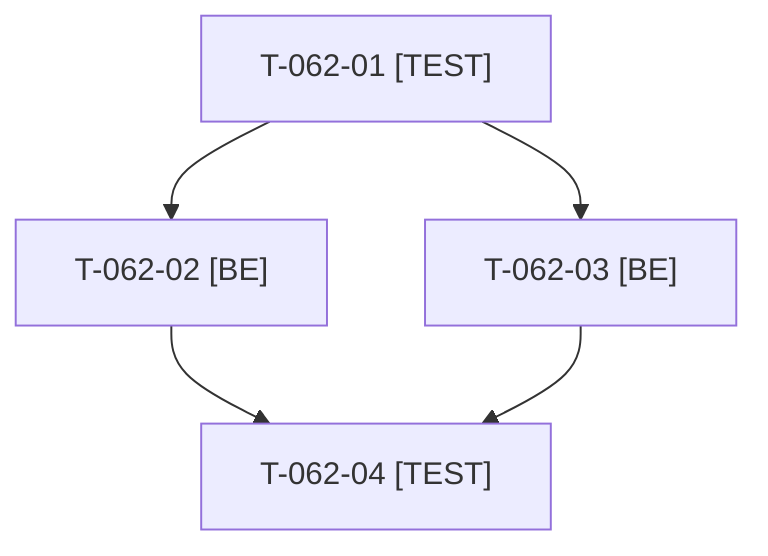

# Tâches : US-062 : Mineurs du script d'images

## Informations US

- **Epic** : EPIC-11
- **Persona** : Thibaut (mainteneur)
- **Story Points** : 1 (Could, n°1)
- **Sprint** : sprint-22-finalisation
- **Story** : [US-062](../../../backlog/user-stories/US-062.md)

## Résumé de la US

**En tant que** Thibaut
**Je veux** corriger les mineurs restants du script d'images
**Afin de** fiabiliser le téléchargement et la conservation des images du catalogue

## Règles et contraintes

- **Le script d'images est dans la démo** : `bin/fetch-product-images` (script manuel, jamais lancé par le reset, le build ou la CI) et `src/Demo/Images/Fetch/` (`ProductImageFetcher`, `OpenverseClient`, `ImageProcessor`, `ProductQueryBuilder`), test `tests/Unit/Demo/Images/ProductImageFetcherTest.php`, documentation `docs/images-produits.md`. Aucun plugin concerné.
- Constat actuel : seul un plafond d'octets après téléchargement existe (`MAX_DOWNLOAD_BYTES`) ; manquent le contrôle du `Content-Length` avant lecture, une limite de pixels, la gestion du 429, la conservation de l'image principale si le manifeste change et le plafond en lecture d'un corps `chunked`.
- Aucun appel réseau dans les tests : client HTTP simulé. Aucun appel réseau réel au runtime (garde `ImageBudgetTest`).
- Tests : uniquement `WORKER_ID=wN TEST_DB_NAME=b2b_wN TEST_CACHE_DIR=var/cache-wN bin/run-tests` (refuse de démarrer sous 5 Go libres) ; jamais phpunit en direct ; si le disque est insuffisant, la CI valide.
- Règles du sprint et consigne de worker : voir [README.md](./README.md).

## Fichiers principaux touchés

À croiser avec la matrice des chevauchements de [README.md](./README.md) avant de lancer deux développeurs en parallèle.

- `src/Demo/Images/Fetch/ProductImageFetcher.php`, `OpenverseClient.php`, `ImageProcessor.php`
- `src/Demo/Images/ImageManifest.php` (conservation de l'image principale)
- `bin/fetch-product-images` (lecture)
- `tests/Unit/Demo/Images/`
- `docs/images-produits.md`

## Vue d'ensemble des tâches

La colonne « Réalisé par » dit qui fait la tâche : **Claude** seul, **Orchestrateur** (Claude en rôle d'orchestrateur) ou **Thibaut** (action de sa part). Ordre TDD : les tâches [TEST] « rouges » précèdent le code qu'elles décrivent. Estimations de 0,25 h à 3 h (aucune tâche au-dessus de 8 h).

| ID | Type | Tâche | Estimation | Dépend de | Réalisé par | Statut |
|----|------|-------|------------|-----------|-------------|--------|
| T-062-01 | [TEST] | Tests rouges (client HTTP simulé) : image conforme enregistrée comme avant, `Content-Length` excessif ou pixels hors limite refusés et consignés, 429 suivi d'une attente puis d'un nouvel essai, manifeste modifié sans perte de l'image principale, corps `chunked` plafonné à la taille réellement lue | 0,75 h | - | Claude | 🔲 |
| T-062-02 | [BE] | Limites de pixels et de `Content-Length` avant lecture, lecture plafonnée en `chunked`, refus consigné dans le rapport du script | 0,75 h | T-062-01 | Claude | 🔲 |
| T-062-03 | [BE] | Gestion du 429 (attente bornée selon `Retry-After`, nombre d'essais limité) et conservation de l'image principale quand le manifeste change | 0,75 h | T-062-01 | Claude | 🔲 |
| T-062-04 | [TEST] | Suite ciblée via `bin/run-tests`, ECS (`src tests`), PHPStan max ; `docs/images-produits.md` mis à jour (limites, 429) | 0,5 h | T-062-02, T-062-03 | Claude | 🔲 |

**Total estimé : 2,75 h** (4 tâches, dont 0 de Thibaut, soit 0 h ; 2,75 h pour Claude et l'orchestrateur).

## Dépendances

