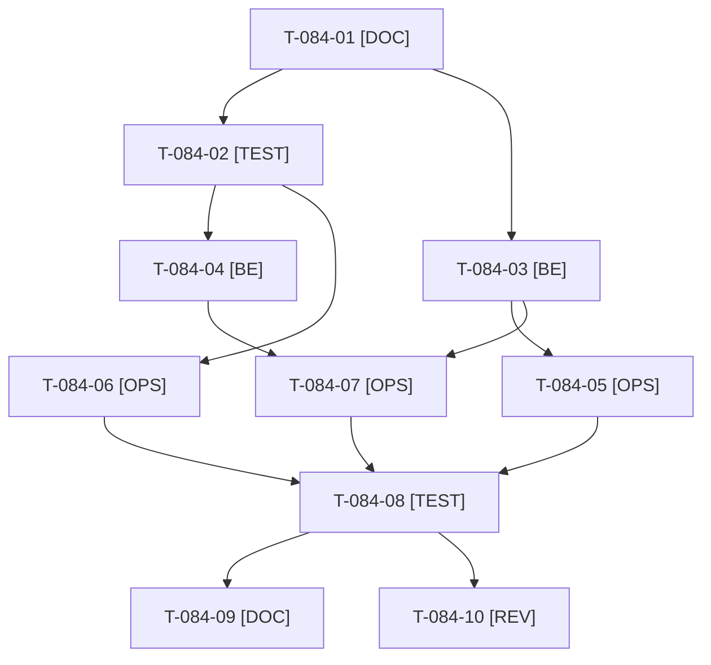

# Tâches : US-084 : Qualité : Rector en CI, seuil de couverture et `bin/proof-refresh`

## Informations US

- **Epic** : EPIC-10
- **Persona** : Thibaut (mainteneur)
- **Story Points** : 5 (Should, non sacrifiable)
- **Sprint** : sprint-22-finalisation
- **Story** : [US-084](../../../backlog/user-stories/US-084.md)

## Résumé de la US

**En tant que** Thibaut
**Je veux** Rector en vérification dans la CI, un seuil de couverture bloquant et un `bin/proof-refresh` rejoué
**Afin de** que les garde-fous de qualité soient automatiques et que les chiffres de la preuve publiée restent exacts

## Règles et contraintes

- **Touche la CI** (`.github/workflows/ci.yaml`) : les jobs « Quality and smoke tests » et « Docker image » sont requis par la protection de `main` ; ne pas renommer leurs noms. Actions épinglées par SHA conservées.
- Rector : 78 fichiers modifiables en dry-run à l'audit. Ils sont ramenés à 0 **avant** que l'étape CI soit bloquante. **Chevauchement fort** : l'application de Rector touche potentiellement beaucoup de fichiers de `src/` (donc ceux d'US-165, US-164, US-162, US-088). Ordre recommandé : appliquer Rector par lots dès le début du sprint, en PR séparée mergée avant les stories parallèles, ou à défaut en fin de sprint après les autres merges.
- Seuil de couverture : valeur déduite de la mesure de la CI (la couverture n'est pas mesurable localement, pcov est en CI) ; le taux et le seuil apparaissent dans le message d'échec et le résumé du job.
- `bin/proof-refresh` : script manuel, sources publiques seulement (Packagist, `gh`) ; ajouter un contrôle de retard (option de vérification) sans écrire de chiffre de couverture dans `proof.json`.
- Tests : uniquement `WORKER_ID=wN TEST_DB_NAME=b2b_wN TEST_CACHE_DIR=var/cache-wN bin/run-tests` (refuse de démarrer sous 5 Go libres) ; jamais phpunit en direct ; si le disque est insuffisant, la CI valide.
- Règles du sprint et consigne de worker : voir [README.md](./README.md).

## Fichiers principaux touchés

À croiser avec la matrice des chevauchements de [README.md](./README.md) avant de lancer deux développeurs en parallèle.

- `.github/workflows/ci.yaml` (étape Rector, seuil, résumé)
- `rector.php`
- `src/` et `tests/` (application de Rector, lots à lister au cadrage) **chevauche toutes les autres stories de code**
- `bin/proof-refresh`, `src/Demo/Proof/Refresh/`
- `config/demo/proof.json`
- `phpunit.xml.dist` (périmètre de couverture)
- `composer.json` (scripts `rector-dry-run`, `rector-apply`)
- `docs/theme-b2b.md` (bloc de preuve), `docs/tests-locaux.md`

## Vue d'ensemble des tâches

La colonne « Réalisé par » dit qui fait la tâche : **Claude** seul, **Orchestrateur** (Claude en rôle d'orchestrateur) ou **Thibaut** (action de sa part). Ordre TDD : les tâches [TEST] « rouges » précèdent le code qu'elles décrivent. Estimations de 0,25 h à 3 h (aucune tâche au-dessus de 8 h).

| ID | Type | Tâche | Estimation | Dépend de | Réalisé par | Statut |
|----|------|-------|------------|-----------|-------------|--------|
| T-084-01 | [DOC] | Cadrage : `composer rector-dry-run` rejoué (nombre de fichiers, familles de règles), étape de couverture de la CI et dernier taux publié, `proof.json` et sa date, `bin/proof-refresh` lus ; seuil et ordre de merge consignés | 1 h | - | Claude | 🔲 |
| T-084-02 | [TEST] | Tests rouges : garde sur le workflow (étape Rector présente, seuil défini, résumé du job), `bin/proof-refresh` signale un écart de nombre de tests au lieu de passer en silence (option de contrôle), sortie 1 en cas d'écart | 1,25 h | T-084-01 | Claude | 🔲 |
| T-084-03 | [BE] | Rector appliqué par lots de familles de règles sur `src` et `tests`, diff relu à chaque lot, suite ciblée entre les lots ; 0 fichier modifiable à la fin (par lots, une PR de retouche dédiée si besoin) | 3 h | T-084-01 | Claude | 🔲 |
| T-084-04 | [BE] | `bin/proof-refresh` : contrôle de retard (nombre de tests, d'assertions et de plugins comparés à la suite réelle), message d'écart, option sans écriture | 1,5 h | T-084-02 | Claude | 🔲 |
| T-084-05 | [OPS] | CI : étape Rector en mode vérification (échec si un fichier est modifiable), après ECS et PHPStan | 0,75 h | T-084-03 | Claude | 🔲 |
| T-084-06 | [OPS] | CI : seuil de couverture bloquant (échec avec taux et seuil dans le message), taux publié dans le résumé du job ; seuil fixé sur le taux mesuré moins une marge | 1,5 h | T-084-02 | Claude | 🔲 |
| T-084-07 | [OPS] | `bin/proof-refresh` rejoué, `config/demo/proof.json` rafraîchi (nombre de tests, assertions, plugins), diff relu | 0,75 h | T-084-04, T-084-03 | Claude | 🔲 |
| T-084-08 | [TEST] | Suite via `bin/run-tests` (si le disque le permet, sinon CI seule), ECS (`src tests`), PHPStan max, lint YAML du workflow ; première CI verte attendue avant merge | 1 h | T-084-05, T-084-06, T-084-07 | Claude | 🔲 |
| T-084-09 | [DOC] | Documentation à jour (`docs/tests-locaux.md`, bloc de preuve de `docs/theme-b2b.md`) : Rector en CI, seuil, procédure de rafraîchissement de la preuve | 0,5 h | T-084-08 | Claude | 🔲 |
| T-084-10 | [REV] | Revue (aucun secret dans le workflow, noms de jobs inchangés pour la protection de `main`, `proof.json` sans chiffre de couverture) | 0,5 h | T-084-08 | Claude | 🔲 |

**Total estimé : 11,75 h** (10 tâches, dont 0 de Thibaut, soit 0 h ; 11,75 h pour Claude et l'orchestrateur).

## Dépendances

