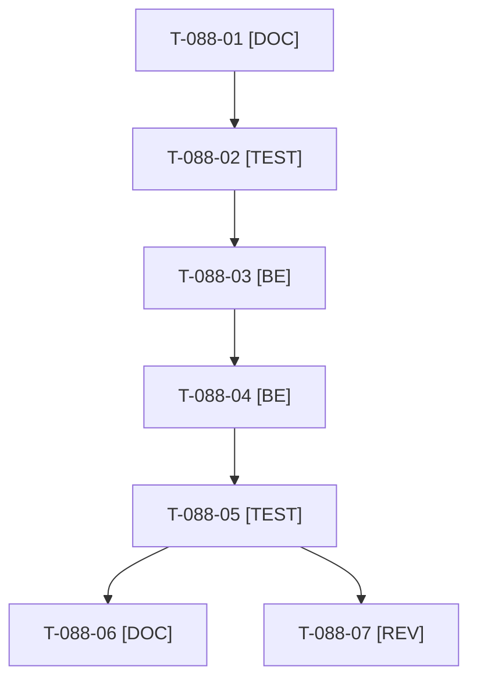

# Tâches : US-088 : Journal d'audit lisible : reset masqué et événements métier

## Informations US

- **Epic** : EPIC-11
- **Persona** : Sophie (back-office du marchand)
- **Story Points** : 3 (Should, n°4)
- **Sprint** : sprint-22-finalisation
- **Story** : [US-088](../../../backlog/user-stories/US-088.md)

## Résumé de la US

**En tant que** Sophie (back-office)
**Je veux** un journal d'audit sans les créations de la remise à zéro, mais avec quelques événements métier
**Afin de** démontrer l'audit sans bruit

## Règles et contraintes

- **État actuel du code (à vérifier au cadrage)** : l'exclusion de la remise à zéro est déjà configurée (US-087 : `ignored_commands` du plugin d'audit dans `config/packages/tmonier_plugins_overrides.yaml`, tests `AuditLogIgnoresDemoResetTest` et `AuditLogIgnoresDemoResetContainerTest`) et `AuditLogDemoFixture` rejoue déjà des événements (US-097 : prix, téléphone, note de commande). La story se réduit donc à **vérifier sur un reset réel que le journal est vide de lignes de reset** et à **compléter les événements manquants** (validation d'inscription, plafond modifié, approbation) pour atteindre 5 à 6 événements couvrant les quatre types demandés.
- Dépôt de la démo seul ; le plugin `sylius-audit-log-plugin` (`^1.0`) reste en lecture seule.
- Deux resets de suite sans doublon ; une modification réelle d'un visiteur reste journalisée ; test d'intégration qui échoue si le filtre est désactivé.
- Tests : uniquement `WORKER_ID=wN TEST_DB_NAME=b2b_wN TEST_CACHE_DIR=var/cache-wN bin/run-tests` (refuse de démarrer sous 5 Go libres) ; jamais phpunit en direct ; si le disque est insuffisant, la CI valide.
- Règles du sprint et consigne de worker : voir [README.md](./README.md).

## Fichiers principaux touchés

À croiser avec la matrice des chevauchements de [README.md](./README.md) avant de lancer deux développeurs en parallèle.

- `src/Demo/DataFixtures/AuditLogDemoFixture.php`
- `config/packages/tmonier_plugins_overrides.yaml` (lecture, modification seulement si l'exclusion est incomplète)
- `src/Demo/Command/DemoResetCommand.php` (lecture)
- `tests/Unit/Demo/AuditLogIgnoresDemoResetTest.php`, `tests/Smoke/AuditLogIgnoresDemoResetContainerTest.php`, `tests/Functional/Demo/Fixtures/`
- `docs/remise-a-zero-demo.md`

## Vue d'ensemble des tâches

La colonne « Réalisé par » dit qui fait la tâche : **Claude** seul, **Orchestrateur** (Claude en rôle d'orchestrateur) ou **Thibaut** (action de sa part). Ordre TDD : les tâches [TEST] « rouges » précèdent le code qu'elles décrivent. Estimations de 0,25 h à 3 h (aucune tâche au-dessus de 8 h).

| ID | Type | Tâche | Estimation | Dépend de | Réalisé par | Statut |
|----|------|-------|------------|-----------|-------------|--------|
| T-088-01 | [DOC] | Cadrage : état réel relevé (configuration d'exclusion, tests existants, 3 types d'événements déjà rejoués, types manquants), décompte des lignes « Création » après un reset local consigné ; choix « exclure » ou « purger » confirmé | 0,75 h | - | Claude | ✅ |
| T-088-02 | [TEST] | Tests rouges : journal sans ligne de reset après deux resets de suite, 5 à 6 événements datés et attribués couvrant prix, validation d'inscription, plafond et approbation, modification réelle journalisée, échec explicite si le filtre est désactivé | 1,5 h | T-088-01 | Claude | ✅ |
| T-088-03 | [BE] | Exclusion confirmée ou complétée (configuration ou purge en fin de reset) sans toucher aux écritures des visiteurs | 1,25 h | T-088-02 | Claude | ✅ |
| T-088-04 | [BE] | Événements métier manquants dans `AuditLogDemoFixture` (validation d'inscription, plafond modifié, approbation), attribués à des comptes de démo, dates cohérentes, cohérents avec les données chargées | 1,5 h | T-088-03 | Claude | ✅ |
| T-088-05 | [TEST] | Reset réel exécuté deux fois ; rendu réel du journal FR et EN, pa11y WCAG2AAA ; suite via `bin/run-tests`, ECS (`src tests`), PHPStan | 1 h | T-088-04 | Claude | 🔲 |
| T-088-06 | [DOC] | `docs/remise-a-zero-demo.md` mis à jour (journal propre, événements rejoués) | 0,25 h | T-088-05 | Claude | ✅ |
| T-088-07 | [REV] | Revue (aucun secret, chiffres vérifiables, parité FR et EN) | 0,25 h | T-088-05 | Claude | ✅ |

**Total estimé : 6,5 h** (7 tâches, dont 0 de Thibaut, soit 0 h ; 6,5 h pour Claude et l'orchestrateur).

## Dépendances

