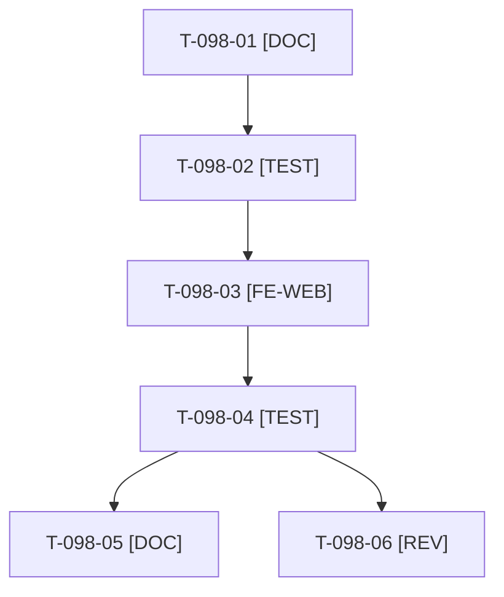

# Tâches : US-098 : Jauge de remplissage condensée sur la fiche produit

## Informations US

- **Epic** : EPIC-11
- **Persona** : Nadia (responsable e-commerce B2B)
- **Story Points** : 2 (Should, n°3)
- **Sprint** : sprint-22-finalisation
- **Story** : [US-098](../../../backlog/user-stories/US-098.md)

## Résumé de la US

**En tant que** Nadia
**Je veux** une jauge de remplissage qui n'affiche que les contenants pertinents
**Afin de** la lire sans effort

## Règles et contraintes

- **Emplacement à confirmer au cadrage** : le gabarit de la jauge de la fiche produit vit dans le plugin `sylius-container-fill-plugin` ; la démo ne surcharge aujourd'hui que `templates/shop/container_fill/cart_checkout.html.twig` (panier et paiement). La surcharge de gabarit se fait dans la démo (pas de release de plugin). Si une partie relève du plugin, la story sort de son enveloppe de 2 points : arbitrage au point d'étape.
- Contenant pertinent = taux strictement supérieur à 0 % ; les autres dans un `
` natif (clavier, sans JavaScript) ; bloc masqué sans donnée de contenant.
- Tests : uniquement `WORKER_ID=wN TEST_DB_NAME=b2b_wN TEST_CACHE_DIR=var/cache-wN bin/run-tests` (refuse de démarrer sous 5 Go libres) ; jamais phpunit en direct ; si le disque est insuffisant, la CI valide.
- Règles du sprint et consigne de worker : voir [README.md](./README.md).

## Fichiers principaux touchés

À croiser avec la matrice des chevauchements de [README.md](./README.md) avant de lancer deux développeurs en parallèle.

- `templates/shop/container_fill/` (nouvelle surcharge de la jauge de la fiche produit, nom à fixer au cadrage)
- `templates/shop/container_fill/cart_checkout.html.twig` (lecture : cohérence)
- `translations/` (libellé « détails »)
- `tests/Unit/Template/`
- `docs/remplissage-contenants.md`

## Vue d'ensemble des tâches

La colonne « Réalisé par » dit qui fait la tâche : **Claude** seul, **Orchestrateur** (Claude en rôle d'orchestrateur) ou **Thibaut** (action de sa part). Ordre TDD : les tâches [TEST] « rouges » précèdent le code qu'elles décrivent. Estimations de 0,25 h à 3 h (aucune tâche au-dessus de 8 h).

| ID | Type | Tâche | Estimation | Dépend de | Réalisé par | Statut |
|----|------|-------|------------|-----------|-------------|--------|
| T-098-01 | [DOC] | Cadrage : gabarit de la jauge de la fiche produit repéré (plugin ou démo), `docs/remplissage-contenants.md` lu, définition de « pertinent » confirmée, emplacement du rendu consigné | 0,5 h | - | Claude | 🔲 |
| T-098-02 | [TEST] | Tests rouges : 2 contenants pertinents sur 9, détails repliables au clavier, 9 sur 9 sans contrôle « détails », aucune donnée de contenant (bloc masqué), `
` sans JavaScript | 1 h | T-098-01 | Claude | 🔲 |
| T-098-03 | [FE-WEB] | Gabarit : filtre des contenants pertinents, `
` des autres, libellés FR et EN, contraste AAA | 1,25 h | T-098-02 | Claude | 🔲 |
| T-098-04 | [TEST] | Rendu réel FR et EN, pa11y WCAG2AAA, `bin/measure-mobile` ; suite ciblée via `bin/run-tests`, ECS (`src tests`), PHPStan | 0,75 h | T-098-03 | Claude | 🔲 |
| T-098-05 | [DOC] | `docs/remplissage-contenants.md` mis à jour | 0,25 h | T-098-04 | Claude | 🔲 |
| T-098-06 | [REV] | Revue (ton neutre, parité FR et EN, accessibilité) | 0,25 h | T-098-04 | Claude | 🔲 |

**Total estimé : 4 h** (6 tâches, dont 0 de Thibaut, soit 0 h ; 4 h pour Claude et l'orchestrateur).

## Dépendances

