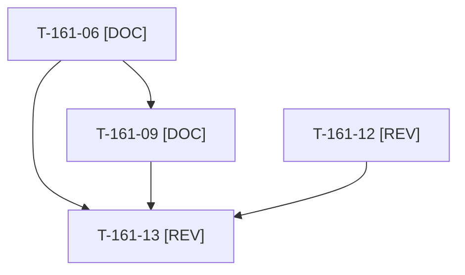

# Tâches : US-161 : Actions de la rétrospective du sprint 17 (solde)

> **Solde de la story du sprint 18** (5 points, 3 livrés au sprint 18). Seules les tâches restantes sont décomposées ici ; les tâches faites (T-161-01 à T-161-05, T-161-07, T-161-08, T-161-10, T-161-11) restent décrites dans [le fichier du sprint 18](../../sprint-18-repositionnement/tasks/US-161-tasks.md). Les identifiants d'origine sont conservés.

## Informations US

- **Epic** : EPIC-01
- **Persona** : Thibaut (mainteneur)
- **Story Points** : 2 (Must, non sacrifiable)
- **Sprint** : sprint-22-finalisation
- **Story** : [US-161](../../../backlog/user-stories/US-161.md)

## Résumé de la US

**En tant que** Thibaut
**Je veux** que les cinq actions SMART de la rétrospective du sprint 17 soient tenues
**Afin de** que le delivery assisté par l'IA reste fiable et que ce soit démontrable

## Règles et contraintes

- **Solde** de la story du sprint 18 (5 points, dont 3 livrés) : sont faits T-161-01 à T-161-05, T-161-07, T-161-08, T-161-10 et T-161-11 (`bin/check-disk`, nettoyage ciblé par `WORKER_ID`, `bin/run-tests --wait`, gabarits de consigne et de story, registre `communication/INDEX.md`). Restent T-161-06, T-161-09, T-161-12 et T-161-13, décrites dans [le fichier du sprint 18](../../sprint-18-repositionnement/tasks/US-161-tasks.md).
- **À ne conserver que si la story est encore ouverte** : à contrôler en premier (T-161-06 : relire l'état des gabarits ; si tout est déjà tenu, la story est close sans autre tâche).
- Documentation de processus uniquement, aucun code applicatif.
- Règles du sprint et consigne de worker : voir [README.md](./README.md).

## Fichiers principaux touchés

À croiser avec la matrice des chevauchements de [README.md](./README.md) avant de lancer deux développeurs en parallèle.

- `project-management/templates/consigne-worker.md` et `user-story.md`
- checklist d'intégration et gabarit de rapport (`project-management/templates/`)
- `docs/tests-locaux.md`
- registre `communication/INDEX.md` (hors dépôt, lecture)

## Vue d'ensemble des tâches

La colonne « Réalisé par » dit qui fait la tâche : **Claude** seul, **Orchestrateur** (Claude en rôle d'orchestrateur) ou **Thibaut** (action de sa part). Ordre TDD : les tâches [TEST] « rouges » précèdent le code qu'elles décrivent. Estimations de 0,25 h à 3 h (aucune tâche au-dessus de 8 h).

| ID | Type | Tâche | Estimation | Dépend de | Réalisé par | Statut |
|----|------|-------|------------|-----------|-------------|--------|
| T-161-06 | [DOC] | Checklist d'intégration et gabarit de rapport : commande et dernière ligne de sortie de PHPStan, ECS, lint Twig/YAML et suite ; rejeu de PHPStan et ECS par l'orchestrateur ; rapport refusé sans preuve ; suite en échec rejouée seule avant enquête (contrôle préalable : la story est-elle encore ouverte ?) | 1 h | - | Orchestrateur | ✅ |
| T-161-09 | [DOC] | Reste des actions du sprint 16 : arrêt explicite des tâches de fond (TaskStop) et vérification avant relance dans le gabarit de consigne ; checklist de revue « image reconstruite après correctif » | 0,5 h | T-161-06 | Orchestrateur | ✅ |
| T-161-12 | [REV] | Thibaut valide le format du registre `communication/INDEX.md` (nom, date, statut, sans contenu) | 0,5 h | - | Thibaut | 🔲 |
| T-161-13 | [REV] | Revue : gabarits à jour, tests des scripts verts via `bin/run-tests` (rejeu), bilan des cinq indicateurs préparé pour la rétro du sprint 22 | 0,75 h | T-161-06, T-161-09, T-161-12 | Claude | ✅ |

**Total estimé : 2,75 h** (4 tâches, dont 1 de Thibaut, soit 0,5 h ; 2,25 h pour Claude et l'orchestrateur).

> Contrôle de T-161-06 (2026-10-23) : story encore ouverte (checklist d'intégration et gabarit de rapport absents des gabarits, les règles ne vivaient que dans le README du sprint 18) ; livrés dans `project-management/templates/checklist-integration.md`. T-161-12 reste à Thibaut.

## Dépendances

