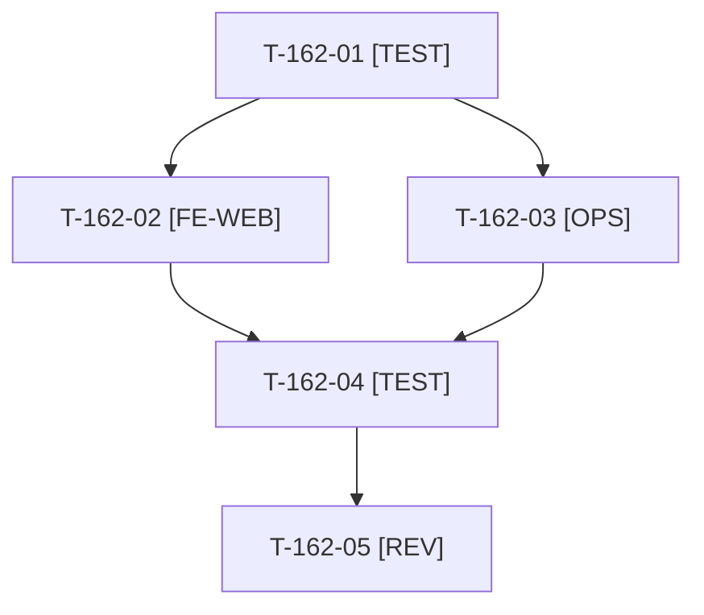

# Tâches : US-162 : Anomalies mineures relevées en production (sprints 18 à 20)

## Informations US

- **Epic** : EPIC-01
- **Persona** : Visiteur de la démo
- **Story Points** : 1 (Must, non sacrifiable)
- **Sprint** : sprint-22-finalisation
- **Story** : [US-162](../../../backlog/user-stories/US-162.md)

## Résumé de la US

**En tant que** visiteur de la démo
**Je veux** ne voir que des liens qui mènent quelque part et des en-têtes de réponse propres
**Afin de** que la démo reste crédible et sans bruit dans les outils d'audit

## Règles et contraintes

- Deux constats : lien « Créer un compte » visible alors que l'inscription est fermée dans la démo (`DEMO_REGISTRATION_OPEN=0`, garde `RegistrationGateListener`) ; en-tête `Strict-Transport-Security` émis deux fois (Caddy dans `docker/Caddyfile` et `SecurityHeadersSubscriber` dans l'application).
- HSTS : une seule source retenue au cadrage (la règle de l'application couvre les pages, celle de Caddy les fichiers statiques servis directement). Une seule ligne de `docker/Caddyfile` change : ce fichier est aussi touché par US-167 : un seul développeur à la fois dessus.
- Le gabarit du lien « Créer un compte » est probablement dans les gabarits Sylius (hooks Twig) : surcharge minimale dans `templates/` ou masquage par le hook, à repérer au cadrage.
- Tests : uniquement `WORKER_ID=wN TEST_DB_NAME=b2b_wN TEST_CACHE_DIR=var/cache-wN bin/run-tests` (refuse de démarrer sous 5 Go libres) ; jamais phpunit en direct ; si le disque est insuffisant, la CI valide.
- Règles du sprint et consigne de worker : voir [README.md](./README.md).

## Fichiers principaux touchés

À croiser avec la matrice des chevauchements de [README.md](./README.md) avant de lancer deux développeurs en parallèle.

- `docker/Caddyfile` (bloc HSTS) **partagé avec US-167**
- `src/Demo/Http/SecurityHeadersSubscriber.php`
- `src/Demo/Http/RegistrationGateListener.php` (lecture du paramètre seulement)
- `templates/` : surcharge ou hook des liens d'inscription (accueil, page de connexion, en-tête)
- `tests/Unit/Demo/Http/`, `tests/Unit/Docker/`, `tests/Functional/Demo/`
- `docs/durcissement-demo.md`

## Vue d'ensemble des tâches

La colonne « Réalisé par » dit qui fait la tâche : **Claude** seul, **Orchestrateur** (Claude en rôle d'orchestrateur) ou **Thibaut** (action de sa part). Ordre TDD : les tâches [TEST] « rouges » précèdent le code qu'elles décrivent. Estimations de 0,25 h à 3 h (aucune tâche au-dessus de 8 h).

| ID | Type | Tâche | Estimation | Dépend de | Réalisé par | Statut |
|----|------|-------|------------|-----------|-------------|--------|
| T-162-01 | [TEST] | Tests rouges : aucun lien d'inscription sur l'accueil et la connexion quand l'inscription est fermée, lien présent quand elle est ouverte, accès direct toujours refusé, un seul en-tête HSTS sur une page et sur une page 404 (HTTPS) | 0,75 h | - | Claude | 🔲 |
| T-162-02 | [FE-WEB] | Liens « Créer un compte » masqués quand l'inscription est fermée (accueil, page de connexion, menu de compte), conservés quand elle est ouverte | 0,75 h | T-162-01 | Claude | 🔲 |
| T-162-03 | [OPS] | HSTS : une seule source (Caddy pour le statique, application pour le dynamique, sans doublon) ; test sur le Caddyfile et sur l'écouteur de l'application ; vérification du rendu dans l'image par la CI (« Docker image ») | 0,75 h | T-162-01 | Claude | 🔲 |
| T-162-04 | [TEST] | Suite ciblée via `bin/run-tests`, ECS, PHPStan ; rendu réel de l'accueil et de la connexion FR et EN avec inscription fermée puis ouverte ; `docs/durcissement-demo.md` à jour | 0,75 h | T-162-02, T-162-03 | Claude | 🔲 |
| T-162-05 | [REV] | Revue (aucun lien mort restant, parité FR et EN) | 0,25 h | T-162-04 | Claude | 🔲 |

**Total estimé : 3,25 h** (5 tâches, dont 0 de Thibaut, soit 0 h ; 3,25 h pour Claude et l'orchestrateur).

## Dépendances

