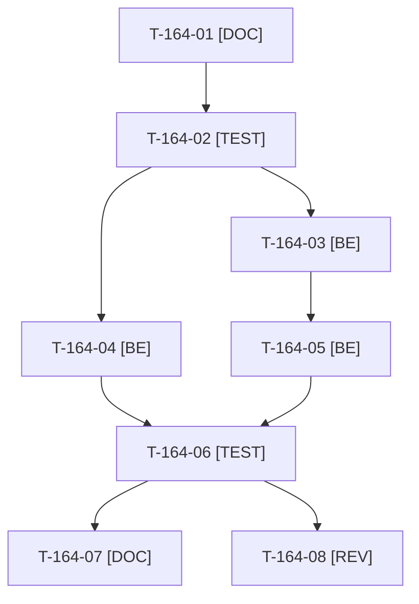

# Tâches : US-164 : Bornes du parc d'équipements des comptes partagés et limitation de débit des routes récentes

## Informations US

- **Epic** : EPIC-10
- **Persona** : Thibaut (mainteneur) ; Camille (visiteuse)
- **Story Points** : 3 (Must, non sacrifiable)
- **Sprint** : sprint-22-finalisation
- **Story** : [US-164](../../../backlog/user-stories/US-164.md)

## Résumé de la US

**En tant que** Thibaut
**Je veux** borner le volume d'écritures des comptes de démo partagés et appliquer la limitation de débit aux routes ajoutées récemment
**Afin de** que la démo publique reste stable et sans abus possible entre deux remises à zéro

## Règles et contraintes

- **Sécurité : aucun détail exploitable dans le dépôt public** (ni route, ni valeur, ni seuil, ni message de commit ou de PR). Les fichiers de tâches, les tests nommés et la documentation restent en termes généraux ; le rapport détaillé (routes, seuils, valeurs retenues) est remis à Thibaut **hors dépôt**.
- Démo seule (aucun tag de plugin). Si le plafond devait vivre dans le plugin du parc d'équipements, la décision est reportée au planning : elle ferait basculer la story hors de l'enveloppe de 3 points (ordre : tag, Packagist, vérification, démo).
- Valeurs de seuil lues dans l'environnement et la configuration de la démo, jamais écrites dans la documentation du dépôt.
- Tests : uniquement `WORKER_ID=wN TEST_DB_NAME=b2b_wN TEST_CACHE_DIR=var/cache-wN bin/run-tests` (refuse de démarrer sous 5 Go libres) ; jamais phpunit en direct ; si le disque est insuffisant, la CI valide.
- Règles du sprint et consigne de worker : voir [README.md](./README.md).

## Fichiers principaux touchés

À croiser avec la matrice des chevauchements de [README.md](./README.md) avant de lancer deux développeurs en parallèle.

- `src/Demo/Http/RateLimitSubscriber.php` (table des règles de limitation)
- `config/packages/demo_hardening.yaml` (seaux de limitation, paramètres)
- `src/Demo/Reset/` et `src/Demo/Command/DemoResetCommand.php` (réinitialisation du compteur)
- nouveau service de plafond dans `src/Demo/` (à nommer au cadrage) + écouteur ou garde sur l'ajout au parc
- `translations/` (message clair FR et EN)
- `tests/Unit/Demo/Http/`, `tests/Functional/Demo/`
- `docs/durcissement-demo.md` (termes généraux)

## Vue d'ensemble des tâches

La colonne « Réalisé par » dit qui fait la tâche : **Claude** seul, **Orchestrateur** (Claude en rôle d'orchestrateur) ou **Thibaut** (action de sa part). Ordre TDD : les tâches [TEST] « rouges » précèdent le code qu'elles décrivent. Estimations de 0,25 h à 3 h (aucune tâche au-dessus de 8 h).

| ID | Type | Tâche | Estimation | Dépend de | Réalisé par | Statut |
|----|------|-------|------------|-----------|-------------|--------|
| T-164-01 | [DOC] | Cadrage : rapport d'audit de sécurité lu hors dépôt, routes récentes et parc d'équipements repérés dans le code, choix du lieu du plafond (démo ou plugin) consigné sans valeur ; `df -h .` et `bin/check-disk` | 0,75 h | - | Claude | 🔲 |
| T-164-02 | [TEST] | Tests rouges, formulés en termes généraux : ajout refusé au plafond avec parc inchangé, ajout accepté sous le plafond, réponse de limitation avec en-tête d'attente sur les routes récentes, requête renouvelée avant la fin de la fenêtre sans effet de bord, compteur réinitialisé par la remise à zéro | 1,5 h | T-164-01 | Claude | 🔲 |
| T-164-03 | [BE] | Garde de plafond des écritures du parc pour les comptes de démo partagés (service injectable, valeur par paramètre d'environnement) et message clair FR et EN | 2 h | T-164-02 | Claude | 🔲 |
| T-164-04 | [BE] | Rattachement des routes récentes aux seaux de limitation existants (table des règles et configuration), sans créer d'exception à la règle « clé = IP du visiteur » | 1,25 h | T-164-02 | Claude | 🔲 |
| T-164-05 | [BE] | Remise à zéro nocturne : le compteur du plafond est réinitialisé avec les données (un compte bloqué est libéré) | 0,5 h | T-164-03 | Claude | 🔲 |
| T-164-06 | [TEST] | Suite ciblée puis complète via `bin/run-tests`, ECS (`src tests`), PHPStan max rejoués sur l'arbre exact ; dernière ligne de sortie citée | 1 h | T-164-04, T-164-05 | Claude | 🔲 |
| T-164-07 | [DOC] | Rapport détaillé remis à Thibaut hors dépôt ; `docs/durcissement-demo.md` complété en termes généraux (existence d'un plafond et d'une limitation, sans valeur) | 0,5 h | T-164-06 | Claude | 🔲 |
| T-164-08 | [REV] | Revue : relecture du diff et des messages de commit à la recherche de tout détail exploitable (route, seuil, valeur) ; parité FR et EN | 0,5 h | T-164-06 | Claude | 🔲 |

**Total estimé : 8 h** (8 tâches, dont 0 de Thibaut, soit 0 h ; 8 h pour Claude et l'orchestrateur).

## Dépendances

