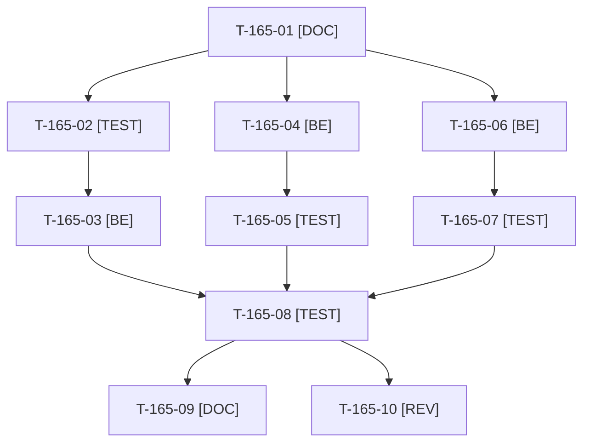

# Tâches : US-165 : Dettes qualité de l'audit : écriture en base, codes acheteurs du simulateur, code mort de la vitrine

## Informations US

- **Epic** : EPIC-10
- **Persona** : Thibaut (mainteneur)
- **Story Points** : 3 (Should, n°5)
- **Sprint** : sprint-22-finalisation
- **Story** : [US-165](../../../backlog/user-stories/US-165.md)

## Résumé de la US

**En tant que** Thibaut
**Je veux** sortir l'écriture en base du contrôleur des listes de l'entreprise, extraire les codes acheteurs du simulateur PunchOut de la fixture et supprimer le code mort de la vitrine
**Afin de** corriger trois dettes d'architecture relevées par l'audit

## Règles et contraintes

- Démo seule ; aucun comportement visible modifié (vitrine, simulateur, listes).
- Constat 1 : `CompanyWishlistController` écrit lui-même en base (`flush`) : service applicatif dans `src/Wishlist/`, un seul `flush` par requête, test dédié.
- Constat 2 : le simulateur lit `PunchoutDemoFixture::BUYER_CODE` (dépendance inversée) : constante neutre partagée, la fixture en dépend.
- Constat 3 : `StandardBlock::isInDemo()` et les branches « absent de la démo » de `ReadmeApplier`, `ReadmeChecker` et du rendu de la vitrine : suppression ; le rendu des 25 plugins reste identique (`bin/vitrine-readme --check`).
- Tests : uniquement `WORKER_ID=wN TEST_DB_NAME=b2b_wN TEST_CACHE_DIR=var/cache-wN bin/run-tests` (refuse de démarrer sous 5 Go libres) ; jamais phpunit en direct ; si le disque est insuffisant, la CI valide.
- Règles du sprint et consigne de worker : voir [README.md](./README.md).

## Fichiers principaux touchés

À croiser avec la matrice des chevauchements de [README.md](./README.md) avant de lancer deux développeurs en parallèle.

- `src/Controller/CompanyWishlistController.php`, `src/Wishlist/` (nouveau service, dépôt)
- `src/Demo/PunchOutSimulator/BuyerCredentialsProvider.php`, `OciBuyerProvider.php`, `src/Demo/DataFixtures/PunchoutDemoFixture.php` (+ nouvelle constante partagée)
- `src/Demo/Vitrine/StandardBlock.php`, `ReadmeApplier.php`, `ReadmeChecker.php`, gabarits de la vitrine
- `bin/vitrine-readme`
- `tests/Unit/Wishlist/`, `tests/Unit/Demo/PunchOutSimulator/`, `tests/Unit/Demo/`
- audit qualité du 2026-10-22 (statut des trois constats)

## Vue d'ensemble des tâches

La colonne « Réalisé par » dit qui fait la tâche : **Claude** seul, **Orchestrateur** (Claude en rôle d'orchestrateur) ou **Thibaut** (action de sa part). Ordre TDD : les tâches [TEST] « rouges » précèdent le code qu'elles décrivent. Estimations de 0,25 h à 3 h (aucune tâche au-dessus de 8 h).

| ID | Type | Tâche | Estimation | Dépend de | Réalisé par | Statut |
|----|------|-------|------------|-----------|-------------|--------|
| T-165-01 | [DOC] | Cadrage : contrôleur des listes de l'entreprise, ses tests (`CompanyWishlistSmokeTest`, `CompanyWishlistVoterTest`), usages de `BUYER_CODE`/`OCI_BUYER_CODE`, usages d'`isInDemo()` (grep) ; plan des trois lots | 0,5 h | - | Claude | ✅ |
| T-165-02 | [TEST] | Tests rouges du service des listes : écriture nominale avec un seul flush, échec d'écriture sans état partiel, erreur propre côté contrôleur | 1,25 h | T-165-01 | Claude | ✅ |
| T-165-03 | [BE] | Service applicatif d'enregistrement de la liste de l'entreprise ; contrôleur allégé (plus d'accès direct à l'`EntityManager` pour écrire) | 1,5 h | T-165-02 | Claude | ✅ |
| T-165-04 | [BE] | Constante neutre des codes acheteurs partagée entre le simulateur et la fixture ; la fixture dépend de la constante, le simulateur ne dépend plus de la fixture | 1 h | T-165-01 | Claude | ✅ |
| T-165-05 | [TEST] | Test du simulateur : code acheteur absent de la constante refusé avec le message d'erreur existant ; code connu accepté | 0,5 h | T-165-04 | Claude | ✅ |
| T-165-06 | [BE] | Suppression d'`isInDemo()` et des branches « absent de la démo » (applicateur, vérificateur, rendu de la vitrine) ; tests adaptés | 1,25 h | T-165-01 | Claude | ✅ |
| T-165-07 | [TEST] | Rendu de la vitrine et des README identique : `bin/vitrine-readme --check` et tests de la vitrine | 0,75 h | T-165-06 | Claude | ✅ |
| T-165-08 | [TEST] | Suite ciblée puis complète via `bin/run-tests`, ECS (`src tests`), PHPStan max rejoués sur l'arbre exact | 0,75 h | T-165-03, T-165-05, T-165-07 | Claude | ✅ |
| T-165-09 | [DOC] | Audit qualité : les trois constats passent à « corrigée » (état, sans détail superflu) | 0,25 h | T-165-08 | Claude | ✅ |
| T-165-10 | [REV] | Revue (aucun comportement visible modifié, injection par constructeur, SOLID) | 0,5 h | T-165-08 | Claude | ✅ |

**Total estimé : 8,25 h** (10 tâches, dont 0 de Thibaut, soit 0 h ; 8,25 h pour Claude et l'orchestrateur).

## Dépendances

