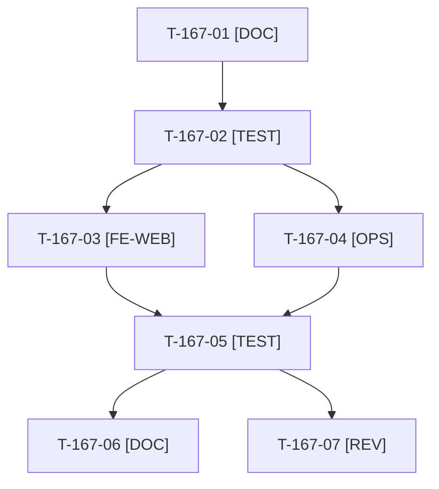

# Tâches : US-167 : Performance à faible effort : vignettes du haut du catalogue et cache des fichiers versionnés

## Informations US

- **Epic** : EPIC-10
- **Persona** : Camille (recruteuse IT) ; Thibaut (mainteneur)
- **Story Points** : 2 (Should, non sacrifiable)
- **Sprint** : sprint-22-finalisation
- **Story** : [US-167](../../../backlog/user-stories/US-167.md)

## Résumé de la US

**En tant que** visiteuse de la démo
**Je veux** que les premières vignettes du catalogue s'affichent sans attendre et que les fichiers versionnés soient mis en cache durablement
**Afin de** d'améliorer le LCP mobile et les visites suivantes

## Règles et contraintes

- `docker/Caddyfile` : `Cache-Control: public, max-age=31536000, immutable` sur `/build/*` **uniquement** ; `/media/*` et `/bundles/*` gardent leur cache de 7 jours (pas d'empreinte garantie). **Fichier partagé avec US-162 (HSTS).**
- `templates/bundles/SyliusShopBundle/shared/components/main_image.html.twig` : les premières vignettes en chargement immédiat (pas de `loading="lazy"`), `fetchpriority="high"` sur la première ; les suivantes restent différées. Le composant ne connaît pas la position : passer un attribut depuis `templates/bundles/SyliusShopBundle/product/index.html.twig` (boucle de la liste).
- Mesure avant/après du LCP mobile du catalogue avec `bin/measure-mobile` consignée dans la documentation (la mesure se rejoue sur le rendu local ; la production se vérifie après déploiement).
- Caddy et l'image ne se reconstruisent pas en local si le disque est limité : la CI (« Docker image ») valide.
- Tests : uniquement `WORKER_ID=wN TEST_DB_NAME=b2b_wN TEST_CACHE_DIR=var/cache-wN bin/run-tests` (refuse de démarrer sous 5 Go libres) ; jamais phpunit en direct ; si le disque est insuffisant, la CI valide.
- Règles du sprint et consigne de worker : voir [README.md](./README.md).

## Fichiers principaux touchés

À croiser avec la matrice des chevauchements de [README.md](./README.md) avant de lancer deux développeurs en parallèle.

- `docker/Caddyfile` (bloc `@static`) **partagé avec US-162**
- `templates/bundles/SyliusShopBundle/shared/components/main_image.html.twig`
- `templates/bundles/SyliusShopBundle/product/index.html.twig`
- autres appelants du composant (recherche, accueil, vitrines) : à lister au cadrage
- `tests/Unit/Docker/` (Caddyfile), `tests/Unit/Template/` (rendu)
- `docs/seo-et-vitesse.md`

## Vue d'ensemble des tâches

La colonne « Réalisé par » dit qui fait la tâche : **Claude** seul, **Orchestrateur** (Claude en rôle d'orchestrateur) ou **Thibaut** (action de sa part). Ordre TDD : les tâches [TEST] « rouges » précèdent le code qu'elles décrivent. Estimations de 0,25 h à 3 h (aucune tâche au-dessus de 8 h).

| ID | Type | Tâche | Estimation | Dépend de | Réalisé par | Statut |
|----|------|-------|------------|-----------|-------------|--------|
| T-167-01 | [DOC] | Cadrage : appelants de `main_image`, boucle de la liste produits, bloc `@static` du Caddyfile lus ; mesure initiale du LCP mobile du catalogue (`bin/measure-mobile`) consignée | 0,75 h | - | Claude | 🔲 |
| T-167-02 | [TEST] | Tests rouges : vignettes du haut sans `loading="lazy"` et première avec `fetchpriority="high"`, vignettes du bas différées, catégorie vide ou à une vignette sans erreur, règle `/build/*` immutable et `/media/*`, `/bundles/*` inchangés | 1 h | T-167-01 | Claude | 🔲 |
| T-167-03 | [FE-WEB] | Composant d'image : paramètre de position (chargement immédiat des premières vignettes, priorité haute pour la première) ; liste produits : transmission de l'indice ; repli inchangé sans image | 1,25 h | T-167-02 | Claude | 🔲 |
| T-167-04 | [OPS] | Caddyfile : cache long immutable sur `/build/*` seulement ; `/media/*` et `/bundles/*` conservent 7 jours | 0,5 h | T-167-02 | Claude | 🔲 |
| T-167-05 | [TEST] | Rendu réel du catalogue FR et EN, pa11y WCAG2AAA, `bin/measure-mobile` après modification (LCP consigné) ; suite ciblée via `bin/run-tests`, ECS, PHPStan ; construction de l'image laissée à la CI | 1 h | T-167-03, T-167-04 | Claude | 🔲 |
| T-167-06 | [DOC] | `docs/seo-et-vitesse.md` : règle de cache, chargement des vignettes, mesures avant/après | 0,25 h | T-167-05 | Claude | 🔲 |
| T-167-07 | [REV] | Revue (aucun `immutable` hors `/build/*`, accessibilité des images inchangée) | 0,25 h | T-167-05 | Claude | 🔲 |

**Total estimé : 5 h** (7 tâches, dont 0 de Thibaut, soit 0 h ; 5 h pour Claude et l'orchestrateur).

## Dépendances

