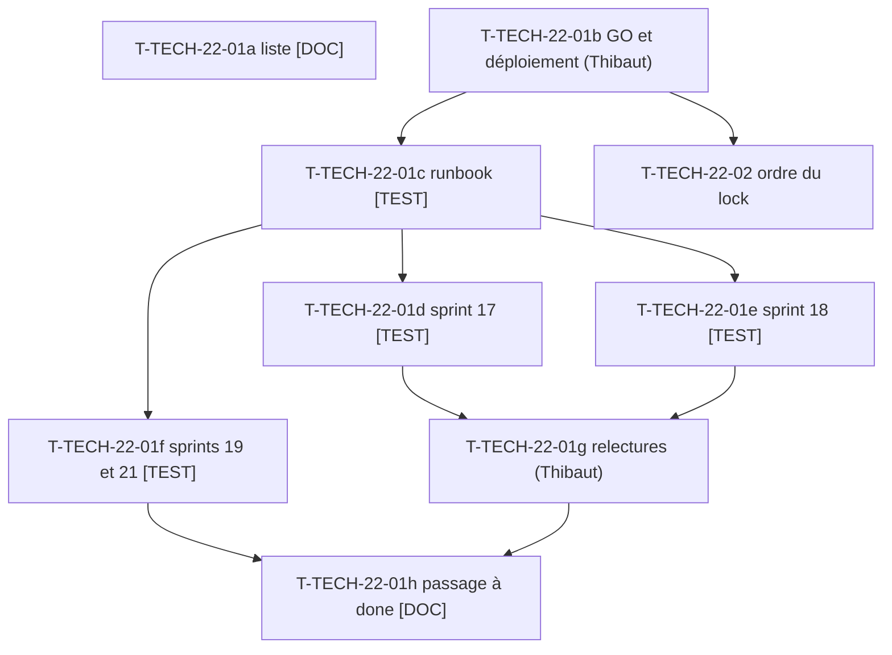

# Tâches transverses : clôture des reviews des sprints 17 à 21 et gestion du sprint

Tâches **sans points** : elles comptent dans les heures, pas dans les 27 points. Le gros morceau est **T-TECH-22-01** : vérification **en production, en lecture seule**, des stories laissées en `review` par les sprints 17 à 21 (règle de la Definition of Done : « done » seulement après vérification en production), puis passage à `done` dans `.bmad/sprint-status.yaml`. Aucune commande Railway par Claude ; aucune écriture en production ; rien de sensible consigné dans le dépôt public.

## Vue d'ensemble des tâches

| ID | Type | Tâche | Estimation | Dépend de | Réalisé par | Statut |
|----|------|-------|------------|-----------|-------------|--------|
| T-TECH-22-01a | [DOC] | Liste des stories à vérifier tirée du YAML (tableau ci-dessous) et checklist de vérification par story (URL ou page, comportement attendu, FR et EN) ; version déployée relevée (`/healthz`, lecture seule) | 0,75 h | - | Claude | ✅ |
| T-TECH-22-01b | [OPS] | Thibaut donne le GO et réalise les opérations en attente : merge des PR de plugins ouvertes (parc d'équipements, purchase-approval), tags, indexation Packagist, puis déploiement groupé de la démo sur Railway (aucune commande Railway par Claude) | 0,5 h | - | Thibaut | ✅ |
| T-TECH-22-01c | [TEST] | Checks du runbook en lecture seule sur la production (`docs/ouverture-publique.md`, `docs/deploiement-railway.md`) : santé, en-têtes, mode public, `noindex`, pages principales FR et EN | 1 h | T-TECH-22-01b | Claude | ✅ |
| T-TECH-22-01d | [TEST] | Vérification des stories du sprint 17 (10 stories : US-105, US-106, US-107, US-116, US-117, US-120, US-122, US-123, US-127, US-129) : pages et documents vérifiables en ligne ; livrables de communication contrôlés par leur présence (registre hors dépôt) | 1,5 h | T-TECH-22-01c | Claude | ✅ |
| T-TECH-22-01e | [TEST] | Vérification des stories du sprint 18 (7 stories : US-158, US-148, US-160, US-159, US-124, US-111, US-068) : profil et libellés neutres, limiteurs de débit, page de preuve, liens des README | 1,5 h | T-TECH-22-01c | Claude | ✅ |
| T-TECH-22-01f | [TEST] | Vérification des stories des sprints 19 et 21 (US-155, US-056, US-057, US-058, US-157, US-060) : tableau de bord company-insights, parc d'équipements (compte de démo, données fictives), aperçu des approbations | 1,5 h | T-TECH-22-01c | Claude | ✅ |
| T-TECH-22-01g | [REV] | Thibaut relit et valide ce qui demande un humain : kit média (US-120), profil LinkedIn (US-129), calendrier et posts (US-122, US-123, US-124, US-159, US-127), captures company-insights (T-155-14) | 1 h | T-TECH-22-01d, T-TECH-22-01e | Thibaut | ✅ |
| T-TECH-22-01h | [DOC] | Passage à `done` dans `.bmad/sprint-status.yaml` des stories vérifiées (une par une, avec la date et le commit de déploiement) ; stories non vérifiables laissées en `review` avec la raison ; anomalies ouvertes en backlog sans détail sensible ; tableaux des sprints 17 à 21 mis à jour | 0,75 h | T-TECH-22-01f, T-TECH-22-01g | Claude | ✅ |
| T-TECH-22-02 | [OPS] | Ordre d'écriture du `composer.lock` de la démo (écrivain unique) : montées en attente décidées par Thibaut (purchase-approval v1.3.0 : T-157-12 du sprint 21 ; parc d'équipements 0.1.0 : T-058-16 du sprint 21), puis company-insights 0.3.0 (T-154-14). Aucune PR de montée avant la vérification de la version publiée | 0,5 h | T-TECH-22-01b | Orchestrateur | ✅ |
| T-TECH-22-03 | [OPS] | ECS (`src tests`) et PHPStan max rejoués sur l'arbre exact avant chaque push de la démo (et du plugin company-insights), dans Docker ; dernière ligne de sortie citée dans chaque rapport | 1 h | - | Orchestrateur | ✅ |
| T-TECH-22-04 | [OPS] | Disque : `df -h .` et `bin/check-disk` au démarrage et avant chaque lot ; `bin/clean-test-caches` limité au worker ; suites lancées uniquement par `WORKER_ID=wN TEST_DB_NAME=b2b_wN TEST_CACHE_DIR=var/cache-wN bin/run-tests` (refuse sous 5 Go libres) ; jamais phpunit direct ; si l'espace manque, la CI valide | 0,5 h | - | Orchestrateur | ✅ |
| T-TECH-22-05 | [OPS] | PR du sprint : CI verte (« Quality and smoke tests » et « Docker image »), **run terminé avant le merge** (`main` protégée) ; l'image n'est reconstruite qu'en CI si le disque est limité | 0,5 h | T-TECH-22-03 | Orchestrateur | ✅ |
| T-TECH-22-06 | [DOC] | Bilan des indicateurs de la rétro du sprint 21 (arrêts dus au disque, écart de gate, tâches livrées restées 🔲) et des cinq indicateurs d'US-161, préparés pour la rétro du 2026-11-06 | 0,5 h | T-TECH-22-05 | Orchestrateur | ✅ |

**Total estimé : 11,5 h** (13 lignes ; T-TECH-22-01 = a à h : 8,5 h, dont 1,5 h pour Thibaut ; autres : 3 h). Total de Thibaut : 1,5 h ; pour Claude et l'orchestrateur : 10 h. Sous-tâches de T-TECH-22-01 toutes ≤ 1,5 h.

**Définition de fini** : chaque story de la liste est `done` (vérifiée en production) ou reste `review` avec la raison écrite ; aucune écriture en production ; aucun détail sensible dans le dépôt.

## Stories en `review` à vérifier (tirées de `.bmad/sprint-status.yaml`)

| Sprint | US | Titre | Points | Vérification principale |
|--------|----|-------|--------|-------------------------|
| 17 | US-105 | Parcours guidés : moteur de visite par étapes | 8 | Une visite démarre, avance, se termine (FR et EN) |
| 17 | US-106 | Parcours guidés : contenu par persona et écran de sortie | 5 | Contenu par persona, sortie vers le profil |
| 17 | US-107 | Page « Intégrer ces plugins dans votre projet » | 5 | Page accessible, guide technique sans formules ni délais |
| 17 | US-116 | Charte éditoriale LinkedIn et messages clés | 2 | Document présent (hors dépôt), relu par Thibaut |
| 17 | US-117 | Mesure de la communication : visites par campagne sans cookie | 3 | Mesure active sans cookie |
| 17 | US-120 | Kit média (1/2) : GIF courts | 5 | Fichiers présents ; relecture de Thibaut |
| 17 | US-122 | Calendrier éditorial LinkedIn sur huit semaines | 3 | Relecture de Thibaut |
| 17 | US-123 | Posts LinkedIn rédigés, lot 1 | 3 | Relecture de Thibaut |
| 17 | US-127 | Suivi de l'annonce d'ouverture, de J+1 à J+30 | 2 | Suivi à jour ; bilan J+30 hors sprint |
| 17 | US-129 | Profil LinkedIn : texte, bannière et section « À la une » | 2 | Application du profil par Thibaut |
| 18 | US-158 | Repositionnement de la démo : profil LinkedIn, libellés neutres, guide technique | 3 | Lien vers le profil, libellés neutres en production |
| 18 | US-148 | Plugins : limiteurs de débit typés | 3 | Versions de plugins déployées, démo fonctionnelle |
| 18 | US-160 | Dettes du sprint 17 : verrou atomique, GET sans écriture de session, menu compte nommé | 5 | Menu de compte nommé, pas de régression de session |
| 18 | US-159 | Contenu LinkedIn réaligné sur la recherche d'emploi | 3 | Relecture de Thibaut |
| 18 | US-124 | Posts LinkedIn rédigés, lot 2 | 5 | Relecture de Thibaut |
| 18 | US-111 | Bloc de preuve technique | 3 | Page de preuve en ligne, chiffres exacts |
| 18 | US-068 | Liens vers la démo et le profil dans les 24 README | 3 | Contrôle `--check` des README sur les branches principales |
| 19 | US-155 | Company-insights : historique d'achats et intégration à la démo | 5 | Tableau de bord d'un compte de démo ; relecture des captures (T-155-14) |
| 21 | US-056 | Plugin équipements : modèles d'équipement (admin) | 5 | Écran d'administration des modèles |
| 21 | US-057 | Plugin équipements : parc du client | 5 | « Mon matériel » d'un compte de démo |
| 21 | US-058 | Plugin équipements : filtre « pièces compatibles » | 5 | Filtre au catalogue |
| 21 | US-157 | Purchase-approval : aperçu des approbations en attente | 2 | Panneau d'en-tête (dépend de la v1.3.0 déployée) |
| 21 | US-060 | Plugin équipements : intégration à la démo | 3 | Données du parc visibles en production (livrée au sprint 21, PR #51, vérifiée en production le 2026-10-23 : parc de Claire et filtre compatible OK ; non planifiée au sprint 23, rattachée à T-TECH-22-01f pour le passage à `done`) |

**23 stories** (hors US-147, US-059 et sprint 20, déjà `done`). Écart à noter : le périmètre de la commande de démarrage visait les sprints 18 à 21 ; les 10 stories du sprint 17 restées `review` y sont ajoutées car la clôture du sprint 17 les renvoyait explicitement à cette tâche. US-060 est classée dans `backlog:` du YAML (statut `review`) mais a été livrée au sprint 21 (PR #51) et vérifiée en production le 2026-10-23 ; elle n'est pas planifiée au sprint 23.

## Dépendances

