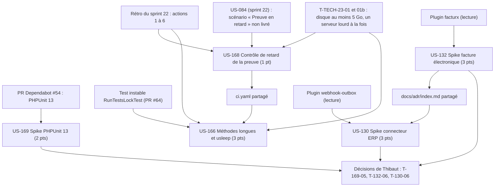

# Dépendances : Sprint 023 (garde-fous et cadrages)

> Périmètre validé par Thibaut le 2026-10-23 (12 points). Les dépendances ci-dessous portent sur les stories ; le détail des tâches est dans chaque fichier `tasks/US-XXX-tasks.md`. Sources : [sprint-goal.md](./sprint-goal.md), [tasks/README.md](./tasks/README.md).

## Lecture

| Story | Dépend de | Nature | Bloquant |
|-------|-----------|--------|----------|
| US-168 | Règle de comptage de `ProofCollector` | Code existant à partager | non |
| US-166 | US-168, à cause du fichier `ci.yaml` | Séquencement, si la garde passe par la CI | non (garde possible dans un test) |
| US-166, US-168 | Disque d'au moins 5 Go pour la suite locale | Environnement | non (la CI fait foi) |
| US-169 | PR #54 ouverte | Branche d'essai | non |
| US-130 | US-132, à cause de `docs/adr/index.md` (numéros 0015 puis 0016) | Séquencement | non |
| Clôture des spikes | Décisions de Thibaut | Action humaine | oui, pour passer en done |
