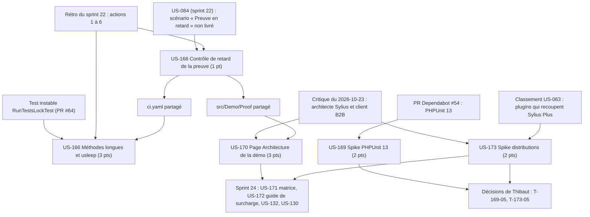

# Dépendances : Sprint 023 (garde-fous et lisibilité de l'architecture)

> Périmètre validé par Thibaut le 2026-10-23 puis remanié le même jour (11 points). Les dépendances ci-dessous portent sur les stories ; le détail des tâches est dans chaque fichier `tasks/US-XXX-tasks.md`. Sources : [sprint-goal.md](./sprint-goal.md), [tasks/README.md](./tasks/README.md).

## Lecture

| Story | Dépend de | Nature | Bloquant |
|-------|-----------|--------|----------|
| US-168 | Règle de comptage de `ProofCollector` | Code existant à partager | non |
| US-166 | US-168, à cause du fichier `ci.yaml` | Séquencement, si la garde passe par la CI | non (garde possible dans un test) |
| US-170 | US-168, à cause de `src/Demo/Proof` (lecture de `ProofReader`) | Séquencement | non |
| US-169 | PR #54 ouverte | Branche d'essai | non |
| US-173 | Classement US-063 (`docs/vitrine-plugins.md`) | Règle de composition des packs | non |
| US-171, US-172 (sprint 24) | US-170 (page à compléter), US-173 (forme des distributions) | Suite | non pour ce sprint |
| Clôture des spikes | Décisions de Thibaut | Action humaine | oui, pour passer en done |
