# Dépendances : Sprint 024 (intégrateurs)

> Périmètre décidé par le PO le 2026-10-23 (16 points engagés, 3 conditionnels). Les dépendances ci-dessous portent sur les stories ; le détail des tâches est dans chaque fichier `tasks/US-XXX-tasks.md`. Sources : [sprint-goal.md](./sprint-goal.md), [tasks/README.md](./tasks/README.md).

```mermaid
graph TD
    RETRO["Rétro du sprint 23 : actions 1 à 4"]
    CRIT["Critique du 2026-10-23 : architecte Sylius et client B2B"]
    SPK169["Spike US-169 : rapport PHPUnit 13"]
    PR54["PR Dependabot #54 : PHPUnit 13"]
    PROD170["Vérification en production d'US-170 (T-170-06)"]
    ADR15["ADR 0015 : distributions de plugins"]
    CLASS["Classement US-063 : plugins qui recoupent Sylius Plus"]
    US174["US-174 Montée à PHPUnit 13 (3 pts)"]
    US171["US-171 Matrice et graphe (3 pts)"]
    US172["US-172 Guide de surcharge (3 pts)"]
    US179["US-179 Lisibilité mobile (1 pt)"]
    US132["US-132 Spike facture électronique (3 pts)"]
    US130["US-130 Spike ERP (3 pts)"]
    US175["US-175 Métapaquets (3 pts, conditionnelle)"]
    GO175["GO de Thibaut : dépôts et noms des paquets (T-175-01)"]
    PROOF["proof.json, bin/proof-check (US-168)"]
    TESTS["tests/ partagé"]
    ADRIDX["docs/adr/index.md"]
    DEPLOY["Déploiement de main par Thibaut (T-TECH-24-09)"]
    GOREADME["GO de Thibaut : PR de README (T-172-08)"]
    DEC["Décisions de Thibaut : ADR 0016 et 0017"]
    NEXT["Suite : US-176, US-177, US-178 (ADR 0015)"]

    SPK169 --> US174
    PR54 --> US174
    CRIT --> US171
    CRIT --> US172
    PROD170 --> US179
    ADR15 --> US175
    CLASS --> US175
    GO175 --> US175
    RETRO --> US174
    US171 --> PROOF
    US172 --> PROOF
    US174 --> PROOF
    US174 --> TESTS
    US171 --> TESTS
    US172 --> TESTS
    US179 --> TESTS
    US132 --> ADRIDX
    US130 --> ADRIDX
    US132 --> DEC
    US130 --> DEC
    US171 --> DEPLOY
    US172 --> DEPLOY
    US179 --> DEPLOY
    US172 --> GOREADME
    US175 --> NEXT
```

## Lecture

| Story | Dépend de | Nature | Bloquant |
|-------|-----------|--------|----------|
| US-174 | Rapport du spike US-169, PR #54 ouverte | Branche existante, mesure par la CI | non |
| US-174 | Merge des autres stories du sprint (ordre) | Séquencement : mergée en dernière, car elle réécrit une quinzaine de fichiers de `tests/` | non (la montée est mesurable avant), mais ordre de merge imposé |
| US-171 | Mécanisme de `bin/proof-check` (US-168) | Code existant à étendre | non |
| US-171, US-172, US-174 | `config/demo/proof.json` | Fichier partagé : proof-refresh rejoué après chaque rebase | non |
| US-171, US-172, US-179 (rendu) | Déploiement de `main` par Thibaut (T-TECH-24-09) | Action humaine : la vérification du rendu se fait en production | oui, pour passer en done |
| US-172 (README de plugins) | GO de Thibaut (T-172-08) | Action humaine | oui, pour les PR des README seulement |
| US-179 | Constats de la vérification en production d'US-170 | Origine | non |
| US-179 et US-174 | `ArchitecturePageTest.php` | Fichier partagé : US-179 d'abord | non |
| US-132 et US-130 | `docs/adr/index.md` | Un seul écrivain : l'orchestrateur | non |
| US-132, US-130 | Décisions de Thibaut (T-132-06, T-130-06) | Action humaine | oui, pour passer en done |
| US-175 | GO de Thibaut et noms des paquets (T-175-01) | Condition d'entrée | oui : sans GO, la story reste au backlog |
| US-175 | ADR 0015 et classement US-063 | Règle de composition des packs | non |
| US-176, US-177, US-178 | US-175 publiée | Suite hors sprint | non pour ce sprint |

## Ordre proposé

1. **Voie A** (démo, un serveur lourd à la fois) : US-179, puis US-171, puis US-172.
2. **Voie B** (rédaction, sans serveur) : US-132, puis US-130 ; en parallèle de la voie A.
3. **Voie C** : US-174 sur la branche de la PR #54, mesurée par la CI ; en parallèle, sans serveur local.
4. **Voie D** : US-175 dès le GO de Thibaut.
5. **Merge** : PR du sprint, puis déploiement de `main` par Thibaut, puis vérification du rendu en production, puis PR #54 (US-174) rebasée, avec `proof-refresh` rejoué.
