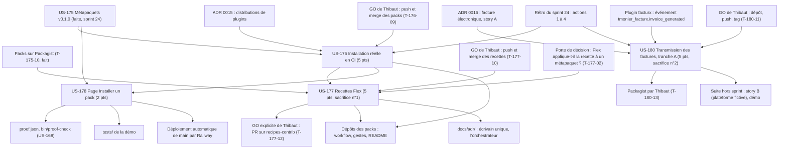

# Dépendances : Sprint 025 (packs et transmission)

> Périmètre décidé par Thibaut le 2026-10-24 (17 points engagés). Les dépendances ci-dessous portent sur les stories ; le détail des tâches est dans chaque fichier `tasks/US-XXX-tasks.md`. Sources : [sprint-goal.md](./sprint-goal.md), [tasks/README.md](./tasks/README.md).

## Lecture

| Story | Dépend de | Nature | Bloquant |
|-------|-----------|--------|----------|
| US-176 | US-175 faite (métapaquets, README, `etc/composition.json`) | Origine | non |
| US-176 | GO de Thibaut (T-176-09) | Action humaine : push, PR et merge dans les deux dépôts de packs | oui, pour tout ce qui est distant ; le code et les tests locaux avancent avant |
| US-177 | Merge d'US-176 | Séquencement : mêmes fichiers (workflow, gestes, README) dans les mêmes dépôts | oui |
| US-177 | Essai de la porte de décision (T-177-02) | Si Flex n'applique pas la recette à un métapaquet : arrêt de la story (scénario de la fiche), pas un sacrifice | oui, pour T-177-04 à T-177-13 |
| US-177 | GO de Thibaut pour le push (T-177-10), puis GO explicite pour la PR publique (T-177-12) | Action humaine ; deux GO distincts | oui, pour chacune des deux étapes ; sans le second, aucune PR (scénario « Publication sans accord ») |
| US-178 | Packs lisibles via `gh` (US-175) | Origine | non |
| US-178 | Merge d'US-176 | La génération réelle des données (T-178-05) lit les README après correction éventuelle | non pour le code et les tests (fixture) ; oui pour la génération réelle |
| US-178 (rendu) | Déploiement automatique de `main` par Railway | Automatique : aucune action de Thibaut, aucune commande Railway | oui, pour passer en done |
| US-178 | `config/demo/proof.json`, `bin/proof-check` | Fichier partagé : proof-refresh rejoué après chaque rebase | non |
| US-180 | ADR 0016 (story A) et événement de `facturx` | Origine, lecture seule du plugin `facturx` | non |
| US-180 | GO de Thibaut (T-180-11) puis Packagist (T-180-13) | Action humaine : dépôt, push, tag, soumission | oui, pour tout ce qui est distant ; le plugin se développe et se teste en local avant |
| US-180 | US-176, US-177, US-178 | Aucune dépendance de code ; seule la ressource lourde est partagée (une installation à la fois) | non |
| US-177 | `docs/adr/0015-*.md` | Résultat de l'essai écrit par l'orchestrateur (T-177-03) | non |

## Ordre proposé

1. **Voie A** (dépôts des packs, CI comme juge) : US-176 dès le cadrage et les tests rouges ; GO (T-176-09) demandé dès les workflows prêts ; puis US-177 après le merge d'US-176, en commençant par la porte de décision.
2. **Voie B** (nouveau plugin, local) : US-180 en parallèle de la voie A, installation lourde ponctuelle et nettoyée après le lot ; dépôt et tag sur GO.
3. **Voie C** (démo) : US-178, tests rouges et code avant le merge d'US-176 (fixture), génération réelle des données ensuite ; jamais en même temps que l'installation lourde de la voie B.
4. **Merge** : dépôts des packs (US-176, puis US-177), PR du sprint dans la démo (US-178 et dossier de sprint, `proof-refresh` rejoué), vérification du rendu en production après le déploiement automatique de `main`.
5. **Sacrifice** si la charge dépasse la capacité : US-177 d'abord (n°1), puis US-180 (n°2) ; US-176 et US-178 ne se sacrifient pas.
