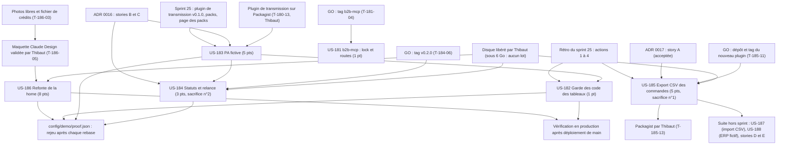

# Dépendances : Sprint 026 (vitrine et flux)

> Périmètre décidé par Thibaut le 2026-10-24 (23 points engagés). Les dépendances ci-dessous portent sur les stories ; le détail des tâches est dans chaque fichier `tasks/US-XXX-tasks.md`. Sources : [sprint-goal.md](./sprint-goal.md), [tasks/README.md](./tasks/README.md).

## Lecture

| Story | Dépend de | Nature | Bloquant |
|-------|-----------|--------|----------|
| tout le sprint | Disque libéré par Thibaut (5,2 Go libres au planning, seuil de 6 Go) | Action humaine : aucun lot ne démarre sous 6 Go | oui, pour tout lot d'exécution ; cadrage, rédaction, photos et maquette avancent avant |
| US-186 | Photos et fichier de crédits (T-186-03) | Origine : la maquette en dépend | non |
| US-186 | Maquette validée par Thibaut (T-186-05) | Action humaine : aucun gabarit Twig avant | oui, pour T-186-06 à T-186-13 |
| US-186 (done) | Déploiement automatique de `main` par Railway | Automatique : aucune action de Thibaut, aucune commande Railway | oui, pour passer en done |
| US-186 | `config/demo/proof.json`, compteur de plugins d'US-183 | Fichier partagé : proof-refresh rejoué après chaque rebase | non |
| US-183 | Plugin de transmission v0.1.0 sur Packagist (T-180-13 du sprint 25, Thibaut) | Action humaine du sprint précédent | oui, pour T-183-02 à T-183-10 ; le cadrage avance |
| US-184 | Merge d'US-183 | Séquencement : mêmes fichiers (`composer.*`, `src/Demo/Einvoice/`) | oui |
| US-184 | GO de Thibaut pour le tag `v0.2.0` (T-184-06) | Action humaine : push, tag et release du plugin | oui, pour T-184-07 ; le code et les tests locaux avancent avant |
| US-185 | GO de Thibaut (T-185-11) puis Packagist (T-185-13) | Action humaine : dépôt, push, tag, soumission | oui, pour tout ce qui est distant ; le plugin se développe et se teste en local avant |
| US-185 | Dépôts `webhook-outbox` et `facturx` à jour | Origine, lecture seule | non |
| US-181 | GO de Thibaut (T-181-04) | Action humaine : push, merge, tag du plugin b2b-mcp | oui, pour T-181-05 et T-181-06 |
| US-182 | Merge d'US-183 | Séquencement : `templates/demo/integrate.html.twig` | oui, pour le démarrage de T-182-03 |
| US-182 (done) | Déploiement automatique de `main` | Automatique | oui, pour passer en done |
| US-186, US-183, US-184, US-185 | Ressource lourde partagée (`bin/run-tests`, `vendor/`, Docker) | Un seul lot d'exécution à la fois, verrou de `bin/run-tests` | non |

## Ordre proposé

1. **Voie A (w186, démo)** : US-186. T-186-01 à T-186-03 d'abord (cadrage, mesure avant, photos), maquette par l'orchestrateur (T-186-04), **attente de l'accord de Thibaut**, puis tests rouges et intégration ; vérification en production après le merge.
2. **Voie B (w183, démo et plugin)** : US-183 (paquet sur Packagist, PA fictive), puis US-184 après son merge (plugin 0.2.0 sur GO, puis écran de la démo).
3. **Voie C (w185, hors démo puis démo)** : US-185 (nouveau plugin local, dépôt et tag sur GO), puis US-181 (b2b-mcp, CI comme juge, tag sur GO), puis US-182 (garde, après le merge d'US-183).
4. **Lots d'exécution** : un à la fois, annoncés à l'orchestrateur ; nettoyage après chaque lot (T-TECH-26-05).
5. **Merge** : plugins sur GO d'abord, puis les PR de la démo une à une avec leur preuve rafraîchie, puis vérification en production (US-186, US-182).
6. **Sacrifice** si la charge dépasse la capacité : US-185 d'abord (n°1), puis US-184 (n°2) ; US-186, US-183, US-181 et US-182 ne se sacrifient pas.
