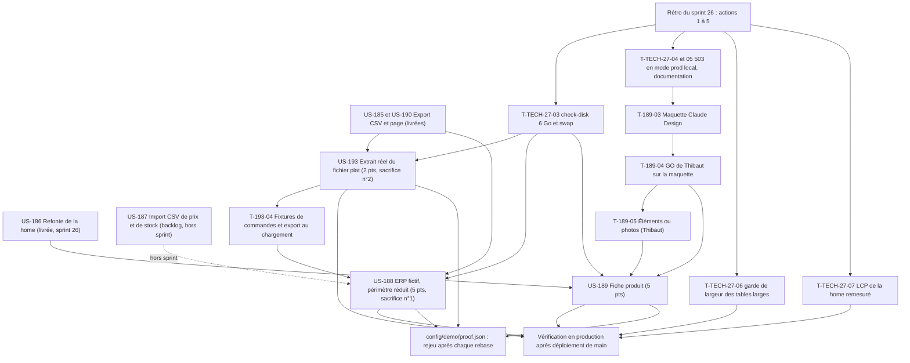

# Dépendances : Sprint 027 (fiche produit et ERP fictif)

> Périmètre validé par Thibaut le 2026-10-24 (13 points engagés). Les dépendances ci-dessous portent sur les stories ; le détail des tâches est dans chaque fichier `tasks/US-XXX-tasks.md`. Sources : [sprint-goal.md](./sprint-goal.md), [tasks/README.md](./tasks/README.md).

## Lecture

| Dépendance | Nature | Conséquence |
|------------|--------|-------------|
| T-TECH-27-04 et 05 avant T-189-03 | Action 4 de la rétro du sprint 26 | La maquette et les captures de la fiche s'appuient sur un rendu du noyau en mode prod ; borné à 1 h, sinon script de captures |
| T-189-04 avant T-189-07 à T-189-13 | Porte de Thibaut | Aucun gabarit Twig avant la validation de la maquette ; tâches 📅 |
| T-189-05 avant T-189-06 et T-189-08 | Éléments de la maquette | Sans objet si la maquette n'en demande pas |
| T-193-04 avant T-188-07 | Fichiers partagés (`DemoResetCommand`, fixtures) | US-193 d'abord, US-188 reprend son résultat ; un seul worker sur ces fichiers à la fois |
| US-187 hors sprint | Périmètre | US-188 est réduite : pas d'import, accusé de réception simulé à la place du CSV de prix et de stock |
| T-TECH-27-03 avant le premier lot | Action 3 | `bin/check-disk` durci avant tout lot ; aucune suite complète sous 6 Go |
| Vérification en production après le merge | Action 5 | Mesures consignées le jour du déploiement ; US-189 reste en review jusque-là ; la page du back-office d'US-188 est vérifiée en local |

## Chemin critique

T-TECH-27-04 (1 h) → T-TECH-27-05 (0,5 h) → T-189-03 (2 h) → T-189-04 (Thibaut) → T-189-07 (1 h) → T-189-08 (2,75 h) → T-189-10 (0,75 h) → merge → T-189-12 (0,75 h, production) → T-189-13 (0,5 h). Les durées de travail s'enchaînent sur environ 9,25 h de Claude ; le temps d'attente de Thibaut n'est pas compté. US-193 puis US-188 se déroulent en parallèle de l'attente de la maquette.
