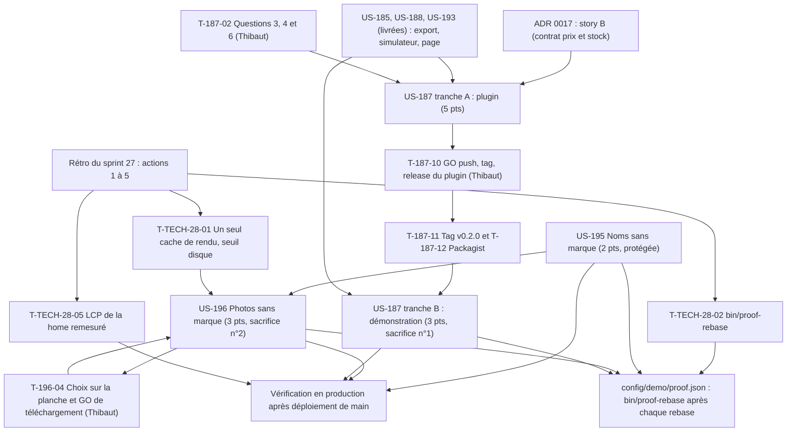

# Dépendances : Sprint 028 (noms, photos et import ERP)

> Périmètre validé par Thibaut le 2026-10-24 (13 points engagés). Les dépendances ci-dessous portent sur les stories ; le détail des tâches est dans chaque fichier `tasks/US-XXX-tasks.md`. Sources : [sprint-goal.md](./sprint-goal.md), [tasks/README.md](./tasks/README.md).

## Lecture

| Dépendance | Nature | Conséquence |
|------------|--------|-------------|
| T-195-03 avant T-196-03 | Noms affichés sur la planche | US-195 d'abord ; la planche nomme les produits avec leurs nouveaux noms |
| T-196-04 avant T-196-06 | Porte de Thibaut | **Aucun téléchargement avant le GO explicite** ; avant le GO, rien n'est enregistré dans le dépôt |
| T-187-02 avant T-187-03 | Questions ouvertes 3, 4 et 6 de l'ADR | L'affinage de la fiche attend les réponses (propositions fournies) |
| T-187-10 avant T-187-11 | Porte de Thibaut | **Aucun push, tag ni release du plugin sans GO** ; tâches 📅 |
| T-187-12 avant T-187-14 | Version publiée | `composer.json` et `composer.lock` de la démo ne sont commités qu'une fois `v0.2.0` visible sur Packagist ; le développement de la tranche B avance avant sur une copie locale non commitée |
| Tranche A seule | Valeur autonome | Le plugin publié sert sans la tranche B ; la tranche B est sacrifiée la première |
| T-TECH-28-01 avant le premier rendu d'US-196 | Action 1 | Un seul cache de rendu par worker, seuil disque appliqué aux rendus |
| T-TECH-28-02 avant le premier rebase | Action 2 | `bin/proof-rebase` ; PR fusionnées en série |
| Vérification en production après le merge | Action 5 | Mesures consignées le jour du déploiement ; la page du back-office d'US-187 est vérifiée en local |

## Chemin critique

La file la plus longue est celle d'US-187 : T-187-01 (0,5 h) → T-187-02 (Thibaut) → T-187-03 (0,5 h) → T-187-04 (1,75 h) → T-187-05 (2 h) → T-187-07 (2 h) → T-187-08 (0,75 h) → T-187-09 (0,5 h) → T-187-10 (Thibaut) → T-187-11 (0,5 h) → T-187-12 (Thibaut) → T-187-14 (0,25 h) → T-187-16 (1 h) → T-187-17 (1,25 h) → T-187-19 (0,75 h) → merge → T-187-20 (0,5 h) → T-187-21 (0,5 h). Environ 13,25 h de Claude et trois attentes de Thibaut. US-195 puis US-196 (attente de la planche) se déroulent en parallèle.
