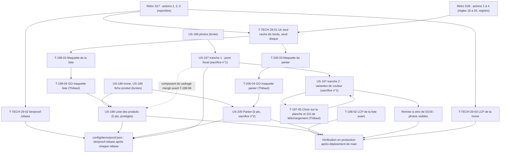

# Dépendances : Sprint 029 (liste, panier et photos)

> Périmètre décidé par Thibaut le 2026-10-25 (13 points engagés). Les dépendances ci-dessous portent sur les stories ; le détail des tâches est dans chaque fichier `tasks/US-XXX-tasks.md`. Sources : [sprint-goal.md](./sprint-goal.md), [tasks/README.md](./tasks/README.md).

## Lecture

| Dépendance | Nature | Conséquence |
|------------|--------|-------------|
| T-TECH-29-01 avant T-198-03 et T-200-03 | Action 1 de la rétro du sprint 27 | Un seul cache de rendu par worker et seuil disque avant la première capture de maquette |
| T-198-04 avant T-198-05 | Porte de Thibaut | **Aucun Twig de la liste avant le GO de la maquette** ; tâches de code 📅 |
| T-200-04 avant T-200-05 | Porte de Thibaut | **Aucun Twig du panier avant le GO de la maquette** ; tâches de code 📅 |
| T-197-05 avant T-197-06 | Porte de Thibaut | **Aucun téléchargement avant le GO explicite** ; avant le GO, rien n'est enregistré dans le dépôt |
| T-197-03 avant T-198-06 | Composant de cadrage partagé | La carte d'US-198 réutilise le point focal ; sinon elle garde le cadrage actuel |
| T-198-02 avant T-198-06 | Mesure d'avant | LCP de la liste mesuré avant le premier gabarit, au même protocole que « après » |
| Remise à zéro de 03:00 avant T-197-09 et T-198-10 | Règle 16 (la base survit aux déploiements) | Les nouvelles photos ne sont visibles en production qu'après la remise à zéro suivante ; contrôle le lendemain du déploiement |
| T-TECH-29-02 avant le premier rebase | Action 2 | `bin/proof-rebase` ; PR fusionnées en série |
| Tranche 1 d'US-197 seule | Valeur autonome | Le point focal sert sans les variantes de couleur ; la tranche 2 est sacrifiée avec la story |

## Chemin critique

La file la plus longue est celle d'US-198, puis celle d'US-200 : T-TECH-29-01 (1,25 h) → T-198-01 (0,75 h) → T-198-03 (2 h) → T-198-04 (Thibaut) → T-198-05 (1 h) → T-198-06 (3 h) → T-198-07 (0,5 h) → T-198-08 (0,75 h) → T-198-09 (0,5 h) → merge → T-198-10 (0,75 h) → T-198-11 (0,5 h). Environ 11 h de Claude et une attente de Thibaut. La file d'US-200 est du même ordre (10,25 h) et se déroule après celle d'US-198 si un seul worker de code est disponible ; les deux maquettes sont faites l'une après l'autre par l'orchestrateur (4 h), pendant que US-197 tranche 1 avance. US-197 tranche 2 attend le GO de la planche sur son propre chemin.
