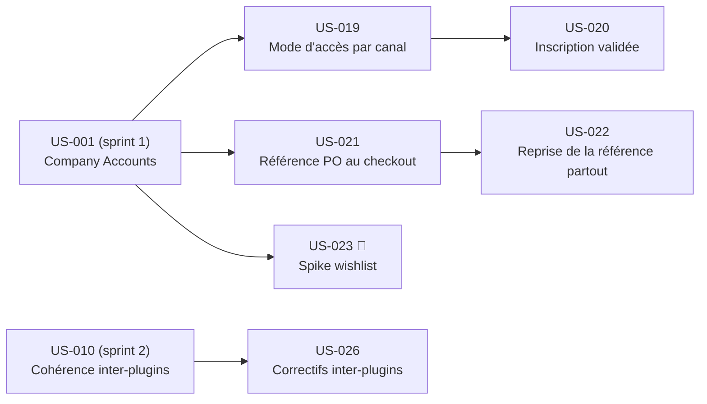

# Sprint 3 — Nouveaux plugins et fonctionnalités B2B

## Informations

| Attribut | Valeur |
|----------|--------|
| Numéro | 3 |
| Nom | nouveaux-plugins |
| Début | 2026-10-16 |
| Fin | 2026-10-30 |
| Durée | 10 jours ouvrés |
| Points engagés | 17 |

## Sprint Goal

> Nouveaux plugins et fonctionnalités B2B : mode d'accès par canal, inscription validée par l'admin, référence PO et centre de coût au checkout et leur reprise, spike wishlist, correctifs d'interaction entre plugins.

À la fin du sprint, la démo expose le contrôle d'accès par canal (canal fermé ou prix masqués), un workflow d'inscription B2B soumis à validation admin, la saisie et la propagation de la référence PO dans l'admin, les e-mails, la facture Factur-X (BT-10) et les OrderRequest PunchOut, une ADR décidant de la wishlist officielle vs plugin maison, et les trois correctifs d'interaction inter-plugins (container-fill, PunchOut checkout, OrderRequest + credit-limit/approbation).

## Contrainte d'architecture

> **Ces stories sont implémentées comme fonctionnalités de l'application de démo** : le code va dans `src/`, la configuration dans `config/`, les fixtures dans `fixtures/`, le thème dans `templates/` et `assets/`. **Aucun dépôt de plugin autonome publié n'est créé pendant ce sprint.**
>
> **Point de décision :** US-019 (mode d'accès par canal) et US-020 (inscription validée) portent la note « Nouveau plugin publié » dans leur backlog d'origine. Cette implémentation en tant que fonctionnalité de démo est le choix retenu pour le sprint 3. Si l'équipe souhaite extraire ces comportements en plugins publiés, cela fera l'objet d'une ADR distincte en dehors de ce sprint.

## Lien avec le Sprint 2

Le sprint 2 a livré le catalogue industriel depuis des CSV, les entreprises/membres/comptes de démo, la cohérence inter-plugins et la commande de remise à zéro. **Prérequis strict : le sprint 2 est mergé sur `main`, `bin/console app:fixtures:load` passe sans erreur, et les données de démo (catalogue, entreprises, comptes) sont disponibles.**

## Sprint Backlog

| ID | Titre | Points | Statut |
|----|-------|--------|--------|
| US-019 | Mode d'accès par canal | 5 | 🚫 Bloquée — extraite en plugin autonome dédié (hors sprint) |
| US-020 | Inscription validée par l'admin | 5 | 🚫 Bloquée — extraite en plugin autonome dédié (hors sprint) |
| US-021 | Référence PO et centre de coût au checkout | 5 | 🔵 To Do |
| US-022 | Reprise de la référence partout | 5 | 🔵 To Do |
| US-023 | Spike : wishlist officielle sur Sylius 2.3 | 2 | 🔵 To Do |
| US-026 | Correctifs d'interaction entre plugins | 5 | 🔵 To Do |

**Total engagé : 17 points** (US-019 et US-020 retirées — extraites en plugins autonomes dédiés)

## Ordre de réalisation recommandé

> US-019 et US-020 sont extraites en plugins autonomes dédiés et ne font plus partie de ce sprint.

1. US-021 (référence PO — bloque US-022)
2. US-023 (spike wishlist — isolé, 2 points, livrable = ADR uniquement)
3. US-022 (reprise de la référence — dépend de US-021)
4. US-026 (correctifs inter-plugins — dépend de US-010 sprint 2, peut démarrer en parallèle)

> **US-023 est un spike de recherche** : le livrable attendu est une ADR documentée (`docs/adr/`), pas du code de production. Le sprint peut se terminer avec un résultat "ne pas adopter la wishlist officielle".

## Dépendances inter-stories

| Story | Dépend de |
|-------|-----------|
| US-019 | US-001 (sprint 1, company accounts) |
| US-020 | US-019 (canal fermé ou prix masqués déjà en place) |
| US-021 | US-001 (sprint 1, checkout B2B) |
| US-022 | US-021 (champ PO présent en base) |
| US-023 | US-001 (catalogue B2B opérationnel pour tester l'install) |
| US-026 | US-010 (sprint 2, données inter-plugins cohérentes) |



## Definition of Done (rappel)

- [ ] Critères d'acceptation automatisés (tests fonctionnels ou de fumée) et verts
- [ ] ECS et PHPStan passent sur le code ajouté/modifié
- [ ] Libellés en français et en anglais si interface
- [ ] Aucun secret ni identifiant réel dans le dépôt
- [ ] Documentation mise à jour si comportement visible
- [ ] CI verte sur la branche du sprint

## Risques identifiés

| Risque | Probabilité | Impact | Mitigation |
|--------|-------------|--------|------------|
| US-022 transverse (admin + e-mails + Factur-X + PunchOut) → scope difficile à borner | Élevée | Élevé | Découpages en sous-tâches ; ponts conditionnels isolés ; tests par surface |
| US-019/US-020 tentées en plugin autonome (note backlog) → décision d'archi non tranchée | Moyenne | Moyen | Contrainte d'architecture accrochée au sprint-goal ; point de décision documenté |
| US-026 bloquée si sprint 2 non stable (données inter-plugins) | Moyenne | Élevé | Pré-checklist : vérifier `app:fixtures:load` et les 21 plugins avant de démarrer |
| Spike US-023 non concluant → ADR "ne pas adopter" acceptée comme livrable valide | Faible | Faible | ADR = livrable, pas du code ; pas de blocage sprint |
| Compatibilité canal B2C pour US-019 (mode d'accès) | Faible | Moyen | Canaux B2C restent en mode ouvert par défaut ; tests de non-régression B2C |

## Burndown (prévisionnel)

```
Points |
  27   | ●
  24   |   ●
  21   |     ●
  18   |       ●
  15   |         ●
  12   |           ●
   9   |             ●
   6   |               ●
   3   |                 ●
   0   |                   ●
       D1 D2 D3 D4 D5 D6 D7 D8 D9 D10
```

## Cérémonies

| Cérémonie | Date indicative | Durée |
|-----------|----------------|-------|
| Sprint Planning Part 1 (Quoi) | 2026-10-16 | 2 h |
| Sprint Planning Part 2 (Comment) | 2026-10-16 | 2 h |
| Daily Scrum | Chaque jour | 15 min |
| Sprint Review | 2026-10-30 (matin) | 1 h |
| Rétrospective | 2026-10-30 (après-midi) | 1 h 30 |
| Affinage Backlog | 2026-10-23 (mid-sprint) | 1 h |

## Notes de planning

- US-019 et US-021 peuvent démarrer en parallèle dès le jour 1 : elles n'ont aucune dépendance entre elles.
- US-023 (spike) est isolée : peut être traitée par un développeur en parallèle des autres stories.
- US-026 peut démarrer dès que les données du sprint 2 sont stables (dépend de US-010, pas de stories du sprint 3).
- US-020 et US-022 sont les stories d'intégration de leurs chaînes respectives : les démarrer en second.
- La contrainte d'architecture (fonctionnalités démo vs plugins publiés) doit être confirmée en Sprint Planning Part 1.
