# Task Board — Sprint 3 (Nouveaux Plugins)

## Légende

- 🔲 À faire
- 🔄 En cours
- 👀 En review
- ✅ Terminé
- 🚫 Bloqué

---

## Graphe de dépendances global

```mermaid
graph TD
    subgraph US021["US-021 Référence PO + centre de coût au checkout (7h)"]
        T02101["T-021-01 Migration DB po_reference + cost_center [DB] 1h"]
        T02102["T-021-02 Trait + interface OrderPoReferenceAware [BE] 0.5h"]
        T02103["T-021-03 Config canal PO requis/optionnel [BE] 1h"]
        T02104["T-021-04 Form extension checkout [BE] 1.5h"]
        T02105["T-021-05 Template Twig Hook FR/EN [FE-WEB] 1h"]
        T02106["T-021-06 Tests fonctionnels checkout [TEST] 1.5h"]
        T02107["T-021-07 Documentation comportement canal [DOC] 0.5h"]
        T02101 --> T02102
        T02102 --> T02103
        T02103 --> T02104
        T02104 --> T02105
        T02105 --> T02106
        T02106 --> T02107
    end

    subgraph US022["US-022 Reprise de la référence partout (8.5h)"]
        T02201["T-022-01 Colonne + filtre admin PO reference [BE] 1h"]
        T02202["T-022-02 Fiche admin PO + cost_center [BE] 0.5h"]
        T02203["T-022-03 Variable poReference e-mail [BE] 1h"]
        T02204["T-022-04 Bridge FacturX BT-10 [BE] 2h"]
        T02205["T-022-05 Bridge PunchOut orderID [BE] 1h"]
        T02206["T-022-06 Test grille admin [TEST] 0.5h"]
        T02207["T-022-07 Test e-mail confirmation [TEST] 0.5h"]
        T02208["T-022-08 Test XML Factur-X BT-10 [TEST] 1h"]
        T02209["T-022-09 Test OrderRequest PunchOut [TEST] 1h"]
        T02201 --> T02202
        T02201 --> T02206
        T02203 --> T02207
        T02204 --> T02208
        T02205 --> T02209
    end

    subgraph US023["US-023 Spike wishlist officielle (4.5h)"]
        T02301["T-023-01 Installer wishlist-plugin branche spike [BE] 1h"]
        T02302["T-023-02 Évaluer compat Sylius 2.3 + fonctionnalités [BE] 1h"]
        T02303["T-023-03 Évaluer notion entreprise [BE] 0.5h"]
        T02304["T-023-04 Analyse licence et maintenance [BE] 0.5h"]
        T02305["T-023-05 Rédiger ADR-0012 [DOC] 1h"]
        T02306["T-023-06 Présentation + validation décision [REV] 0.5h"]
        T02301 --> T02302
        T02302 --> T02303
        T02302 --> T02305
        T02303 --> T02305
        T02304 --> T02305
        T02305 --> T02306
    end

    subgraph US026["US-026 Correctifs d'interaction entre plugins (7.5h)"]
        T02601["T-026-01 Analyser listener guard container-fill [BE] 1h"]
        T02602["T-026-02 Correctif I1 container-fill checkout [BE] 1h"]
        T02603["T-026-03 Correctif I2 PunchOut checkout blocker [BE] 1.5h"]
        T02604["T-026-04 Correctif I3 OrderRequest trade-credit + approbation [BE] 1.5h"]
        T02605["T-026-05 Test I1 container-fill [TEST] 0.5h"]
        T02606["T-026-06 Test I2 PunchOut blocker [TEST] 0.5h"]
        T02607["T-026-07 Test I3 OrderRequest [TEST] 1h"]
        T02608["T-026-08 Documentation correctifs [DOC] 0.5h"]
        T02601 --> T02602
        T02602 --> T02605
        T02603 --> T02606
        T02604 --> T02607
        T02605 --> T02608
        T02606 --> T02608
        T02607 --> T02608
    end

    %% Dépendances inter-US
    US021 --> T02201
    US021 --> T02203
    US021 --> T02204
    US021 --> T02205
```

---

## 🔲 À faire

### US-021 — Référence PO + centre de coût au checkout (dès J1)

| ID | Tâche | Type | Estimation |
|----|-------|------|------------|
| T-021-01 | Migration DB `po_reference` + `cost_center` | [DB] | 1h |
| T-021-02 | Trait + interface `OrderPoReferenceAware` | [BE] | 0.5h |
| T-021-03 | Config canal PO requis/optionnel | [BE] | 1h |
| T-021-04 | Form extension checkout | [BE] | 1.5h |
| T-021-05 | Template Twig Hook FR/EN | [FE-WEB] | 1h |
| T-021-06 | Tests fonctionnels checkout | [TEST] | 1.5h |
| T-021-07 | Documentation comportement canal | [DOC] | 0.5h |

### US-022 — Reprise de la référence partout (après US-021)

| ID | Tâche | Type | Estimation |
|----|-------|------|------------|
| T-022-01 | Colonne + filtre admin `po_reference` | [BE] | 1h |
| T-022-02 | Fiche admin PO + centre de coût | [BE] | 0.5h |
| T-022-03 | Variable `poReference` dans les e-mails | [BE] | 1h |
| T-022-04 | Bridge FacturX BT-10 | [BE] | 2h |
| T-022-05 | Bridge PunchOut `orderID` | [BE] | 1h |
| T-022-06 | Test grille admin | [TEST] | 0.5h |
| T-022-07 | Test e-mail confirmation | [TEST] | 0.5h |
| T-022-08 | Test XML Factur-X BT-10 | [TEST] | 1h |
| T-022-09 | Test OrderRequest PunchOut | [TEST] | 1h |

### US-023 — Spike wishlist officielle (parallèle dès J1)

| ID | Tâche | Type | Estimation |
|----|-------|------|------------|
| T-023-01 | Installer `sylius/wishlist-plugin` sur branche spike | [BE] | 1h |
| T-023-04 | Analyse licence et maintenance | [BE] | 0.5h |
| T-023-02 | Évaluer compatibilité Sylius 2.3 + fonctionnalités | [BE] | 1h |
| T-023-03 | Évaluer notion entreprise (partage wishlist) | [BE] | 0.5h |
| T-023-05 | Rédiger ADR-0012 | [DOC] | 1h |
| T-023-06 | Présentation + validation décision | [REV] | 0.5h |

### US-026 — Correctifs d'interaction entre plugins (parallèle dès J1)

| ID | Tâche | Type | Estimation |
|----|-------|------|------------|
| T-026-01 | Analyser listener guard container-fill | [BE] | 1h |
| T-026-02 | Correctif I1 : container-fill checkout | [BE] | 1h |
| T-026-03 | Correctif I2 : PunchOut checkout blocker | [BE] | 1.5h |
| T-026-04 | Correctif I3 : OrderRequest trade-credit + approbation | [BE] | 1.5h |
| T-026-05 | Test I1 : container-fill non bloquant | [TEST] | 0.5h |
| T-026-06 | Test I2 : PunchOut checkout bloqué | [TEST] | 0.5h |
| T-026-07 | Test I3 : OrderRequest approbation + crédit | [TEST] | 1h |
| T-026-08 | Documentation correctifs | [DOC] | 0.5h |

---

## 🔄 En cours

| ID | US | Tâche | Démarré | Assigné |
|----|-----|-------|---------|---------|
| — | — | — | — | — |

---

## 👀 En review

| ID | US | Tâche | Reviewer |
|----|-----|-------|----------|
| — | — | — | — |

---

## ✅ Terminé

| ID | US | Tâche | Réel | Terminé |
|----|-----|-------|------|---------|
| — | — | — | — | — |

---

## 🚫 Bloqué

| ID | US | Raison | Action |
|----|-----|--------|--------|
| — | — | — | — |

---

## Métriques

- **Tâches** : 30 total | 0 terminées (0%)
- **Heures** : 27.5h estimées | 0h consommées | 27.5h restantes
- **Points** : 17 engagés (US-021: 5 + US-022: 5 + US-023: 2 + US-026: 5) | 0 livrés

### Répartition par type

| Type | Nb tâches | Heures |
|------|-----------|--------|
| [DB] | 1 | 1h |
| [BE] | 17 | 16h |
| [FE-WEB] | 1 | 1h |
| [TEST] | 8 | 6.5h |
| [DOC] | 2 | 1.5h |
| [REV] | 1 | 0.5h |
| **TOTAL** | **30** | **27.5h** |

### Répartition par US

| US | Tâches | Heures | Points |
|----|--------|--------|--------|
| US-021 | 7 | 7h | 5 |
| US-022 | 9 | 8.5h | 5 |
| US-023 | 6 | 4.5h | 2 |
| US-026 | 8 | 7.5h | 5 |
| **TOTAL** | **30** | **27.5h** | **17** |
