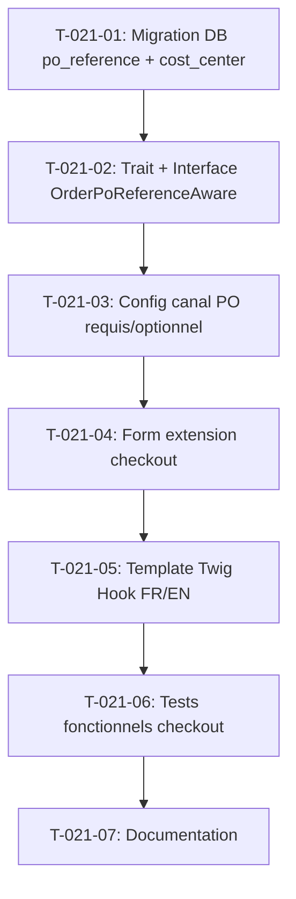

# Tâches — US-021 : Référence PO et centre de coût au checkout

## Informations US

- **Epic** : EPIC-05 — Fluidité B2B avancée
- **Persona** : Claire (acheteuse)
- **Story Points** : 5
- **Sprint** : sprint-3-nouveaux-plugins
- **Dépendances** : US-001

## Résumé

En tant que Claire, je veux saisir ma référence de commande et mon centre de coût au checkout, afin que la facture corresponde à mon bon de commande.

## Vue d'ensemble des tâches

| ID | Type | Tâche | Estimation | Dépend de | Statut |
|----|------|-------|------------|-----------|--------|
| T-021-01 | [DB] | Migration : colonnes `po_reference` et `cost_center` sur `sylius_order` | 1h | — | 🔲 |
| T-021-02 | [BE] | Trait + interface `OrderPoReferenceAwareInterface` sur `App\Entity\Order` | 0.5h | T-021-01 | 🔲 |
| T-021-03 | [BE] | Configuration canal : champ PO requis/optionnel, centre de coût optionnel | 1h | T-021-02 | 🔲 |
| T-021-04 | [BE] | Extension du type de formulaire checkout : ajout des deux champs | 1.5h | T-021-03 | 🔲 |
| T-021-05 | [FE-WEB] | Template Twig Twig Hook : bloc référence PO + traductions FR/EN | 1h | T-021-04 | 🔲 |
| T-021-06 | [TEST] | Test fonctionnel : checkout sans PO → erreur, avec PO → enregistré | 1.5h | T-021-05 | 🔲 |
| T-021-07 | [DOC] | Documenter le comportement par canal (README ou ADR-update) | 0.5h | T-021-06 | 🔲 |

**Total estimé : 7h**

---

## Détail des tâches

### T-021-01 — Migration : colonnes `po_reference` et `cost_center`

- **Type** : [DB]
- **Estimation** : 1h
- **Dépend de** : —

**Description** :
Générer et appliquer une migration Doctrine qui ajoute sur `sylius_order` :
- `po_reference VARCHAR(100) DEFAULT NULL` — référence acheteur (BT-10 futur)
- `cost_center VARCHAR(50) DEFAULT NULL` — centre de coût interne

La migration est réversible (`down()` retire les colonnes).

**Fichiers à créer** :
- `src/Migrations/VersionXXXXXXXXXXXXXX.php` (générée via `make:migration`)

**Critères de validation** :
- [ ] `doctrine:migrations:migrate` s'exécute sans erreur
- [ ] Les colonnes sont présentes dans `sylius_order`
- [ ] `doctrine:migrations:migrate --down` restaure l'état précédent

---

### T-021-02 — Trait + interface `OrderPoReferenceAwareInterface`

- **Type** : [BE]
- **Estimation** : 0.5h
- **Dépend de** : T-021-01

**Description** :
Implémenter l'interface et le trait dans `src/Order/` :

```php
interface OrderPoReferenceAwareInterface
{
    public function getPoReference(): ?string;
    public function setPoReference(?string $reference): void;
    public function getCostCenter(): ?string;
    public function setCostCenter(?string $costCenter): void;
}
```

Faire utiliser le trait par `App\Entity\Order\Order` (mapping Doctrine via annotation ou XML déjà existant).

**Fichiers à créer** :
- `src/Order/OrderPoReferenceAwareInterface.php`
- `src/Order/OrderPoReferenceAwareTrait.php`

**Fichiers modifiés** :
- `src/Entity/Order/Order.php` — ajout `use OrderPoReferenceAwareTrait`

**Critères de validation** :
- [ ] PHPStan niveau max sans erreur
- [ ] `bin/console doctrine:schema:validate` sans erreur de mapping

---

### T-021-03 — Configuration canal : PO requis/optionnel, centre de coût

- **Type** : [BE]
- **Estimation** : 1h
- **Dépend de** : T-021-02

**Description** :
Ajouter sur l'entité `ChannelB2bConfig` (ou créer `ChannelPoConfig` sous `src/Channel/`) :
- `po_reference_required BOOLEAN DEFAULT FALSE`
- `cost_center_enabled BOOLEAN DEFAULT FALSE`

Enregistrer le champ dans le formulaire de paramétrage du canal admin (extension de type Sylius existant ou Twig Hook). Activer « PO requis » sur le canal B2B de démo par défaut (fixture ou migration).

**Fichiers à créer/modifier** :
- `src/Channel/ChannelPoConfig.php` (si nécessaire)
- Extension ou mise à jour du form type canal admin

**Critères de validation** :
- [ ] Option visible et sauvegardée depuis l'admin canal
- [ ] Fixture ou migration applique le réglage sur le canal de démo

---

### T-021-04 — Extension du type de formulaire checkout

- **Type** : [BE]
- **Estimation** : 1.5h
- **Dépend de** : T-021-03

**Description** :
Créer `PoReferenceCheckoutStepExtension` (ou un form type extension sur le formulaire de finalisation Sylius) qui :
1. Ajoute les champs `po_reference` et `cost_center` au formulaire checkout
2. Applique la contrainte `NotBlank` sur `po_reference` uniquement si le canal l'exige
3. Mappe vers les setters de `OrderPoReferenceAwareInterface` via un Event Subscriber Symfony Forms

**Fichiers à créer** :
- `src/Form/Extension/OrderPoReferenceTypeExtension.php`

**Critères de validation** :
- [ ] Champs présents dans le formulaire checkout
- [ ] Contrainte appliquée conditionnellement selon le canal
- [ ] PHPStan niveau max sans erreur

---

### T-021-05 — Template Twig Hook : bloc référence PO

- **Type** : [FE-WEB]
- **Estimation** : 1h
- **Dépend de** : T-021-04

**Description** :
Créer le template Twig branché sur le hook approprié (étape `complete` ou `select_payment`) :
- Libellé « Référence commande * » / « Order reference * » (FR/EN)
- Libellé « Centre de coût » / « Cost center » (facultatif)
- Message d'erreur inline si le champ requis est vide

**Fichiers à créer** :
- `templates/checkout/po_reference_block.html.twig`
- Entrées dans `translations/messages.fr.yaml` et `messages.en.yaml`

**Critères de validation** :
- [ ] Bloc affiché uniquement si le canal a l'une des options activées
- [ ] Libellés FR/EN présents

---

### T-021-06 — Tests fonctionnels checkout

- **Type** : [TEST]
- **Estimation** : 1.5h
- **Dépend de** : T-021-05

**Description** :
Écrire des tests PHPUnit (TDD) :

1. `PoReferenceCheckoutTest::testCheckoutBlockedWithoutPoReferenceOnRequiredChannel()`
   - Canal avec PO requis, formulaire soumis sans référence → validation échoue
2. `PoReferenceCheckoutTest::testPoReferenceIsSavedOnOrder()`
   - Checkout complet avec référence « PO-2025-0001 » → `order->getPoReference() === 'PO-2025-0001'`
3. `PoReferenceCheckoutTest::testCostCenterIsSavedWhenProvided()`

**Fichiers à créer** :
- `tests/Functional/Checkout/PoReferenceCheckoutTest.php`

**Critères de validation** :
- [ ] Tests rouges avant implémentation
- [ ] Tests verts après implémentation
- [ ] ECS et PHPStan sans erreur

---

### T-021-07 — Documentation comportement par canal

- **Type** : [DOC]
- **Estimation** : 0.5h
- **Dépend de** : T-021-06

**Description** :
Ajouter dans `docs/` ou mettre à jour le README de la démo :
- Options de canal disponibles (PO requis, centre de coût)
- Comportement par défaut du canal B2B de démo
- Champs présents sur `sylius_order`

**Critères de validation** :
- [ ] Documentation lisible sans contexte supplémentaire

---

## Graphe de dépendances



## Résumé

| Type | Nb tâches | Heures |
|------|-----------|--------|
| [DB] | 1 | 1h |
| [BE] | 3 | 3h |
| [FE-WEB] | 1 | 1h |
| [TEST] | 1 | 1.5h |
| [DOC] | 1 | 0.5h |
| **TOTAL** | **7** | **7h** |
