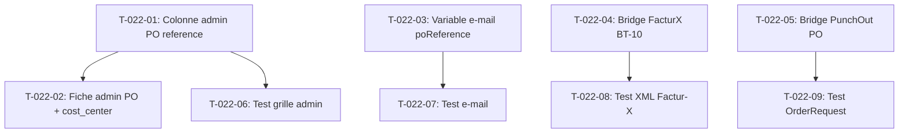

# Tâches — US-022 : Reprise de la référence partout

## Informations US

- **Epic** : EPIC-05 — Fluidité B2B avancée
- **Persona** : Sophie (gestionnaire achats)
- **Story Points** : 5
- **Sprint** : sprint-3-nouveaux-plugins
- **Dépendances** : US-021

## Résumé

En tant que Sophie, je veux retrouver la référence PO dans l'admin, les e-mails, la facture Factur-X et les commandes PunchOut, afin de rapprocher les documents.

## Vue d'ensemble des tâches

| ID | Type | Tâche | Estimation | Dépend de | Statut |
|----|------|-------|------------|-----------|--------|
| T-022-01 | [BE] | Colonne + filtre `po_reference` dans la grille admin des commandes | 1h | — | 🔲 |
| T-022-02 | [BE] | Affichage PO reference + centre de coût dans la fiche commande admin | 0.5h | T-022-01 | 🔲 |
| T-022-03 | [BE] | Variable `poReference` dans les e-mails de confirmation FR/EN | 1h | — | 🔲 |
| T-022-04 | [BE] | Bridge FacturX BT-10 : décorateur `FacturXInvoiceMapperInterface` | 2h | — | 🔲 |
| T-022-05 | [BE] | Bridge PunchOut : injecter la référence PO dans l'`OrderRequestHandler` | 1h | — | 🔲 |
| T-022-06 | [TEST] | Test : colonne PO visible dans la grille admin | 0.5h | T-022-01 | 🔲 |
| T-022-07 | [TEST] | Test : référence PO présente dans l'e-mail de confirmation | 0.5h | T-022-03 | 🔲 |
| T-022-08 | [TEST] | Test : BT-10 renseigné dans le XML Factur-X | 1h | T-022-04 | 🔲 |
| T-022-09 | [TEST] | Test : référence PO = orderID dans l'OrderRequest PunchOut | 1h | T-022-05 | 🔲 |

**Total estimé : 8.5h**

---

## Détail des tâches

### T-022-01 — Colonne + filtre `po_reference` dans la grille admin

- **Type** : [BE]
- **Estimation** : 1h
- **Dépend de** : —

**Description** :
Étendre la grille Sylius des commandes admin (`sylius_admin_order`) via la configuration YAML ou un GridExtension :
- Ajouter la colonne `po_reference` (libellé « Référence PO » / « PO Reference »)
- Ajouter un filtre texte sur `po_reference`

**Fichiers à modifier** :
- `config/packages/sylius_grid.yaml` (ou extension dédiée dans `src/Grid/`)
- `translations/SyliusUiBundle.fr.yaml` et `.en.yaml`

**Critères de validation** :
- [ ] Colonne visible dans la liste des commandes admin
- [ ] Filtre fonctionnel
- [ ] Libellé FR/EN

---

### T-022-02 — Fiche commande admin : PO + centre de coût

- **Type** : [BE]
- **Estimation** : 0.5h
- **Dépend de** : T-022-01

**Description** :
Via un Twig Hook (`sylius:admin:order:show:summary` ou équivalent), afficher :
- Référence PO : `{{ order.poReference }}`
- Centre de coût : `{{ order.costCenter }}` (si renseigné)

**Fichiers à créer** :
- `templates/admin/order/po_reference_detail.html.twig`

**Critères de validation** :
- [ ] Section visible uniquement si `poReference` non null
- [ ] Libellés FR/EN

---

### T-022-03 — Variable `poReference` dans les e-mails de confirmation

- **Type** : [BE]
- **Estimation** : 1h
- **Dépend de** : —

**Description** :
Vérifier comment Sylius passe les données à ses templates e-mail (`sylius_mailer`). Soit :
- Décorer le service d'envoi d'e-mail pour injecter `poReference`
- Soit utiliser un EventSubscriber sur `OrderEmailInterface`

Mettre à jour les templates `order_confirmation_*.html.twig` pour afficher la référence PO si elle est renseignée.

**Fichiers à modifier** :
- `templates/email/order_confirmation.html.twig` (ou override)
- Traductions FR/EN pour le libellé dans l'e-mail

**Critères de validation** :
- [ ] `poReference` disponible dans le template e-mail
- [ ] Section masquée si `poReference` est null
- [ ] Libellés FR/EN

---

### T-022-04 — Bridge FacturX BT-10 : décorateur `FacturXInvoiceMapperInterface`

- **Type** : [BE]
- **Estimation** : 2h
- **Dépend de** : —

**Description** :
Le plugin `tmonier/sylius-facturx-plugin` expose `FacturXInvoiceMapperInterface` (service décorable). La classe `FacturXInvoice` ne possède pas encore de champ `buyerReference` (BT-10). Approche en deux étapes :

**Étape 1 — Analyse (0.5h)** : vérifier si `CiiXmlWriter` ou `FacturXInvoice` peut recevoir BT-10 sans modification du vendor. Options :
- a) La bibliothèque horstoeko/zugferd sous-jacente expose `setDocumentBuyerOrderReferencedDocument()` : décorer `CiiXmlWriter` ou la chaîne de génération pour appeler cette méthode.
- b) Si `FacturXInvoice` supporte un futur champ `buyerReference` (PR upstream), attendre ou monkey-patch.

**Étape 2 — Implémentation (1.5h)** : créer `PoReferenceFacurXBridge` qui :
1. Écoute `FacturXInvoiceGenerated::NAME`
2. Charge la commande depuis `$event->getInvoice()->order()`
3. Si `order instanceof OrderPoReferenceAwareInterface && $order->getPoReference()` → log + future intégration

*Note démo* : si BT-10 ne peut pas être injecté sans modifier le vendor, créer un décorateur `PoReferenceAwareFacturXInvoiceMapper` qui surcharge `map()` et reconstruit `FacturXInvoice` avec un `note` (SG2 free text) portant la référence PO. Documenter le besoin d'un PR upstream.

**Fichiers à créer** :
- `src/FacturX/PoReferenceFacturXBridge.php`

**Critères de validation** :
- [ ] La référence PO est tracée dans la facture (field BT-10 ou note)
- [ ] PHPStan niveau max sans erreur
- [ ] Pont conditionnel : sans `facturx-plugin` installé → aucune erreur

---

### T-022-05 — Bridge PunchOut : référence PO dans l'OrderRequest

- **Type** : [BE]
- **Estimation** : 1h
- **Dépend de** : —

**Description** :
Dans `tmonier/sylius-punchout-cxml-plugin`, l'`OrderRequestHandler` crée une commande Sylius à partir d'un cXML `OrderRequest`. Le champ `orderID` du document cXML est stocké comme `purchase_order` côté plugin (table `punchout_received_po`).

Créer un EventSubscriber `PunchOutOrderPoReferenceSubscriber` qui :
1. Écoute l'événement Sylius `sylius.order.post_complete` (ou équivalent PunchOut)
2. Si la commande est issue d'un OrderRequest PunchOut (`ReceivedPurchaseOrder` lié)
3. Lit `receivedPo->purchase_order` (= orderID cXML)
4. Appelle `order->setPoReference($orderID)` si `poReference` est vide

**Fichiers à créer** :
- `src/PunchOut/PunchOutOrderPoReferenceSubscriber.php`

**Critères de validation** :
- [ ] PO reference renseignée automatiquement sur commande PunchOut
- [ ] Pont conditionnel : sans punchout-plugin → aucune erreur
- [ ] PHPStan niveau max sans erreur

---

### T-022-06 — Test : colonne PO visible dans la grille admin

- **Type** : [TEST]
- **Estimation** : 0.5h
- **Dépend de** : T-022-01

**Description** :
Test de fumée (ou test fonctionnel Admin) :
- Créer une commande avec `poReference = 'PO-TEST-001'`
- Vérifier que la valeur apparaît dans la réponse HTML de la liste admin

**Fichiers à créer** :
- `tests/Smoke/AdminOrderGridPoReferenceTest.php`

**Critères de validation** :
- [ ] Test vert avec la grille configurée

---

### T-022-07 — Test : référence PO dans l'e-mail de confirmation

- **Type** : [TEST]
- **Estimation** : 0.5h
- **Dépend de** : T-022-03

**Description** :
Tester le rendu du template e-mail :
- Commande avec `poReference = 'PO-EMAIL-007'`
- Rendu du template → assertion `assertStringContainsString('PO-EMAIL-007', $rendered)`
- Commande sans `poReference` → section absente

**Fichiers à créer** :
- `tests/Email/OrderConfirmationPoReferenceTest.php`

**Critères de validation** :
- [ ] Les deux cas couverts

---

### T-022-08 — Test : BT-10 dans le XML Factur-X

- **Type** : [TEST]
- **Estimation** : 1h
- **Dépend de** : T-022-04

**Description** :
Test unitaire sur le bridge :
- Instancier une fausse facture avec commande portant `poReference = 'PO-FX-123'`
- Générer le XML (ou intercepter le résultat)
- Vérifier que la référence est présente dans le XML (BT-10 ou note SG2)

**Fichiers à créer** :
- `tests/FacturX/PoReferenceBridgeTest.php`

**Critères de validation** :
- [ ] Assertion sur le XML générée

---

### T-022-09 — Test : référence PO = orderID dans OrderRequest PunchOut

- **Type** : [TEST]
- **Estimation** : 1h
- **Dépend de** : T-022-05

**Description** :
Test de l'EventSubscriber PunchOut :
- Simuler une commande liée à un `ReceivedPurchaseOrder` avec `purchase_order = 'ORD-PO-456'`
- Déclencher l'événement
- Vérifier `order->getPoReference() === 'ORD-PO-456'`

**Fichiers à créer** :
- `tests/PunchOut/PunchOutOrderPoReferenceSubscriberTest.php`

**Critères de validation** :
- [ ] Test vert

---

## Graphe de dépendances

## Résumé

| Type | Nb tâches | Heures |
|------|-----------|--------|
| [BE] | 5 | 5.5h |
| [TEST] | 4 | 3h |
| **TOTAL** | **9** | **8.5h** |
