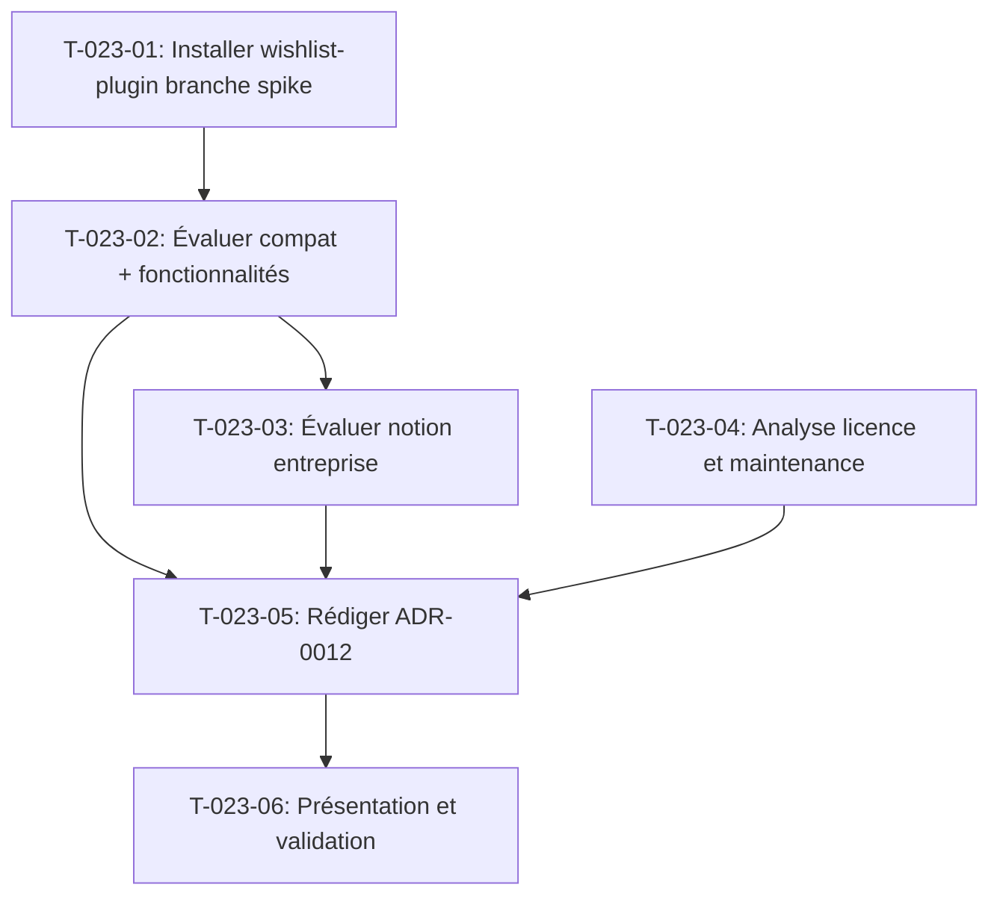

# Tâches — US-023 : Spike — Wishlist officielle sur Sylius 2.3

## Informations US

- **Epic** : EPIC-06 — Expérience acheteur avancée
- **Persona** : Thibaut (architecte / PO technique)
- **Story Points** : 2
- **Sprint** : sprint-3-nouveaux-plugins
- **Dépendances** : US-001

## Résumé

En tant que Thibaut, je veux savoir si `sylius/wishlist-plugin` convient (Sylius 2.3, notion d'entreprise), afin de décider entre ce plugin officiel et un plugin maison.

## Périmètre du spike

Ce spike **ne produit PAS de code de production**. Il produit :
- une évaluation documentée
- une ADR (`docs/adr/0012-wishlist-officielle-ou-plugin-maison.md`) avec recommandation

## Vue d'ensemble des tâches

| ID | Type | Tâche | Estimation | Dépend de | Statut |
|----|------|-------|------------|-----------|--------|
| T-023-01 | [BE] | Installer `sylius/wishlist-plugin` sur une branche dédiée | 1h | — | 🔲 |
| T-023-02 | [BE] | Évaluer compatibilité Sylius 2.3 et fonctionnalités de liste | 1h | T-023-01 | 🔲 |
| T-023-03 | [BE] | Évaluer la notion d'entreprise (partage wishlist par société) | 0.5h | T-023-02 | 🔲 |
| T-023-04 | [BE] | Analyser la licence et la politique de maintenance | 0.5h | — | 🔲 |
| T-023-05 | [DOC] | Rédiger l'ADR-0012 avec recommandation et critères | 1h | T-023-02, T-023-03, T-023-04 | 🔲 |
| T-023-06 | [REV] | Présenter la décision et valider en équipe | 0.5h | T-023-05 | 🔲 |

**Total estimé : 4.5h**

---

## Détail des tâches

### T-023-01 — Installer `sylius/wishlist-plugin` sur une branche dédiée

- **Type** : [BE]
- **Estimation** : 1h
- **Dépend de** : —

**Description** :
Créer une branche `spike/wishlist-evaluation` à partir de `feature/sprint-3-nouveaux-plugins`. Installer le plugin officiel :
```bash
composer require sylius/wishlist-plugin --dev   # ou sans --dev selon le verdict
```
Exécuter les migrations du plugin, activer le bundle, et vérifier que l'application démarre.

**Critères de validation** :
- [ ] Application démarre sans erreur
- [ ] Page wishlist accessible (URL du plugin)
- [ ] Aucun conflit avec les plugins existants (container-fill, punchout, trade-credit…)

---

### T-023-02 — Évaluer compatibilité Sylius 2.3 et fonctionnalités

- **Type** : [BE]
- **Estimation** : 1h
- **Dépend de** : T-023-01

**Description** :
Évaluer sur la branche spike :

| Critère | Résultat attendu |
|---------|-----------------|
| Compatibilité Sylius 2.3 | Oui / Non / Partiel |
| Multiple listes par utilisateur | Oui / Non |
| Partage de liste en lecture seule | Oui / Non |
| Déplacement items panier → wishlist | Oui / Non |
| Pagination / performance > 500 items | Oui / Non |
| API REST/GraphQL exposée | Oui / Non |
| Conflits avec les plugins démo | Aucun / Liste |

Documenter le résultat dans un fichier `docs/spike/wishlist-findings.md` (non committé en `main`).

**Critères de validation** :
- [ ] Tous les critères évalués
- [ ] Résultat documenté avec captures ou commandes de vérification

---

### T-023-03 — Évaluer la notion d'entreprise (wishlist partagée)

- **Type** : [BE]
- **Estimation** : 0.5h
- **Dépend de** : T-023-02

**Description** :
Cas d'usage B2B clé : plusieurs acheteurs d'une même entreprise partagent une wishlist commune. Vérifier si `sylius/wishlist-plugin` supporte :
- Association d'une wishlist à une `Company` (`sylius-company-accounts-plugin`)
- Visibilité des wishlists d'un collègue de la même entreprise
- Permissions (lecture, écriture, suppression) par rôle d'entreprise

Si non natif, évaluer si l'extension serait raisonnable (< 2h de développement supplémentaires).

**Critères de validation** :
- [ ] Résultat explicite (supporté / partiellement / absent)
- [ ] Estimation d'effort pour combler le manque si nécessaire

---

### T-023-04 — Analyse licence et maintenance

- **Type** : [BE]
- **Estimation** : 0.5h
- **Dépend de** : —

**Description** :
Consulter :
- `LICENSE` du dépôt GitHub `sylius/WishlistPlugin`
- Politique de maintenance (LTS, compatibility matrix, dernière release)
- Issues/PR ouvertes concernant Sylius 2.x
- Compatibilité PHP 8.3+

**Critères de validation** :
- [ ] Licence identifiée (MIT / Propriétaire / Autre)
- [ ] Politique de maintenance documentée

---

### T-023-05 — Rédiger l'ADR-0012

- **Type** : [DOC]
- **Estimation** : 1h
- **Dépend de** : T-023-02, T-023-03, T-023-04

**Description** :
Créer `docs/adr/0012-wishlist-officielle-ou-plugin-maison.md` (committé en `main`) suivant le format ADR du projet :

```markdown
# ADR-0012 : Wishlist — plugin officiel ou plugin maison

## Statut
Proposé / Accepté / Rejeté

## Contexte
[Cas d'usage B2B, contraintes Sylius 2.3, résultats du spike]

## Décision
[Plugin officiel sylius/wishlist-plugin / Plugin maison tmonier/sylius-wishlist-plugin]

## Alternatives considérées
- sylius/wishlist-plugin : ✅/❌ par critère
- Plugin maison : effort estimé, avantages B2B

## Conséquences
[Impact sprint 4, dépendances, effort résiduel]
```

Mettre à jour `docs/adr/index.md`.

**Critères de validation** :
- [ ] ADR au format projet
- [ ] Recommandation claire (plugin officiel ou maison)
- [ ] Index mis à jour

---

### T-023-06 — Présentation et validation de la décision

- **Type** : [REV]
- **Estimation** : 0.5h
- **Dépend de** : T-023-05

**Description** :
Présenter brièvement le verdict ADR-0012 en équipe (ou via commentaire PR) :
- Résumé de 5 minutes : résultats, recommandation, impact sur le sprint 4
- Valider (ou réviser) la décision

**Critères de validation** :
- [ ] ADR marqué « Accepté » ou « Rejeté » avec justification
- [ ] La branche `spike/wishlist-evaluation` est archivée ou fermée

---

## Graphe de dépendances



## Résumé

| Type | Nb tâches | Heures |
|------|-----------|--------|
| [BE] | 4 | 3h |
| [DOC] | 1 | 1h |
| [REV] | 1 | 0.5h |
| **TOTAL** | **6** | **4.5h** |

> **Rappel spike** : aucun code de production ne doit être mergé en `main` depuis ce spike. Seule `docs/adr/0012-*.md` est commitée en branche principale.
