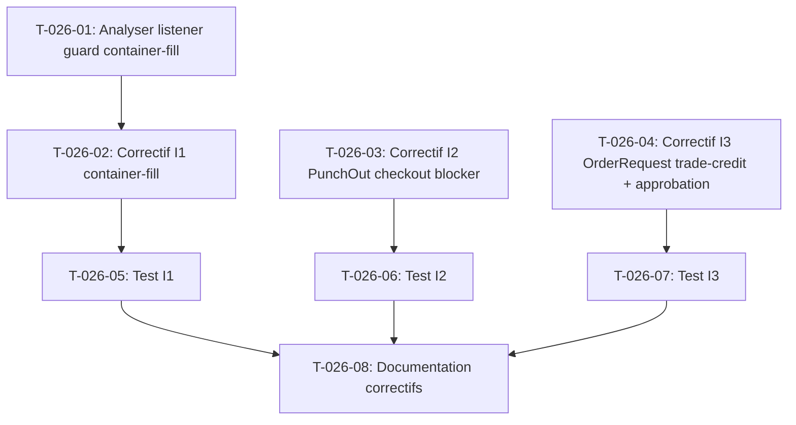

# Tâches — US-026 : Correctifs d'interaction entre plugins

## Informations US

- **Epic** : EPIC-07 — Qualité et robustesse de la démo
- **Persona** : Thibaut (architecte / ops démo)
- **Story Points** : 5
- **Sprint** : sprint-3-nouveaux-plugins
- **Dépendances** : US-010

## Résumé

En tant que Thibaut, je veux que les plugins se comportent correctement ensemble, afin que les scénarios de démo ne se bloquent pas.

## Interactions à corriger

| ID | Interaction | Scénario bloquant |
|----|-------------|-------------------|
| I1 | container-fill × checkout | Panier sans produit palettisable bloque le checkout |
| I2 | punchout × checkout devis / quick-order | Session PunchOut ne bloque pas le checkout standard |
| I3 | punchout OrderRequest × trade-credit + approbation | L'OrderRequest ne déclenche pas la réservation de crédit ni l'approbation |

## Vue d'ensemble des tâches

| ID | Type | Tâche | Estimation | Dépend de | Statut |
|----|------|-------|------------|-----------|--------|
| T-026-01 | [BE] | Analyser le listener guard checkout container-fill | 1h | — | 🔲 |
| T-026-02 | [BE] | Correctif I1 : container-fill ne bloque pas les paniers sans produit palettisable | 1h | T-026-01 | 🔲 |
| T-026-03 | [BE] | Correctif I2 : PunchOut bloque checkout devis + quick-order en session active | 1.5h | — | 🔲 |
| T-026-04 | [BE] | Correctif I3 : OrderRequest PunchOut déclenche trade-credit + approbation | 1.5h | — | 🔲 |
| T-026-05 | [TEST] | Test I1 : panier sans palettisable → checkout non bloqué | 0.5h | T-026-02 | 🔲 |
| T-026-06 | [TEST] | Test I2 : devis et quick-order bloqués pendant session PunchOut | 0.5h | T-026-03 | 🔲 |
| T-026-07 | [TEST] | Test I3 : approbation + réservation trade-credit déclenchées sur OrderRequest | 1h | T-026-04 | 🔲 |
| T-026-08 | [DOC] | Documenter les correctifs (patch notes, tickets amont) | 0.5h | T-026-05, T-026-06, T-026-07 | 🔲 |

**Total estimé : 7.5h**

---

## Détail des tâches

### T-026-01 — Analyser le listener guard container-fill

- **Type** : [BE]
- **Estimation** : 1h
- **Dépend de** : —

**Description** :
Le plugin `tmonier/sylius-container-fill-plugin` enregistre un listener sur `workflow.sylius_order_checkout.guard.complete` qui bloque la transition si une règle container-fill s'applique. Analyser :
1. Quelle condition déclenche le blocage (mode REQUIRED vs OPTIONAL)
2. Pourquoi un panier sans produit palettisable peut être bloqué (règle glob, taxon catch-all ?)
3. Identifier le service/classe responsable dans `src/DependencyInjection/TmonierSyliusContainerFillExtension.php` et le listener associé

Documenter la cause racine dans une note de l'ADR ou directement dans le commentaire du correctif.

**Critères de validation** :
- [ ] Cause racine identifiée et documentée
- [ ] Approche de correction validée avant implémentation

---

### T-026-02 — Correctif I1 : container-fill, panier sans palettisable

- **Type** : [BE]
- **Estimation** : 1h
- **Dépend de** : T-026-01

**Description** :
Implémenter le correctif selon l'analyse T-026-01. Options possibles :
- a) **Décorer le listener** `CheckoutGuardListener` pour court-circuiter la vérification si aucun item du panier n'a de règle container-fill applicable
- b) **EventSubscriber override** (priorité plus haute) qui marque le guard comme non bloquant avant l'exécution du listener plugin

Préférer l'option qui ne nécessite pas de fork du plugin. Si un correctif upstream est nécessaire (patch release), créer la PR sur le dépôt `sylius-container-fill-plugin` et appliquer un `patch` local en attendant.

**Fichiers à créer** :
- `src/ContainerFill/CheckoutGuardFix.php` (si correctif en démo)
- `config/services.yaml` (décoration ou surcharge)

**Critères de validation** :
- [ ] Un panier sans produit palettisable passe le checkout sans blocage
- [ ] Un panier avec produit palettisable non rempli est toujours bloqué (régression)
- [ ] PHPStan niveau max sans erreur

---

### T-026-03 — Correctif I2 : PunchOut bloque checkout devis + quick-order

- **Type** : [BE]
- **Estimation** : 1.5h
- **Dépend de** : —

**Description** :
En session PunchOut active, les seuls flux autorisés sont le panier PunchOut → cXML PunchOutOrderMessage. Le checkout standard, le checkout d'un devis (`sylius-quote-request-plugin`) et le quick-order (`sylius-quick-order-plugin`) doivent être bloqués.

Implémenter un EventSubscriber `PunchOutCheckoutBlocker` qui :
1. Écoute `workflow.sylius_order_checkout.guard.complete`
2. Détecte si l'utilisateur a une session PunchOut active (via le service de session PunchOut)
3. Bloque la transition en ajoutant une violation si la commande n'est pas la commande PunchOut de la session

Gérer séparément le cas `OrderRequest` (flux PunchOut inverse) qui ne doit PAS être bloqué.

**Fichiers à créer** :
- `src/PunchOut/PunchOutCheckoutBlocker.php`
- `config/services.yaml` (enregistrement listener)

**Critères de validation** :
- [ ] Checkout standard bloqué pendant session PunchOut
- [ ] Checkout devis bloqué pendant session PunchOut
- [ ] Quick-order bloqué pendant session PunchOut
- [ ] PunchOut cart checkout non bloqué
- [ ] OrderRequest non impacté
- [ ] PHPStan niveau max sans erreur

---

### T-026-04 — Correctif I3 : OrderRequest PunchOut → trade-credit + approbation

- **Type** : [BE]
- **Estimation** : 1.5h
- **Dépend de** : —

**Description** :
L'`OrderRequestHandler` (`tmonier/sylius-punchout-cxml-plugin`) crée une commande Sylius complétée directement, sans passer par les workflows `sylius_order_checkout` et `sylius_payment`. Les plugins `trade-credit` et `purchase-approval` s'appuient sur ces transitions.

Créer un EventSubscriber `OrderRequestPostCreateSubscriber` qui :
1. Écoute l'événement post-création de commande PunchOut (ou surcharge `OrderRequestHandler` via décoration)
2. Après création de la commande, déclenche manuellement :
   - La réservation de crédit trade-credit (via le service `TradeCreditReserver` ou équivalent)
   - La soumission à l'approbation (`purchase-approval`) si le montant/rôle le requiert
3. Si la réservation échoue → marquer la commande en attente et notifier

**Fichiers à créer** :
- `src/PunchOut/OrderRequestPostCreateSubscriber.php`

**Critères de validation** :
- [ ] Commande issue d'un OrderRequest réserve le trade-credit d'Acme
- [ ] Commande issue d'un OrderRequest soumise à approbation si applicable
- [ ] Commande issue du shop standard non impactée (pas de double réservation)
- [ ] PHPStan niveau max sans erreur

---

### T-026-05 — Test I1 : panier sans palettisable non bloqué

- **Type** : [TEST]
- **Estimation** : 0.5h
- **Dépend de** : T-026-02

**Description** :
Écrire un test PHPUnit `ContainerFillCheckoutGuardTest` :
- Panier avec produit sans règle container-fill → guard `complete` n'est PAS bloqué
- Panier avec produit palettisable non rempli → guard `complete` EST bloqué (régression)

**Fichiers à créer** :
- `tests/Functional/ContainerFill/ContainerFillCheckoutGuardTest.php`

**Critères de validation** :
- [ ] Les deux cas verts

---

### T-026-06 — Test I2 : devis et quick-order bloqués en session PunchOut

- **Type** : [TEST]
- **Estimation** : 0.5h
- **Dépend de** : T-026-03

**Description** :
Écrire un test `PunchOutCheckoutBlockerTest` :
- Simuler une session PunchOut active pour l'utilisateur
- Tenter un checkout standard → guard bloqué
- Tenter un checkout devis → guard bloqué
- Supprimer la session PunchOut → checkout autorisé

**Fichiers à créer** :
- `tests/Functional/PunchOut/PunchOutCheckoutBlockerTest.php`

**Critères de validation** :
- [ ] Trois cas couverts et verts

---

### T-026-07 — Test I3 : approbation + trade-credit sur OrderRequest

- **Type** : [TEST]
- **Estimation** : 1h
- **Dépend de** : T-026-04

**Description** :
Test d'intégration `OrderRequestPostCreateTest` :
1. Acheteur PunchOut Acme (société avec limite trade-credit 5 000 €)
2. OrderRequest cXML pour 1 000 € → réservation trade-credit → solde réduit de 1 000 €
3. OrderRequest cXML pour Claire (rôle nécessitant approbation) → commande marquée `awaiting_approval`

**Fichiers à créer** :
- `tests/Functional/PunchOut/OrderRequestPostCreateTest.php`

**Critères de validation** :
- [ ] Réservation trade-credit vérifiée (balance modifiée)
- [ ] Statut approbation vérifié

---

### T-026-08 — Documenter les correctifs

- **Type** : [DOC]
- **Estimation** : 0.5h
- **Dépend de** : T-026-05, T-026-06, T-026-07

**Description** :
Pour chaque correctif :
- Ajouter un commentaire `// Fix I1: ...` dans le code
- Créer ou mettre à jour `CHANGELOG.md` de la démo
- Si un patch upstream est requis (I1, I3) : créer une issue ou PR sur le dépôt du plugin concerné et référencer le lien

**Critères de validation** :
- [ ] Chaque correctif documenté avec contexte
- [ ] Issues/PR amont créées si nécessaire

---

## Graphe de dépendances

## Résumé

| Type | Nb tâches | Heures |
|------|-----------|--------|
| [BE] | 4 | 5h |
| [TEST] | 3 | 2h |
| [DOC] | 1 | 0.5h |
| **TOTAL** | **8** | **7.5h** |
